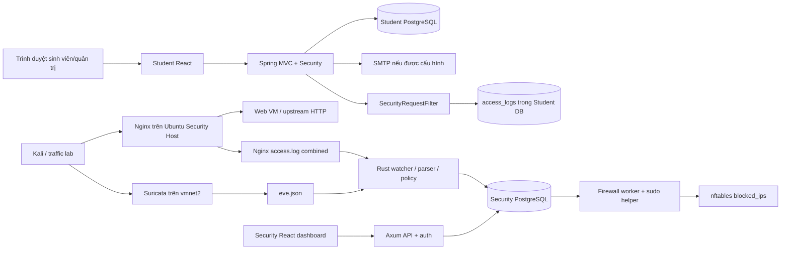

# 00 — Tổng quan dự án và tiến độ

## Mốc autonomous public-data intake — 2026-11-03T21:07+07:00

Đã tải và pin WAMM v2 hợp pháp (CC BY 4.0), audit SQLite **704.665 dòng**, trong đó **704.649** parseable; chỉ **312.241** biểu diễn HTTP text khác nhau và **67.620** vector float32/76 cột khác nhau. Có **757** vector mang hai nhãn. Sau cách ly vector xung đột và loại **23.576** vector trùng development đã lộ, còn **43.287 numeric views** (14.242 publisher benign/29.045 publisher attack) để nghiên cứu *staging*. Đây không phải số request vật lý mới. WAMM có nguồn gốc SR-BH và thiếu campaign/time lineage, nên `AUTONOMOUS_RESEARCH_READY=false`; formal admission **0/2.000.000**, không train/đánh giá độc lập. [Policy v1](../ai-training/configs/autonomous_research_policy_v1.yaml) tách research và formal; [PRETRAINING](../ai-training/PRETRAINING.md) ghi manifest/checksum/giới hạn. Kyoushi chỉ được sàng lọc metadata, WAF Data v2 chưa đủ nhãn attack. GLU 9.675.784/207, checkpoints/ONNX và sealed holdout giữ nguyên. Ledger 06 mục 57.

## Mốc data unblock — 2026-11-03

Đã chốt không train/tune thêm khi thiếu dữ liệu mới. Email tiếng Anh xin quyền Biblio-US17 (RAW/LABEL/README, feature/model use/terms), quy trình intake theo RID và quyền dùng, gói reviewer private cho 8 Oracle request thật cùng 162 hồ sơ cũ và protocol study mới nằm trong [PRETRAINING](../ai-training/PRETRAINING.md). Plan-v3 prospective kiểm SHA/code hiện hành PASS, chưa có chữ ký; re-verifier của capture Oracle cũ FAIL vì collector source SHA đã đổi sau plan, nên giữ 8 intent UNKNOWN. Biblio và independent reviewer `BLOCKED_EXTERNAL`; **0 request mới admitted**, 0 nhãn độc lập mới, 0 training mới. Các mốc G0–G3 chỉ quản lý research, không thay formal gate. Xem ledger 06 mục 56.

## Mốc research GLU 207 train-only — 2026-11-03

Một phép đo optimization sanity đã khóa trước trên prepared-v5 lab: GLU **9.675.784/207**, **100 update**, lấy 12.800 dòng train/12.798 unique views từ 41.472 dòng train-only row groups; không decode validation/test, không dùng threshold. Loss probe train cố định 1,499→0,186, gradient hữu hạn, checkpoint mới/readback Adam exact, 4 CPU/16GiB, 23,14s. Đây là development engineering, **không chứng nhận Recall/FPR hay tổng quát hóa**. 0 nhãn độc lập mới và formal **0/2M**. WebSpotter mới chỉ được sàng lọc metadata: FPAD có source-class confounding, CVE thiếu matched benign, chưa nhập data. Xem [PRETRAINING](../ai-training/PRETRAINING.md), ledger 06 mục 55.

## Quyết định kiến trúc edge → AI — 2026-11-03

Python đã có adapter canonical/`postgres-export` và encoder 207; không cần viết encoder Rust mới. Tuy nhiên Rust canonical Suricata hiện mất response-header request ID, numeric v2 và flow start/end của EVE live; 4/4 EVE HTTP có ID ở response header, 0/4 ở `http.request_id`. Vì vậy **canonical ba nguồn riêng lẻ không đủ cho GLU 207**. Đường khả thi: canonical Student/Nginx qua export read-only + EVE AI numeric v2 trước mask, sau response, cùng request ID. Chỉ xác minh adapter trên 5/5 Student events; chưa có DB export Rust thật hoặc live integration mới. Probe native-log live 12/12 trước đó giữ nguyên. Formal admitted **0/2M**; Biblio-US17 chờ quyền và Oracle intent cần reviewer độc lập. Chi tiết [PRETRAINING](../ai-training/PRETRAINING.md), [runbook](../ai-training/README.md), ledger 06 mục 54.

## Mốc fault replay và edge parity — 2026-11-03T17:51+07:00

Không phát request mới: replay 4 target GET của capture live đã lưu cho thấy input thiếu EVE, correlation ambiguous, request sai thứ tự và request fused phát lại đều bị từ chối trước score; exact duplicate Nginx được dedup. Đã sửa duy nhất luồng Python AI để chặn fused `request_key` bị phát lại. EVE đến muộn được mô phỏng bằng snapshot, chưa có durable scheduler/timeout ngoài replay. Security Web hiện không có encoder/ONNX 207 nên **Rust/edge parity chưa thể đo**; live shadow 12/12 vẫn là bằng chứng lab, chưa phải production. 197/207 cột có giá trị nguồn khi chưa có prior flow, 202/207 khi đã có; 5 original-query metrics vẫn thiếu. Formal admitted **0/2.000.000**, không có nhãn benign/attack độc lập mới. Ưu tiên xin quyền Biblio-US17 và review nhãn intent; xem [PRETRAINING](../ai-training/PRETRAINING.md) và ledger 06 mục 53.

## GLU 207 shadow với Suricata live trong lab — 2026-11-03T16:22+07:00

Đường AI-owned Student → Nginx → **Suricata `-i lo` live** → correlation → GLU post-response đã chạy trong namespace cô lập. Probe đầu mất **100/240 packet**, chỉ 2/4 request đủ ba nguồn; sau cấu hình ring `lo` riêng, ba probe kế tiếp **0 drop**, **12/12** request đủ ba nguồn/được inference, không chặn. Tổng 16 target GET thật qua bốn lượt, 14 được score, 2 bỏ qua có lý do; thêm 4 readiness setup không tính vào target. Lượt chờ 67s có prior flow ở 2 request sau, khác capture offline 11,34s trước đó (0/54). 207 số hữu hạn nhưng 197/207 cột giá trị có nguồn ở hai request đầu, 202/207 khi có prior flow; 5 original-query metrics vẫn vắng. Query vô hại có numeric EVE v2 khớp target 4/4 trước score. Vector live 4/4 exact **cùng Python**; Rust/edge parity và production readiness chưa được chứng nhận. Probe ngắn end-to-end p50/p95/p99 **193,18/218,06/221,13ms** (n=4), peak RSS bốn process **1,318GB** + DB cap 512MiB. Không nhãn mới, formal **0/2M**; GLU/checkpoint/threshold giữ nguyên. Xem [PRETRAINING](../ai-training/PRETRAINING.md), [report](../ai-training/reports/ATTACK_EVIDENCE_20261101.json), ledger 06 mục 52.

## GLU 207 shadow offline và cổng input — 2026-11-03T09:31+07:00

Đã dùng capture AI-owned `eve3-1102c` có packet thật, Suricata đọc PCAP **offline**: 54/54 request mục tiêu khớp Student/Nginx/EVE; một request setup chỉ hai nguồn. GLU 9.675.784/207 giữ nguyên, không train/chọn champion. Replay post-response cho 54/54 output hữu hạn, 207/207 số được tính nhưng chỉ **197 cột giá trị có nguồn quan sát**; 5 flow values và 5 original-query metrics vắng mặt, cờ missingness giữ nguyên. Train v5 có prior flow ở 36.443/41.607 rows, capture mới 0/54; toàn bộ 10/60/300s context còn incomplete. Trước sửa `InferencePipeline` score request thiếu nguồn; giờ profile v5 từ chối request thiếu ba nguồn/response/numeric availability. Kiểm persisted train→inference 512/512 vector exact; capture mới 54/54 parity **cùng Python**, chưa chứng nhận live Rust/edge. Shadow 4 CPU: p50/p95/p99 **6,76/7,11/7,48ms**, peak RSS **323MB**, không gồm chờ log/sensor. AI pytest 227 PASS/1 SKIPPED; formal 0/2M, request mới 0. [PRETRAINING](../ai-training/PRETRAINING.md), [report](../ai-training/reports/ATTACK_EVIDENCE_20261101.json), ledger 06 mục 51.

## Mốc study sampler 76 feature trên development — 2026-11-03T08:44+07:00

Đã khóa protocol và chạy **một** so sánh 300 update/arm giữa sampler cân source/family có hoàn lại và thứ tự ngẫu nhiên không hoàn lại, trên cùng 118.760 development vectors/76 cột. Train pool thực tế 27.142 exact float32 views; bốn bundle MLP/GLU xuất ONNX đều parity PASS. GLU không hoàn lại hạ Student-lab unique-view FPR **10,22%→0%** và tăng recall **15,03%→54,25%**, nhưng SR-BH recall **21,82%→3,18%** và FPR **0,348%→2,50%**; MLP Student recall **17,65%→0%**. Vì tradeoff theo nguồn và nhãn development yếu, **không** áp dụng sampler mới, không chọn champion hay suy ra chất lượng GLU chính 207 cột. Không có request/nhãn/admission mới: formal **0/2 triệu**. [PRETRAINING](../ai-training/PRETRAINING.md), [machine report](../ai-training/reports/PARTITION_RECOVERY_20261031.json), ledger 06 mục 50.

## Mốc intake corpus HTTP mới — 2026-11-03T08:01+07:00

Đã kiểm metadata Biblio-US17 nhưng chưa có quyền/raw RAW+LABEL ở workspace; không gọi lại archive từng trả 401. Một nguồn HTTP mới (CIKM IoT CVE) được kiểm có giới hạn: 281 ví dụ attack CVE, 281 benign IoT, nhưng 245 attack requests là tái dựng thủ công và lớp nhãn gắn với nguồn khác nhau. Chỉ 214/281 attack và 140/281 benign encoded views nếu dùng path-only 70+6, 4 view trái nhãn; body/params thiếu làm profile không thấy nhiều tín hiệu. **0 request mới đủ research training, 0 nhãn độc lập, 0 admitted**, không chạy study. Tổng lab theo report cũ 75.360/2M (3,768%) chưa dedup toàn cục; formal 0/2M. Mẫu xin quyền ngắn và quyết định nguồn ở [PRETRAINING](../ai-training/PRETRAINING.md), [catalog](../ai-training/configs/public_http_sources.yaml), ledger 06 mục 49. Model GLU 207 và checkpoint giữ nguyên.

## Mốc AI chống diễn giải sai do lặp vector — 2026-11-03T07:45+07:00

Đã thêm báo cáo validation theo **exact float32 input view** khi export request-only model: đếm row lặp/view trái nhãn và không tính view-weighted metric nếu một view có hai nhãn. Snapshot 118.760 development rows có event key riêng nhưng số vector val chỉ 6.839/10.000 ở SR-BH và 290/1.024 ở Student lab; không có encoded-view/group trùng giữa train/calibration/val. Phép đo này chưa thay trọng số, ngưỡng, admission hay chứng minh GLU tổng quát hóa tốt hơn. Test export 3 model + ca nhãn xung đột **PASS 5**; full suite **NOT_RUN**. Formal admitted 0/2M, nguồn nhãn độc lập vẫn thiếu. [PRETRAINING](../ai-training/PRETRAINING.md), ledger 06 mục 48.

## Mốc AI checkpoint diagnostic — 2026-11-03T07:04+07:00

Đã dùng checkpoint cũ MLP/GLU **76 cột** chấm lại 118.760 development vectors, không train hoặc đổi threshold. GLU có recall cao hơn theo số dòng SR-BH validation (31,37% so 22,83%) nhưng thấp hơn MLP khi mỗi `feature_key` tính một lần (21,82% so 31,89%): số dòng lặp đang ảnh hưởng diễn giải. Trên Student lab, GLU báo nhầm 79/736 benign rows, tương ứng 14/137 distinct views; MLP 0. AIT no-fit stress cho thấy 25 benign views, 4 views có hai nhãn và gần như toàn bộ scanner attack không được hai model 76 cột phát hiện ở ngưỡng cũ. Đây là development/coverage diagnostic, **không** phải phép đánh giá độc lập hay kết quả của GLU chính 9.675.784/207. Formal admission **0/2.000.000**, Biblio chờ quyền; không chọn champion. Xem [PRETRAINING](../ai-training/PRETRAINING.md), [report](../ai-training/reports/PARTITION_RECOVERY_20261031.json), ledger 06 mục 47.

## Mốc AI development oracle — 2026-11-02T11:09+07:00

Pilot AI-owned **khác** plan-v3 ký độc lập đã chạy thật 8 request: 8/8 có Student/Nginx/Suricata EVE từ PCAP offline, 8 response status, 2 POST body bytes và 1 mutation STAFF có DB `0→1`; lab đã dọn. Tất cả 8 intent vẫn `UNKNOWN`, benign/attack xác minh độc lập 0/0, formal admitted **0/2.000.000**. Bốn capture pending được audit có 170 ID không trùng; tính cả capture v1 cách ly thì năm capture có 218 ID, 79 target hashes/139 lượt lặp target, 0 va chạm trong phạm vi quét và 0 campaign/môi trường đánh giá độc lập. Signed plan-v3 vẫn chưa được ký hoặc chạy. Chi tiết [PRETRAINING](../ai-training/PRETRAINING.md), [machine report](../ai-training/reports/ATTACK_EVIDENCE_20261101.json), ledger 06 mục 43. Model GLU 9.675.784/207 và MLP giữ nguyên; chưa train mới hay chọn champion.

## Kiểm tra cuối Ground Truth pilot — 2026-11-02

Plan 8 request vẫn khớp SHA collector đã khóa; gói phê duyệt riêng tư đã sẵn cho reviewer độc lập. Approval mới sẽ ký hash 10 file thực thi AI, Student Git tree và mẫu Nginx; collector kiểm chữ ký/plan/code trước traffic. Luồng cleanup đã có kiểm chứng container PostgreSQL `--rm`, process và ba cổng lab đóng; kiểm lại hai lab EVE cũ đều PASS. **Pilot mới chưa được ký, 0 request phát, 0 request ba nguồn mới, 0 nhãn xác minh, 0 admitted.** Gate evidence-v2, model và holdout không đổi. Xem [gói reviewer](../ai-training/.artifacts/ground_truth_pilot_20261102/APPROVAL_PACKAGE.md), [quy trình](../ai-training/PRETRAINING.md), ledger 06 mục 42.

## Ground Truth prospective pilot — 2026-11-02

Đã chuẩn bị plan có thể đọc và ký trước capture cho **8 request** trong lab AI-owned, với kiểm tra source/plan SHA, binding ba nguồn và oracle trạng thái DB cho thao tác tạo khoa. Chữ ký reviewer độc lập **chưa có**, pilot **chưa phát request**, oracle thật **chưa chạy**. Kiểm thử fixture chỉ chứng minh đường kỹ thuật; không cấp nhãn thật. **162 hồ sơ cũ UNKNOWN, 0 benign/0 attack độc lập, 0 admitted/2 triệu**; tổng capture reports vẫn 75.360 request (3,768%, chưa dedup toàn cục). GLU 9.675.784/207, MLP và admission gate giữ nguyên. Chi tiết thao tác ở [PRETRAINING](../ai-training/PRETRAINING.md), ledger 06 mục 41.

## Tự động hóa review blind — 2026-11-02

Đã chạy batch/resume trên **162/162 request** của ba queue; SQLite private pin kết quả đối chiếu ID/hash/Student–Nginx–EVE/PCAP. 39 cue cú pháp chỉ là triage, mở runner claim sau blind thấy 29 bất đồng tín hiệu, không có nhãn mới được chứng minh. **0 oracle-verified, 0 AI-proposed từ model, 0 human-reviewed; 162 intent UNKNOWN, 0 admitted.** 78 target views/162 request, 36 view dùng xuyên campaign; 9 campaign development trong một lab, 0 campaign/môi trường đánh giá độc lập. Tổng capture reports 75.360/2M chưa global dedup; formal train/champion/live enforcement vẫn chặn. Chi tiết ở [PRETRAINING](../ai-training/PRETRAINING.md) và ledger 06 mục 40.

## Review 162 hồ sơ — 2026-11-02

Đã có terminal review riêng tư gắn ba queue 54 request với hash/ID/campaign, tách facts khỏi proposal và lưu quyết định người review bất biến. Đối chiếu PCAP xác nhận body bytes cho 12/12 POST của hai capture ba nguồn; 6 POST hai nguồn cũ vẫn thiếu body. HMAC/field names không tự cho nhãn. **0 request admitted; 0 benign/0 attack được review độc lập; 0 campaign/môi trường đánh giá độc lập.** Không phát thêm request lượt này; tổng báo cáo capture vẫn 75.360/2 triệu (3,768%, chưa global dedup), 162 pending. GLU 9.675.784/207 và MLP giữ nguyên; formal training và live inference chưa sẵn sàng. Thao tác cụ thể của reviewer ở [PRETRAINING](../ai-training/PRETRAINING.md), ledger 06 mục 39.

## AI admission và campaign khác target — 2026-11-02T08:54+07:00

Lượt capture ba nguồn thứ hai **PASS 54/54 request**, dùng PCAP thật + Suricata EVE offline; đã có **42 target hash mới** và 30 target attack/hard-negative không trùng hai plan trước. Hai lượt EVE liên tiếp đều 54/54; đây là thử nghiệm ổn định của lab offline, **chưa phải realtime/production sensor**. Nginx masked và EVE numeric v2 khớp trong lab 54/54; live edge/inference 207 cột chưa được nghiệm thu. Hồ sơ tự động của **162 request pending** đã tách facts blind khỏi proposal của runner/cú pháp; không có nhãn nào được AI tự duyệt. 48 request v1 vẫn cách ly.

Bốn lượt mới có **210 request ID riêng**, 78 target hashes; 0 va chạm với 227.619 ID trong bảy Student log lịch sử chưa sealed được quét. Sealed cohort chưa đọc, không tuyên bố dedup toàn cục. Tổng theo capture reports 75.360/2.000.000 request (**3,77%**) nhưng **0/2.000.000 admitted**. Có 9 campaign development hợp lệ và 3 campaign cách ly trong **một lab**, **0 campaign/môi trường đánh giá độc lập**. GLU 9.675.784/207 và MLP 252.680 giữ nguyên; formal train/champion/live enforcement chưa sẵn sàng. Xem [PRETRAINING](../ai-training/PRETRAINING.md) và ledger 06 mục 38.

## AI evidence ba nguồn — 2026-11-02T08:31+07:00

Collector AI mới đã thu **54 request HTTP thật trên fixture loopback được cấp phép**, mỗi request khớp `X-Request-Id`, method/status/IP, timestamp và hash giữa Student audit, Nginx và Suricata EVE HTTP/flow; 54 flow và 18 alert là observations, không phải request hoặc nhãn mới. PCAP/EVE thật được giữ ở artifact private `ai-training/.artifacts/eve3-1102b/`; lab đã dừng. Query numeric Nginx lab/EVE khớp 54/54, nhưng edge production mask khác nên feature parity 207 cột cho formal còn **chưa được chứng nhận**. Queue review ba nguồn 54/54 vẫn `unknown`, 0 nhãn được review độc lập, 0 admitted. Hai lượt 54 cũ không có EVE mới; không hồi tố gắn log.

Ba capture mới có 156 ID riêng (48 cách ly + 54 hai nguồn + 54 ba nguồn), chỉ **36 target hash** và đều một lab; 0 campaign đánh giá hoặc môi trường độc lập mới. Tổng theo báo cáo 75.150 lịch sử +156 mới = **75.306 request ghi nhận/2.000.000 (3,77%)**, chưa có dedup toàn cục với sealed cohort; **0/2.000.000 admitted (0%)**. GLU 9.675.784/207 và MLP 252.680/207 vẫn là pilot, không fit/training thêm. **218 pytest PASS**, formal/champion/live inference vẫn NOT_READY. Xem [PRETRAINING](../ai-training/PRETRAINING.md), [report](../ai-training/reports/ATTACK_EVIDENCE_20261101.json) và ledger 06 mục 37.

## Tiếp tục evidence review và dedup có giới hạn — 2026-11-01T11:45+07:00

54/54 blind-review item đã tái kiểm ID, plan, SHA, timestamp và hai log; **0 nhãn được tự phê duyệt, 0 admitted**. Hai capture mới có 102 ID không trùng, 36 target hash và 66 lượt lặp target. So với 73.218 ID trong ba log Student lịch sử *không niêm phong*, số ID va chạm là 0; log có setup event và cohort sealed chưa đọc nên không gọi 75.252 là số unique toàn cục đã chứng nhận. Catalog formal vẫn `NOT_READY`. Verifier đã được siết để đọc lại method/status/path/target/timestamp; review workflow nằm trong [PRETRAINING](../ai-training/PRETRAINING.md), artifact hash/count ở `ai-training/.artifacts/evidence_campaign_20261101/lineage-audit-v2/report.json`. Bundle pilot GLU **9.675.784/207** và MLP **252.680/207** còn đọc được, ONNX SHA khớp report và batch 1 output hữu hạn; study GLU 9.541.640/76 là contract khác. Mô hình và threshold không đổi; **217 pytest PASS**, formal gate từ chối đúng thiết kế, không chạy train.

## Rà soát tổng thể AI — 2026-11-01T11:32+07:00

Đối chiếu code, manifest dataset, catalog hiện hành và artifact capture (không chạy train hoặc mở holdout): `residual_glu` cấu hình 207 đầu vào/rộng 1024 có **9.675.784 tham số trainable** (96,76% mốc danh nghĩa 10 triệu). Đây là kích thước kiến trúc, chưa chứng minh chất lượng. Prepared lab v5 có **69.345 feature rows**; 75.150 request lab ba nguồn được báo cáo trước đó là tổng capture lịch sử. Hai capture AI-owned mới có **102 request ID khác nhau** (48 cách ly, 54 chờ review), nên tổng theo hai báo cáo capture là **75.252 request được ghi nhận** (3,76% mốc 2 triệu); chưa có kiểm định dedup toàn cục giữa các đợt để gọi toàn bộ 75.252 là unique đã chứng nhận. 102 mới chỉ có Nginx + Student, cùng một lab và không đủ điều kiện train. Không cộng staging, projections, log observations hoặc publisher rows vào số request vật lý này.

Catalog scale hiện hành `NOT_READY`, **0 request admitted/2.000.000 (0%)**, 0 benign/0 attack mới được review độc lập, 0 campaign đánh giá độc lập. Ba campaign mới chỉ là development, cùng môi trường và thời điểm; 54 request vẫn null-label. Kết quả WCP benign-only đo FPR, không đo recall; SR-BH và lab đã lộ trong development, không là final holdout. Pipeline checkpoint/ONNX/cgroup đã có bằng chứng pilot, nhưng formal scale, live inference và tự động chặn chưa được nghiệm thu. Không thể suy ra một phần trăm hoàn thành chất lượng AI từ số tham số hoặc số request. Xem [handoff](../ai-training/FINAL_TRAINING_HANDOFF.json), [catalog](../ai-training/.artifacts/attack_evidence_20261101/scale-catalog-current/report.json), [báo cáo chất lượng](../ai-training/reports/GENERALIZATION_QUALITY_20261101.json) và ledger 06 mục 35.

## Thu thập có bằng chứng trên lab được cấp phép — 2026-11-01T11:21+07:00

Đã tạo plan trước khi gửi request và thu 54 request HTTP mới trên fixture Student/Nginx AI-owned loopback: 54 ID khớp cả hai log, 36 benign/hard-negative intent và 18 attack intent do runner khai báo. **Chưa có nhãn semantic được reviewer độc lập xác nhận, nên admission mới = 0 và formal vẫn NOT_READY.** Lượt thử đầu 48 request bị cách ly vì 45 trả 401 ở lớp xác thực. 3 campaign mới chỉ là development trong cùng lab; 0 campaign đánh giá độc lập, 0 môi trường triển khai độc lập. Blind review queue 54 null-label đã sẵn sàng trong artifact riêng tư; holdout hiện hữu và future holdout chưa dùng. [Report](../ai-training/reports/ATTACK_EVIDENCE_20261101.json) và ledger 06 mục 34 ghi SHA, lệnh kiểm và bước còn thiếu.

## Rà soát hồ sơ nhãn và nguồn mới — 2026-11-01T10:53+07:00

**Formal NOT_READY; 0 request mới được admission, 0 positive/0 benign có nhãn độc lập và 0 campaign độc lập được xác minh.** Hồ sơ private cho 64 dòng pending SOC-MLD đã xác nhận 64/64 SHA từ raw; tất cả vẫn unknown. Split gốc có 38 attack-instance IDs chung và 1.214/1.220 dòng test nằm trong nhóm đã có ở train. Audit workbook ModSec-WP (CC BY 4.0) cho thấy 108.883 dòng nhưng chỉ 27.686 transaction IDs, 20 ID có nhãn mâu thuẫn. Các số này không đại diện cho request đủ điều kiện học. Đã cập nhật catalog, báo cáo và handoff; không chạy train mới. Chi tiết tại [report](../ai-training/reports/ATTACK_EVIDENCE_20261101.json) và ledger 06 mục 33.

## Hiện trạng bổ sung attack và kiểm định nhãn — 2026-11-01T07:36:28.147641+07:00

**Chưa đủ điều kiện train chính thức/chọn champion.** Đã audit nguồn SOC-MLD v2 độc lập về publisher: 198.082 HTTP observations; 193.220 dòng log khác nhau; 6.856 biểu diễn method/URI/UA. Chưa xác minh physical request IDs hay nhãn intent theo từng request, nên **0 mẫu mới được admission**, không cộng EVE HTTP/flow thành request mới.

Bản phát hành thực có 38 attack-instance IDs chung train/test; nhãn dùng time matching rồi fallback payload rule; đặc trưng có cửa sổ tương lai. Giữ raw, đưa nguồn vào chờ review, không chạy model trên đó. WAMM là dẫn xuất SR-BH; WAF Data v2 chưa rõ lineage; Biblio-US17 có giấy phép dataset CC BY-NC-ND 4.0 khác giấy phép bài báo; ModSec-WP cần kiểm tra cơ sở nhãn từng dòng. Không tự coi các nguồn này là final holdout hay nhãn đáng tin.

Đã nâng cổng corpus: mỗi request đủ điều kiện phải có review v2 gắn hash capture, intent provenance và review ngữ nghĩa độc lập; boolean approved kiểu cũ không đủ. Intent và exploit outcome tách riêng; unknown không bị đổi nhãn. Tổng lab 75.150 HTTP giữ nguyên, scale-admitted 0/2M. Giữ kín toàn bộ holdout, gồm 148 website case files. Xem [report](../ai-training/reports/ATTACK_EVIDENCE_20261101.json), handoff hiện hành và ledger 06 mục 32; các mục sau là lịch sử.

Kiểm chứng cuối: **211 pytest PASS, 0 skip**; Ruff/format/compile/canonical PASS; **53/53 gate kỹ thuật legacy PASS**, corpus formal **NOT_READY/0 eligible** (exit 3 đúng thiết kế). Giữ nguyên SHA của **2.941 file** cũ và source/config freeze trong final test; không sửa hai Web. Handoff format 10, ledger 32.

## Hiện trạng AI và dữ liệu — 2026-11-01T06:48:58.523006+07:00

**Đã thêm nguồn benign công khai và kiểm chứng model trên miền mới; chưa đủ điều kiện train chính thức hoặc chọn champion.** Chỉ AI/docs; Student Web, Security Web, contracts và Docker giữ nguyên. Holdout cũ không được mở, không có cập nhật trọng số hoặc tự động chặn.

| Hạng mục | Kết quả đã kiểm chứng |
| --- | --- |
| Corpus mới | open-appsec legitimate captures, giấy phép Apache-2.0 được xác minh. Audit 811.129 record ngoài phần giữ kín; 756.548 chữ ký biểu diễn HTTP khác nhau, 54.391 bản trùng, 190 mẫu cách ly |
| Đặc trưng | Mẫu HMAC cố định: 44.437 projections, 26.318 kiểu input bounded 76. Không thêm raw text, secret, PII, nhãn/source/SID vào tensor; không dựng timestamp/flow giả |
| Benchmark mới | Hai model và ngưỡng cũ khóa trước khi chấm. Validation: 13.290 mẫu/160 nhóm website; GLU 5 FP = **0,0376%**, MLP 174 FP = **1,3093%** |
| Hard negatives | Trong 139 mẫu publisher-benign có các bộ đếm cú pháp đã định trước: GLU 2 FP/139, MLP 34 FP/139. Không đổi nhãn hoặc ngưỡng theo kết quả |
| Holdout | Giữ kín toàn bộ holdout cũ; thêm 148 file website dự phòng chưa đọc/project/score, số request chưa biết. Nguồn benign-only không chứng nhận recall |
| Kiểm thử | **198 pytest PASS, 0 skip**; 53 gate kỹ thuật corpus legacy PASS. 2.682 file bảo vệ giữ nguyên SHA; các job riêng đã dừng |

Kết quả mới đảo chiều so với hard negatives của lab, nơi GLU có FPR 10,73% còn MLP 0%. Không có model tốt nhất trên mọi miền. Những con số mới phụ thuộc nhãn legitimate do publisher công bố và giả định nhóm độc lập; chưa có review ngữ nghĩa độc lập. **Không chọn champion**, không dùng nguồn mới để chỉnh threshold hoặc lặp HPO.

Organization X vẫn unknown, không coi rule nonmatch hoặc HTTP 200 là benign. Tổng lab 75.150 HTTP thật giữ nguyên; dữ liệu công khai mới là các bản ghi capture được cung cấp, không phải traffic mới tự tạo hoặc đã xác minh physical request IDs. Không cộng projection/bản sao/unknown observations để đạt chỉ tiêu. **Scale-admitted=0/2M**; còn thiếu positive độc lập, nhãn và đánh giá cân bằng trên môi trường mới.

[Báo cáo dữ liệu/tổng quát hóa](../ai-training/reports/GENERALIZATION_QUALITY_20261101.json), [handoff format 9](../ai-training/FINAL_TRAINING_HANDOFF.json), ledger 06 mục 31. Các snapshot phía dưới là lịch sử.

## Nâng cấp 9,68M / mục tiêu 2M — nghiệm thu kỹ thuật, dữ liệu còn thiếu — 2026-10-30T15:52:59+07:00

**Đã kiểm chứng phần kỹ thuật; chưa hoàn thành mục tiêu dữ liệu/production.**
Chỉ sửa AI và docs. Corpus vẫn **69.345 request duy nhất, một lab**, nhãn scripted
intent; không thêm request hoặc môi trường. Re-extraction v5 không phải dữ liệu mới.
Chưa có review nhãn độc lập, **0 request được admission cho formal scale**; mục tiêu
2M đa dạng chưa đạt. Không nhân bản hoặc cộng các bản projection/cache vào số lượng.

| Giai đoạn | Trạng thái cuối phiên |
| --- | --- |
| Data | Catalog/provenance/replay/holdout checks đã có; corpus 2M và shared-scaler assembly nhiều môi trường còn thiếu |
| Features/architecture/algorithms | v5/207 cột, thêm 18 dynamics; residual SwiGLU **9.675.784** tham số thực; AdamW/smoothing/dropout/warmup-cosine |
| Tests/readiness | **134/134 pytest PASS, 0 skipped**; **53/53 gate kỹ thuật PASS** trên cùng 69k |
| Pilot | 4 neural candidates × 2 epoch, fresh-process resume và reference khớp chính xác; ONNX mọi 69.345 vectors/candidate PASS |
| Evaluation | Calibration 3 campaign, selection 6 campaign; fit không nhìn validation; test quality giữ kín; tree32 iteration đối chứng |
| Integration | Offline shadow512 request PASS, không gọi Web/firewall; live/TLS/receipt-time/response NOT_RUN |
| Formal/champion | NOT_RUN / chưa chọn; không tự chạy ca dài và chưa đủ data gate |
| Cleanup | Chỉ cache tái tạo được: giải phóng 498.14 MiB; giữ raw/checkpoint/log/evidence cũ |

AP selection cao nhất ở lượt ngắn: **gated_residual**. Main challenger
AP **0.997228**, recall **98.92%**, FPR **0.823%**,
p95 ONNX model-only **5.363 ms**. Model lớn không mặc định tốt hơn;
khác biệt thuật toán/regularization không phải thí nghiệm riêng tác dụng số tham số.
Một lab và sáu nhóm selection không chứng minh FPR/zero-day/production generalization.

[Báo cáo đo thực](../ai-training/reports/SCALE_UPGRADE_20261030.json), [handoff hiện hành](../ai-training/FINAL_TRAINING_HANDOFF.json),
ledger06 mục25. Tất cả snapshot cũ bên dưới là lịch sử; không dùng readiness/source
cũ cho source hiện hành hoặc force-resume checkpoint khác contract.

## Bàn giao corpus và mô hình sâu revision 4.1 — 2026-10-30T09:08:21+07:00

| Hạng mục | Kết quả đo thực |
| --- | --- |
| Corpus | 69,345 request; 297,685 observations từ Student, Nginx và Suricata thật |
| Split và nhãn | 69,345 vectors có nhãn được duyệt; train: 41,607 / val: 13,869 / test: 13,869; groups 27/9/9 |
| Đặc trưng | ai-features-4.1 / normalizer 4.1, 189 cột, projection v2; canonical 1.0 giữ nguyên |
| Mô hình | Residual nhỏ đối chứng; MLP 248.072 / DAE 294.717 / gated residual 445.448 tham số |
| Readiness | 53/53 PASS; payload và hard negatives có identity riêng giữa các temporal bands |
| Pilot | 4 mô hình × 5 epoch; resume qua process mới khớp reference; ONNX 69,345/69,345 vectors PASS từng mô hình |
| Kiểm thử và phạm vi | 118 pytest PASS, 0 skipped; giữ nguyên hash 366 file dịch vụ/contract và 1.946 artifact cũ |
| Train dài / chất lượng trên test / deploy | NOT_RUN; chưa chọn Champion Model hoặc nghiệm thu Rust/live/enforcement |

Ứng viên lớn cho thí nghiệm tiếp: **gated_residual** (AP 0.999077, precision 97.61%, recall 99.16%, FPR 0.996%).
Residual đối chứng: AP 0.999165, precision 97.64%, recall 99.55%, FPR 0.986%. Các số đo trên validation còn sơ bộ
vì cùng tập này được dùng để calibration và so sánh ứng viên. Tăng tham số không
bảo đảm tốt hơn; không kéo dài train chỉ để đủ thời gian.

Manifest hiện hành: [FINAL_TRAINING_HANDOFF.json](../ai-training/FINAL_TRAINING_HANDOFF.json).
Xem [báo cáo](../ai-training/reports/PRETRAIN_EXPANDED_20261030.json) và mục 24 của ledger 06. Các snapshot bên dưới là lịch sử.

## Nâng cấp dữ liệu/model sau ca ngắn — 29/10/2026

Đã hoàn tất corpus mới: **46.230 request / 198.765 observations** từ Student,
Nginx và Suricata thật. 30campaign có plan riêng,480giây/campaign, hai gap620giây;
nhóm18/6/6. Loại96nhãn path traversal trùng sau decode ở holdout, giữ nguyên log
và context; còn46.134mẫu được duyệt, split27.738/9.150/9.246. Capture không ghi
packet drop; parser không ghi invalid/oversized/partial. Canonical1.0 giữ nguyên;
profile `safe_query_numeric_v1`, features/normalizerv4,148cột.

| Hạng mục hiện hành | Kết quả |
| --- | --- |
| Data readiness | **48/48 PASS**; cột hằng38, giảm từ59; query projection và flow có coverage kiểm riêng |
| Pilot bốn ứng viên |5epoch,2→5qua process mới exact với reference; ONNX46.134/46.134PASS từng model |
| Residual validation |AP0,99875; precision98,13%; recall99,23%; FPR0,747% (49/6.558benign) |
| Next experiment |Residual không trọng số, chọn để thử tiếp theo AP validation; chưa chọn champion |
| Formal ca mới |**NOT_RUN**; script riêng `bash ai-training/scripts/train-query-session.sh`,100epoch/max150phút/8CPU/16GiB |
| Test quality / live acceptance |Chưa mở test metrics; chưa Rust serving, TLS/receipt-time parity hoặc enforcement |

Pilot wall163,57giây gồm train/resume/reference/export/diagnostics; không coi là
train150phút. Metric dùng cùng validation để calibration/selection nên sơ bộ;
corpus scripted một topology chưa chứng minh production. Thiếu flow/actor vẫn
có thể tăng FPR. Xem [report nâng cấp](../ai-training/reports/PRETRAIN_UPGRADE_20261029.json)
và ledger06 mục23. Các mục ngày28/ca đầu bên dưới là lịch sử.

Corpus được thu từ Student export tại `8171289`. Trong lúc làm, HEAD nhận
fast-forward tới `fd0fea4` từ luồng khác; các commit UI/email/firewall được giữ.
Luồng AI không sửa ứng dụng/contract ngoài các commit đã nhận đó; report tách
source capture, processing snapshot và source kiểm thử hiện hành.

## Ca residual đầu tiên — 29/10/2026

Đã thực hiện yêu cầu kiểm data rồi chạy ca tối đa **150 phút** trên source `8171289`.
Data gate mới **35/35 PASS**, dataset **19.275 request / 148 features** giữ nguyên hash.
Ca chạy **17:21:05–17:21:17 +07:00**, hoàn thành sau **11,616 giây**, dừng tại
**epoch 14 / step 2.534** do `early_stopping` (patience 8); checkpoint tốt nhất
ở **epoch 6 / step 1.086**. Không ép chạy tiếp để lấp đầy ngân sách thời gian.
Quota thực **8 CPU / 16 GiB**, MemoryHigh 15 GiB, swap 0; có job nền/log riêng và
sleep inhibitor trong lúc chạy. Đã kiểm checkpoint và ONNX parity **19.275/19.275 PASS**.

Validation-only: precision **90,83%**, recall **44,20%**, FPR **0,943%**, AP **0,7757**;
threshold chọn trên cùng validation nên kết quả sơ bộ. **Không mở test metrics,
chưa chọn champion hoặc triển khai Rust/live/enforcement**. Chưa nghiệm thu endurance
150 phút. Xem [báo cáo ca residual](../ai-training/reports/FORMAL_RESIDUAL_20261029.json) và ledger06 mục22. Các mốc “chưa train” ngày28/S0 phía dưới
là lịch sử. Run early-stopped là terminal; không force-resume bằng script ca đầu.

## Cập nhật resource sau pilot — 28/10/2026

Ca tiếp theo dùng **8logicalCPU/16GiB RAM**, CPUQuota800%, MemoryHigh15GiB,
swap0,Nice10; BLAS/OpenMP8,ONNX intra8/inter1 sequential. CPU là50% của16luồng;
16GiB là**52,96% RAM OS-visible** trên máy32GB danh nghĩa, được user chỉ định rõ.
77testsPASS,35readinesschecksPASS, guardprobe0optimizerstep; **không train chính thức
hoặc chạy lại pilot corpus thật**. [Báo cáo resource](../ai-training/reports/RESOURCE_GUARD_20261028.json).

Dataset prepared và pilot-ready giữ nguyên hash; readiness-final cũ cũng được giữ.
Readiness mới`readiness-resource8` gắn source hiện hành và được handoff/script sử dụng.
Các metric/giới hạn2CPU/12GiB ở các snapshot pilot phía dưới là lịch sử. Các attempt
fail/stale/cache/NEXT_COMMANDS cũ đã dọn; giữ raw capture evidence, runtime và venv
cần thiết. Xem ledger06 mục21 cho kiểm tra, danh sách dọn và commit.

**Mốc khảo sát:** 26/10/2026, múi giờ Asia/Ho_Chi_Minh. **Code nền:** `37bc4d2ae1552939659a10647898e2228f1b801f`.

**Phạm vi khảo sát ban đầu (lịch sử):** đọc và phân tích; chỉ thêm tài liệu trong `docs/`. Không sửa mã chức năng, không cài thư viện, không chạy training, server, migration, firewall, deploy hay gửi traffic thử nghiệm. Worktree sạch trước khi tạo bộ tài liệu. Đây là kết quả đọc tĩnh và thiết kế đề xuất, không phải chứng nhận hệ thống đang chạy hoặc đã đạt chuẩn doanh nghiệp.

## 1. Hiện trạng AI pipeline — 28/10/2026

**Trạng thái28/10/2026:** corpus mới có **19.275 request thật / 80.556 observations**, đủ Student audit + Nginx + Suricata EVE từ PCAP thật trong namespace lab. Split **11.565 / 3.855 / 3.855**, nhóm 9/3/3; mỗi campaign ≥420 giây, hai khoảng nghỉ 620 giây thật. Feature v3 / normalizer3, 148 cột, `edge_masked_v1`; canonical v1.0 giữ nguyên. Readiness **35 checks PASS**, **77 tests PASS / 0 skipped**. MLP/AE/residual đều chạy 2 epoch → tiến trình mới resume đến 5 epoch, exact với reference 5 epoch; ONNX parity toàn bộ prepared rows. Chỉ đánh giá validation; test metric chưa mở. [Report có hash](../ai-training/reports/PRETRAIN_PILOT_20261028.json).

Chưa chạy ca chính thức 2–3 giờ, chọn champion, port Rust hoặc bật AI response. Corpus vẫn là loopback với fixture giả / scripted intent; chưa đại diện production. Query bị mask thống nhất nên metadata AI không thấy nội dung payload. Flow chỉ lấy flow client đã kết thúc ≥65 giây trước đó, không backfill bằng đóng flow tương lai. Live receipt-time/TLS/feature parity và human realism review còn riêng.

### Snapshot pre-training27/10 — lịch sử

**Cập nhật pre-training:** luồng AI bổ sung lifecycle lab cô lập, snapshot chỉ đọc,
observer/label provenance, manual review CSV, readiness/capacity và baseline rule
Nginx trên validation. Feature hiện hành **v2/148cột**, có UA product families
multi-hot/missing/unknown; normalizer2. Canonicalv1.0 và toàn bộ Student/Security
source/config giữ nguyên. Corpus pilot được thu qua request thật trên Student
build riêng + PostgreSQL rỗng/tài khoản giả, không lấy dữ liệu người dùng đang chạy.
**Kết quả:**4.875request/15campaign,9.750observations; train2.925/val975/test975,
nhóm9/3/3. Readiness23checksPASS,capacityPASS,58testsPASS. Corpus chưafitmodel,
giờtrainmới0. [Report cóhash](../ai-training/reports/PRETRAIN_20261027.json).
Xem [runbook pre-training](../ai-training/README.md#chuẩn-bị-trước-train--luồng-lab-riêng)
và ledger06 mục18; thay đổi đã được chia commit theo mục19, chưa push.

Phần báo cáo S0 bên dưới là **snapshot lịch sử featurev1/125cột**, không phải vector
v2 hoặc kết quả chất lượng của corpus mới. Trước mỗi train dùng report readiness
đúngdataset/source; READY_FOR_OFFLINE_PILOT không phải production-ready.

**Nhánh hiện hành:** `feat/ai-model-training`, tạo từ `fbe078d8fe2e35bf60f7a08c7d21331f4522221e`. Chỉ thêm package độc lập [`ai-training/`](../ai-training/README.md) và cập nhật docs00/02/03/04/06; đã chia commit theo phần, xem06 mục17; chưa push. Đã đối chiếu SHA-256 **356 file tracked** và Git diff với base: `student-web/`, `security-web/` giữ nguyên. Không đổi cấu hình, restart dịch vụ, truy cập DB live hoặc áp firewall.

Package đã có adapters read-only, privacy/correlation, explicit labels, temporal/grouped split, Parquet manifests, 125 features nhân quả, CPU MLP8 lớp + benign-only autoencoder, checkpoint/resume và ONNX CPU parity. **42 tests PASS**. S0 thực tế 27/10/2026 12:39:52–12:40:01+07:00: 960 request synthetic, hai model đều chạy2epoch rồi tiến trình mới resume đến4epoch, bằng reference chạy4epoch liên tục; ONNX khớp960/960 mỗi model. Chi tiết/hash ở [báo cáo S0](../ai-training/reports/S0_20261027.json) và [06 mục16](06_AI_HANDOFF_AND_RUN_LEDGER.md#16-ai-data--training-pipeline--27102026).

**Tại snapshot S0: giờ training dữ liệu thật là 0.** Chưa có champion, Rust preprocessing/inference, chất lượng production hoặc nghiệm thu ca2–3giờ/thermal trên Zenbook. Query/object identity đã mask ở producer không thể khôi phục; đây là baseline post-response, không phải model payload đầy đủ hay bằng chứng zero-day detection.

### Shared Foundation — snapshot 26/10/2026

**Nhánh:** `codex/foundation-audit-and-schema`; mốc nền `1925764a0b4dbbae647797136e17abfd9a122c45`. Thay đổi đã được chia thành các commit schema/Student/Security/infra/dev/Audit/CI và commit tài liệu bàn giao; xem ledger06 mục15. Chưa push trong phiên này. Quy định docs-only của phiên khảo sát cũ đã được yêu cầu triển khai mới thay thế; không tự áp quy định cũ để dừng việc đã giao.

Student Web hiện lưu audit DB **và** xuất JSONL theo `STUDENT_AUDIT_LOG_PATH`; mặc định ghi cả GET/HEAD/OPTIONS `/api/**` với cờ tắt riêng. Trusted proxy CIDR, `X-Request-Id`, User-Agent product families, HMAC identities và masking query đã được nối vào filter/writer. Header tự do không giữ nguyên văn; method tùy biến được chuẩn hóa thành OTHER. Spring dùng `ForwardedHeaderFilter` được bọc kiểm tra trust; chiến lược auto-forwarding của Boot giữ `NONE` để không rewrite IP trước bước kiểm tra.

Rust đọc `STUDENT_AUDIT`, Nginx structured/combined và EVE; giữ normalized HTTP/flow/non-alert khi `COLLECT_ALL_EVENTS=true`. Migration `0003` bổ sung canonical event store, receipts, quarantine và state auth; `0004` bổ sung response deadlines. Cursor, observations/alerts/jobs và receipts commit cùng transaction. Dòng quá dài được cách ly theo byte/hash, không làm kẹt nguồn.

Contract v1.0 đã khóa tại [`contracts/canonical-event-v1.schema.json`](../contracts/canonical-event-v1.schema.json), có typed Rust, Java exporter, fixture và test tương thích. **Tại snapshot foundation chưa có model, trainer, corpus được gắn nhãn hoặc phiên training**; phần AI mới ở đầu mục1 thay thế trạng thái này. Không đánh đồng normalized observations với dataset benign đã được review.

PostgreSQL Compose mặc định Student `5433`, Security `5434`, cùng loopback và có biến port riêng. Nginx template nghe `0.0.0.0:80`, tách API/frontend upstream local `8080/5173`, Web VM `192.168.20.10:80 backup`; TLS là template tùy chọn cần chứng thư. Backend/frontend bind loopback. Local-first/failover đã được thử bằng hai upstream cô lập; LAN/VM/AWS thật chưa nghiệm thu và chưa có AWS IaC.

Enforcement mặc định `OFF` (kể cả PENDING/RESTORE). IPv4 scope cấu hình được, bảo vệ host/default gateway/Web VM và whitelist ở backend cùng helper độc lập. Helper dùng TTL, job hết hạn/stale bị từ chối; không mở quyền auto-response cho các rule Rust mới. Chưa áp firewall lên host trong phiên này.

## 2. Cách đọc bộ nhớ dự án

| Thứ tự | Tài liệu | Nội dung có thẩm quyền |
|---|---|---|
| 00 | Tệp này | Mốc code, trạng thái tổng thể, quy ước cập nhật |
| 01 | [SYSTEM_AUDIT_AND_ARCHITECTURE](01_SYSTEM_AUDIT_AND_ARCHITECTURE.md) | Bằng chứng code, rủi ro, kiến trúc dual-engine và IPS |
| 02 | [DATA_STRATEGY_AND_FEATURE_ENGINEERING](02_DATA_STRATEGY_AND_FEATURE_ENGINEERING.md) | Log thực có, schema đề xuất, features, thu/sinh/nhãn dữ liệu |
| 03 | [AI_MODEL_AND_TRAINING_PLAN](03_AI_MODEL_AND_TRAINING_PLAN.md) | Mô hình, giới hạn tài nguyên, resume và nghiệm thu training |
| 04 | [ROADMAP_AND_TEAM_TASKS](04_ROADMAP_AND_TEAM_TASKS.md) | Thứ tự triển khai, phụ thuộc, chủ sở hữu và tiêu chí hoàn thành |
| 05 | [DISCOVERY_EVIDENCE_AND_INVENTORY](05_DISCOVERY_EVIDENCE_AND_INVENTORY.md) | Phạm vi đọc, kiểm kê, giới hạn xác minh, manifest SHA-256 |
| 06 | [AI_HANDOFF_AND_RUN_LEDGER](06_AI_HANDOFF_AND_RUN_LEDGER.md) | Quy trình “Đọc lại project”, bàn giao, sổ train và decision log |
| 07 | [VM_ONLY_UPGRADE_GUIDE](07_VM_ONLY_UPGRADE_GUIDE.md) | Checklist nâng bản cho Student trên Web VM, Security ở máy khác; env, hai proxy, DB và audit transport |

Các đường dẫn bằng chứng trong tài liệu tính từ gốc repo; số dòng gắn với commit khảo sát. Khi code thay đổi phải đọc lại đoạn liên quan, không coi số dòng cũ là bằng chứng mới. Tài liệu cũ trong từng service vẫn có giá trị lịch sử; khi mâu thuẫn, ưu tiên **code/config hiện tại + kết quả kiểm chứng có ghi thời điểm**, sau đó cập nhật `docs/`.

## 3. Bản đồ thư mục và công nghệ

| Vùng | Công nghệ / vai trò thực tế | Điểm vào cần đọc |
|---|---|---|
| `student-web/backend` | Java 25, Spring Boot 4.1.1 theo POM; Spring Security, MVC/JPA, PostgreSQL, Flyway, SMTP | `pom.xml`, `StudentWebApplication.java`, `configuration/`, `accesslog/`, `user/` |
| `student-web/backend/src/main/java/com/pbl4/studentweb` | Auth/session/CSRF và vai trò ADMIN/STAFF/STUDENT; hồ sơ, sinh viên, khoa/ngành/chương trình/lớp; liên hệ, địa chỉ, gia đình | `student/`, `faculty/`, `major/`, `trainingprogram/`, `studentclass/`, các module hồ sơ |
| `student-web/backend/src/main/resources` | Config dev/prod, Flyway V1/V2, danh mục địa giới | `application*.yaml`, `db/migration/V1__initial_schema.sql` |
| `student-web/backend/docs` | API, các đợt chuyển schema/seed lịch sử, dữ liệu danh mục và hướng dẫn vận hành | Không coi 019 script SQL là 019 Flyway migration đã chạy |
| `student-web/frontend` | React + TypeScript + Vite, React Router; quản trị và self-service sinh viên | `src/App.tsx`, `api/`, `contexts/AuthContext.tsx`, `pages/` |
| `security-web/src` | Rust edition 2024, rust-version tối thiểu 1.88; Axum 0.8, Tokio, SQLx 0.8, PostgreSQL | `main.rs`, `auth.rs`, `ingest.rs`, `firewall.rs`, `metrics.rs` |
| `security-web/frontend` | React + TypeScript + Vite; API polling, alerts/search/detail, application audit, statistics, rules, trạng thái và firewall audit | `src/main.tsx`, `AlertDetail.tsx`, `ApplicationAudit.tsx`, `auditQuery.ts` |
| `security-web/migrations` | SQLx 0001–0004 cho security DB | `sql/schema.sql` là fixture schema cũ, không phải nguồn migrate chính |
| `security-web/config`, `suricata`, `nginx`, `scripts`, `deploy` | Suricata capture/rules, Nginx proxy, nftables helper, systemd template, probes/acceptance | `docs/HOST_SECURITY_SETUP.md`; `deploy.sh --deploy` hiện bị khóa |
| `docker` | PostgreSQL 16 cho student, không đóng gói đầy đủ ứng dụng | `docker-compose.yml` |
| `security-web/docker-compose.yml` | PostgreSQL 17 cho security | Host port 5434; Student 5433, cấu hình được |
| `.github/workflows` | Hai workflow CI student/security | `ci.yml`, `security.yml` |
| `deliverables/security-host` | Hai DOCX kế hoạch Ubuntu host ngày 25/10, có đoạn không còn khớp mã mới | Snapshot tham khảo, không chứng minh cài đặt thực tế |
| `ai-training` | Python3.12, NumPy/PyArrow, MLP/AE CPU, ONNX Runtime; môi trường/config/artifact riêng | `README.md`, `src/idps_ai`, `configs`, `tests`, `reports/S0_20261027.json` |
| `.agents`, `skills-lock.json` | Bộ công cụ/skill hỗ trợ AI, không phải pipeline ML của IDPS | Có dữ liệu CSV thiết kế UI; không được tính là dataset tấn công |

Lockfile frontend thực tế ghi Student React 19.3.0 / Vite 8.3.0 / TypeScript 6.0.3; Security React 19.3.1 / Vite 8.3.5 / TypeScript 6.0.3. Đây là phiên bản trong snapshot lockfile, không tuyên bố là phiên bản mới nhất hay đã cài. `package.json` chứa khoảng phiên bản, xem manifest gốc khi tái lập môi trường.

## 4. Sơ đồ khảo sát ban đầu — lịch sử trước foundation

Đoạn khảo sát dưới đây mô tả baseline cũ; hiện luồng JSONL Student → Rust đã có như mục 1. Trước foundation, không có mũi tên từ `access_logs` sang Rust. Nginx cấu hình upstream Web IP cổng HTTP 80; repo chưa cung cấp cấu hình web VM đầy đủ để xác nhận chuỗi serve Student SPA và reverse proxy tới Spring. Profile production của Spring bật TLS trực tiếp; cần chốt hợp đồng TLS trước nghiệm thu end-to-end.

Audit student hiện ghi mutation `/api/**` và request lỗi/exception, bỏ qua GET/HEAD/OPTIONS thành công; do đó không đủ tạo chuỗi hành vi đầy đủ. `user_agent` có trong entity nhưng writer hiện không gán. Nguồn IP hiện dùng `getRemoteAddr()`, chưa có hợp đồng trusted proxy. Retention audit student là 3 ngày, nên không thể đợi nhiều tuần rồi mới thu dữ liệu.

Security watcher đọc từng dòng, chỉ giữ EVE `alert` và request Nginx khớp regex SQLi. Alert, cursor và job phản ứng được commit cùng transaction. Firewall xử lý bất đồng bộ, kiểm IP lab/whitelist, helper có timeout; đã có đối chiếu DB/kernel. IDS ở đây là phát hiện từ log; chặn xảy ra sau khi quan sát, **không bảo đảm ngăn request đầu tiên**.

## 5. Tiến độ code theo bằng chứng

Quy ước trạng thái: **CÓ CODE** = tìm thấy triển khai; **CÓ TEST** = tìm thấy test tương ứng nhưng không có nghĩa đã chạy trong phiên này; **ĐỀ XUẤT** = chưa triển khai; **CHƯA XÁC MINH** = cần kiểm môi trường thật. Không gán % hoàn thành tùy ý.

| Hạng mục | Trạng thái ở mốc khảo sát | Bằng chứng / phần còn thiếu |
|---|---|---|
| Student CRUD, academic hierarchy, self-service | CÓ CODE + CÓ TEST | Controllers/services/entities và `StudentApiTests`, `StudentDatabaseTests` |
| Student session, CSRF, RBAC, activation/reset | CÓ CODE + CÓ TEST | `SecurityConfiguration`, `user/*`, PostgreSQL transaction/race tests có điều kiện môi trường |
| Student audit DB + JSONL + reads | PASS 89 Java, gồm PostgreSQL | Filter/writers/attribution và UA/method privacy; retention DB vẫn 3 ngày; exporter có rotation/limit và lỗi được báo |
| Student JSONL / durable collector | PASS Java + Rust + smoke | Path chung cấu hình được; collector checkpoint/dedup/oversize quarantine |
| Suricata + Rust HTTP rules | PASS unit/integration/offline engine | 9 SID và 6 family Rust; chưa đo recall/FP trên workload đại diện |
| Durable ingestion/checkpoint/replay | CÓ CODE + CÓ TEST | `ingest.rs`, migration reliability; giới hạn rotation/.gz/oversized line |
| Firewall safety / mode / TTL / deadlines | PASS policy + DB/executor tests; nft syntax PASS | OFF/MANUAL/ENFORCE, host/gateway discovery, TTL ≤300s, stale gate; kernel enforcement thật NOT_RUN |
| Security dashboard/API | PASS API/build; UI trực quan NOT_RUN | Tab Audit ứng dụng, filters/page/detail/correlation; header refresh đã nối audit. Kiểm tra trước commit:50 Rust +3 frontend PASS; catalog rule tĩnh không chứng minh Suricata đã nạp rule |
| Correlation student/proxy | PASS smoke và cross-source counter test | Request ID thống nhất; Rust live flow-to-request correlation chưa triển khai. AI offline có past-only flow context theo flowID, xem02 |
| Auth burst detector | PASS Rust PostgreSQL | Theo IP+route, cửa sổ/thành công reset/cooldown; dedup request ID Nginx+audit; chưa distributed spraying theo account |
| AI features/trainer/export | PASS offline ba nguồn/pilot | v3/148features,77tests,19,275request,35gatechecks;3models5epoch/resume/ONNX PASS; chưachampion/Rustlive |
| CI | CÓ CẤU HÌNH | Java/PG, Rust/PG, frontend build; chưa xác minh trạng thái run mới nhất |
| Ubuntu host deployment | CÓ CONFIG + HƯỚNG DẪN | Service/helper/config cần host acceptance; không áp dụng trong phiên này |
| AWS, HA, backup/restore đã diễn tập | ĐỀ XUẤT / CHƯA XÁC MINH | Không có IaC hoặc bằng chứng diễn tập trong repo |
| Bộ nhớ dự án | HOÀN THÀNH TRONG PHIÊN TÀI LIỆU | `docs/00`–`06`; cần duy trì theo mỗi PR/run |

## 6. Tiến độ AI và dữ liệu — snapshot lịch sử 28/10

| Sổ theo dõi | Giá trị đã biết |
|---|---|
| Dataset IDPS đã đăng ký | `upgrade_20261028/dataset-ready`: 19,275request/80,556observations;3nguồn thật; split11,565/3,855/3,855; report27/S0 giữlịchsử |
| Log runtime / corpus đại diện | Student/Nginx/Suricata EVE lab thật với fixture giả; không phải trafficproduction hoặc representative acceptance |
| Canonical schema / normalizer | Canonical1.0 giữ nguyên; ai-normalizer-3,ai-features-3/148cột; edge_masked_v1,past-completed-client-flow≥65s |
| Model baseline / champion / ONNX | MLP5.032/AE9.652/residual14.216params; pilot5epoch,exactresume,ONNX PASS cả3; chưachampion |
| Ca train đã ghi nhận | Pilot corpus mới:6phiên chính (2→5epoch) +3reference; S0synthetic cũ ghi riêng |
| Giờ train có bằng chứng | Corpuslab optimizer0.573299s (0.000159250h), reference0.569272s riêng; productiondata0h; không cộngdataprep/export vàooptimizer |
| Latest / best checkpoint | `.artifacts/upgrade_20261028/pilot-ready/{mlp,autoencoder,residual}-resumed`; checksums trong report28; kho artifact chung chưa cấp |
| Metrics PR-AUC/recall/FPR/latency | Validation-only trong report28; threshold/calibration dùng cùngval nên sơ bộ; test giữ kín, không là productionFPR |
| Ca tiếp theo | `bash ai-training/scripts/train-first-session.sh`: candidate residual100epoch/patience8,max150phút,8CPU/16GiB cgroup; chưa thực thi, có thể xong sớm |

Thiết bị mục tiêu do người dùng cung cấp: ASUS Zenbook 14 OLED, RAM 32GB. Chưa biết SKU CPU, số luồng, OS train, GPU/NPU, dung lượng SSD trống hoặc thermal profile. Kế hoạch [03](03_AI_MODEL_AND_TRAINING_PLAN.md) dùng CPU-first, RAM dưới 16GB và ca 2–3 giờ; chưa lấy phần cứng máy thực thi chat làm thông số laptop.

## 7. Quy ước cập nhật cho hai thành viên và AI

1. Mỗi PR thay hành vi phải cập nhật ngay tài liệu chịu ảnh hưởng, dòng trạng thái ở đây và mục bàn giao trong [06](06_AI_HANDOFF_AND_RUN_LEDGER.md). Không đánh dấu DONE khi mới viết kế hoạch.
2. Ghi **commit/PR, owner, ngày giờ có múi giờ, đường dẫn bằng chứng, lệnh kiểm tra, kết quả và giới hạn**. Trạng thái test phân biệt `NOT_RUN`, `PASS`, `FAIL`, `SKIPPED`.
3. Sau mỗi ca train, cập nhật sổ 06 với run/session ID, dataset hash, config hash, checkpoint URI/hash, global step, giờ phiên/giờ tích lũy, metrics và lỗi. Không cộng giờ data prep hoặc export vào giờ optimizer training nếu chưa tách loại thời gian.
4. Model/checkpoint/dữ liệu thô để trong kho artifact được kiểm soát; Git chỉ lưu manifest, cấu hình đã khử bí mật, model card và báo cáo gọn. Chưa có kho đó thì ghi `chưa cấp`, không tạo link giả.
5. Mỗi task có một người thực hiện và một người review; dùng nhánh `codex/…` hoặc quy ước nhóm. Tránh hai người sửa cùng schema/hợp đồng; chốt version trước rồi làm song song.
6. Các mục tiêu/số đo đề xuất phải giữ nhãn **mục tiêu ban đầu — cần benchmark**. Chỉ chuyển thành measured khi có dữ liệu và báo cáo tái lập.
7. Không đưa mật khẩu, token, email/mã sinh viên, nội dung hồ sơ thật hoặc payload chưa khử bí mật vào docs. Những dữ liệu danh mục/seed trong repo không tự động đủ quyền để dùng làm corpus ML chia sẻ.
8. Khi mâu thuẫn tài liệu và code: ghi drift, đối chiếu code và tests, sửa docs trong cùng PR; không âm thầm đổi tiến độ. Quyết định đổi kiến trúc phải có decision entry ở 06.

## 8. Ưu tiên tiếp theo

Ưu tiên đầu là thống nhất hợp đồng triển khai/proxy/IP và đóng các khoảng trống IPS, sau đó thu audit và traffic bình thường theo schema có version. Chỉ bắt đầu train khi dữ liệu có nhãn/split sạch, sampler và checkpoint đã kiểm chứng. Foundation đã được triển khai trong phiên tiếp nối; ưu tiên tiếp theo là data/feature/benchmark và nghiệm thu môi trường thật theo [04](04_ROADMAP_AND_TEAM_TASKS.md).

## 9. Kết quả kiểm chứng foundation ban đầu — snapshot lịch sử

- Java: **87 test PASS**, gồm các test PostgreSQL trên container test riêng (PostgreSQL 17); 0 skipped.
- Rust: **44 test PASS**, gồm migrations/cursor/dedup/oversize/DB rollback/benign capture/auth correlation/deadlines; clippy toàn target và rustfmt PASS.
- Nginx 1.28: 5 kịch bản PASS, gồm request ID/secret masking và local→backup failover. Suricata 8.0.3: syntax + PCAP offline đủ 9 SID PASS.
- Smoke stack riêng PASS: backend 127.0.0.1:8080, frontend 127.0.0.1:5173, edge 18780, security 127.0.0.1:3001, DB 55433/55434; request ID xuất hiện ở cả NGINX và STUDENT_AUDIT trong normalized_events. Xem trạng thái cuối và lệnh tái lập tại [06](06_AI_HANDOFF_AND_RUN_LEDGER.md).

Các finding runtime còn lại và giới hạn production được ghi trong 01/02/06; S0 kỹ thuật synthetic đã PASS ở mục1; dữ liệu thật/benchmark R30–R34 vẫn cần trước train/champion production. Những bảng/lời kết khảo sát cũ bên trên không phải trạng thái tính năng mới; mục 1/5/9 và ledger 06 là nguồn hiện hành.
