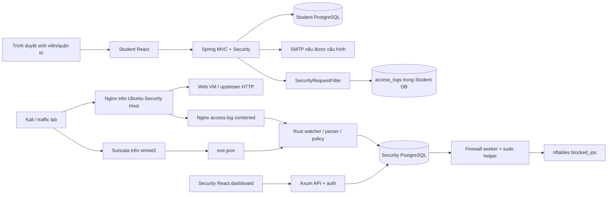

# 00 — Tổng quan dự án và tiến độ

## Cập nhật resource sau pilot — 28/10/2026

Ca tiếp theo dùng **8logicalCPU/16GiB RAM**, CPUQuota800%, MemoryHigh15GiB,
swap0,Nice10; BLAS/OpenMP8,ONNX intra8/inter1 sequential. CPU là50% của16luồng;
16GiB là**52,96% RAM OS-visible** trên máy32GB danh nghĩa, được user chỉ định rõ.
77testsPASS,35readinesschecksPASS, guardprobe0optimizerstep; **không train chính thức
hoặc chạy lại pilot corpus thật**. [Báo cáo resource](../ai-training/reports/RESOURCE_GUARD_20261028.json).

Dataset prepared và pilot-ready giữ nguyên hash; readiness-final cũ cũng được giữ.
Readiness mới`readiness-resource8` gắn source hiện hành và được handoff/script sử dụng.
Các metric/giới hạn2CPU/12GiB ở các snapshot pilot phía dưới là lịch sử. Các attempt
fail/stale/cache/NEXT_COMMANDS cũ đã dọn; giữ raw capture evidence, runtime và venv
cần thiết. Xem ledger06 mục21 cho kiểm tra, danh sách dọn và commit.

**Mốc khảo sát:** 26/10/2026, múi giờ Asia/Ho_Chi_Minh. **Code nền:** `37bc4d2ae1552939659a10647898e2228f1b801f`.

**Phạm vi khảo sát ban đầu (lịch sử):** đọc và phân tích; chỉ thêm tài liệu trong `docs/`. Không sửa mã chức năng, không cài thư viện, không chạy training, server, migration, firewall, deploy hay gửi traffic thử nghiệm. Worktree sạch trước khi tạo bộ tài liệu. Đây là kết quả đọc tĩnh và thiết kế đề xuất, không phải chứng nhận hệ thống đang chạy hoặc đã đạt chuẩn doanh nghiệp.

## 1. Hiện trạng AI pipeline — 28/10/2026

**Trạng thái28/10/2026:** corpus mới có **19.275 request thật / 80.556 observations**, đủ Student audit + Nginx + Suricata EVE từ PCAP thật trong namespace lab. Split **11.565 / 3.855 / 3.855**, nhóm 9/3/3; mỗi campaign ≥420 giây, hai khoảng nghỉ 620 giây thật. Feature v3 / normalizer3, 148 cột, `edge_masked_v1`; canonical v1.0 giữ nguyên. Readiness **35 checks PASS**, **77 tests PASS / 0 skipped**. MLP/AE/residual đều chạy 2 epoch → tiến trình mới resume đến 5 epoch, exact với reference 5 epoch; ONNX parity toàn bộ prepared rows. Chỉ đánh giá validation; test metric chưa mở. [Report có hash](../ai-training/reports/PRETRAIN_PILOT_20261028.json).

Chưa chạy ca chính thức 2–3 giờ, chọn champion, port Rust hoặc bật AI response. Corpus vẫn là loopback với fixture giả / scripted intent; chưa đại diện production. Query bị mask thống nhất nên metadata AI không thấy nội dung payload. Flow chỉ lấy flow client đã kết thúc ≥65 giây trước đó, không backfill bằng đóng flow tương lai. Live receipt-time/TLS/feature parity và human realism review còn riêng.

### Snapshot pre-training27/10 — lịch sử

**Cập nhật pre-training:** luồng AI bổ sung lifecycle lab cô lập, snapshot chỉ đọc,
observer/label provenance, manual review CSV, readiness/capacity và baseline rule
Nginx trên validation. Feature hiện hành **v2/148cột**, có UA product families
multi-hot/missing/unknown; normalizer2. Canonicalv1.0 và toàn bộ Student/Security
source/config giữ nguyên. Corpus pilot được thu qua request thật trên Student
build riêng + PostgreSQL rỗng/tài khoản giả, không lấy dữ liệu người dùng đang chạy.
**Kết quả:**4.875request/15campaign,9.750observations; train2.925/val975/test975,
nhóm9/3/3. Readiness23checksPASS,capacityPASS,58testsPASS. Corpus chưafitmodel,
giờtrainmới0. [Report cóhash](../ai-training/reports/PRETRAIN_20261027.json).
Xem [runbook pre-training](../ai-training/README.md#chuẩn-bị-trước-train--luồng-lab-riêng)
và ledger06 mục18; thay đổi đã được chia commit theo mục19, chưa push.

Phần báo cáo S0 bên dưới là **snapshot lịch sử featurev1/125cột**, không phải vector
v2 hoặc kết quả chất lượng của corpus mới. Trước mỗi train dùng report readiness
đúngdataset/source; READY_FOR_OFFLINE_PILOT không phải production-ready.

**Nhánh hiện hành:** `feat/ai-model-training`, tạo từ `fbe078d8fe2e35bf60f7a08c7d21331f4522221e`. Chỉ thêm package độc lập [`ai-training/`](../ai-training/README.md) và cập nhật docs00/02/03/04/06; đã chia commit theo phần, xem06 mục17; chưa push. Đã đối chiếu SHA-256 **356 file tracked** và Git diff với base: `student-web/`, `security-web/` giữ nguyên. Không đổi cấu hình, restart dịch vụ, truy cập DB live hoặc áp firewall.

Package đã có adapters read-only, privacy/correlation, explicit labels, temporal/grouped split, Parquet manifests, 125 features nhân quả, CPU MLP8 lớp + benign-only autoencoder, checkpoint/resume và ONNX CPU parity. **42 tests PASS**. S0 thực tế 27/10/2026 12:39:52–12:40:01+07:00: 960 request synthetic, hai model đều chạy2epoch rồi tiến trình mới resume đến4epoch, bằng reference chạy4epoch liên tục; ONNX khớp960/960 mỗi model. Chi tiết/hash ở [báo cáo S0](../ai-training/reports/S0_20261027.json) và [06 mục16](06_AI_HANDOFF_AND_RUN_LEDGER.md#16-ai-data--training-pipeline--27102026).

**Tại snapshot S0: giờ training dữ liệu thật là 0.** Chưa có champion, Rust preprocessing/inference, chất lượng production hoặc nghiệm thu ca2–3giờ/thermal trên Zenbook. Query/object identity đã mask ở producer không thể khôi phục; đây là baseline post-response, không phải model payload đầy đủ hay bằng chứng zero-day detection.

### Shared Foundation — snapshot 26/10/2026

**Nhánh:** `codex/foundation-audit-and-schema`; mốc nền `1925764a0b4dbbae647797136e17abfd9a122c45`. Thay đổi đã được chia thành các commit schema/Student/Security/infra/dev/Audit/CI và commit tài liệu bàn giao; xem ledger06 mục15. Chưa push trong phiên này. Quy định docs-only của phiên khảo sát cũ đã được yêu cầu triển khai mới thay thế; không tự áp quy định cũ để dừng việc đã giao.

Student Web hiện lưu audit DB **và** xuất JSONL theo `STUDENT_AUDIT_LOG_PATH`; mặc định ghi cả GET/HEAD/OPTIONS `/api/**` với cờ tắt riêng. Trusted proxy CIDR, `X-Request-Id`, User-Agent product families, HMAC identities và masking query đã được nối vào filter/writer. Header tự do không giữ nguyên văn; method tùy biến được chuẩn hóa thành OTHER. Spring dùng `ForwardedHeaderFilter` được bọc kiểm tra trust; chiến lược auto-forwarding của Boot giữ `NONE` để không rewrite IP trước bước kiểm tra.

Rust đọc `STUDENT_AUDIT`, Nginx structured/combined và EVE; giữ normalized HTTP/flow/non-alert khi `COLLECT_ALL_EVENTS=true`. Migration `0003` bổ sung canonical event store, receipts, quarantine và state auth; `0004` bổ sung response deadlines. Cursor, observations/alerts/jobs và receipts commit cùng transaction. Dòng quá dài được cách ly theo byte/hash, không làm kẹt nguồn.

Contract v1.0 đã khóa tại [`contracts/canonical-event-v1.schema.json`](../contracts/canonical-event-v1.schema.json), có typed Rust, Java exporter, fixture và test tương thích. **Tại snapshot foundation chưa có model, trainer, corpus được gắn nhãn hoặc phiên training**; phần AI mới ở đầu mục1 thay thế trạng thái này. Không đánh đồng normalized observations với dataset benign đã được review.

PostgreSQL Compose mặc định Student `5433`, Security `5434`, cùng loopback và có biến port riêng. Nginx template nghe `0.0.0.0:80`, tách API/frontend upstream local `8080/5173`, Web VM `192.168.20.10:80 backup`; TLS là template tùy chọn cần chứng thư. Backend/frontend bind loopback. Local-first/failover đã được thử bằng hai upstream cô lập; LAN/VM/AWS thật chưa nghiệm thu và chưa có AWS IaC.

Enforcement mặc định `OFF` (kể cả PENDING/RESTORE). IPv4 scope cấu hình được, bảo vệ host/default gateway/Web VM và whitelist ở backend cùng helper độc lập. Helper dùng TTL, job hết hạn/stale bị từ chối; không mở quyền auto-response cho các rule Rust mới. Chưa áp firewall lên host trong phiên này.

## 2. Cách đọc bộ nhớ dự án

| Thứ tự | Tài liệu | Nội dung có thẩm quyền |
|---|---|---|
| 00 | Tệp này | Mốc code, trạng thái tổng thể, quy ước cập nhật |
| 01 | [SYSTEM_AUDIT_AND_ARCHITECTURE](01_SYSTEM_AUDIT_AND_ARCHITECTURE.md) | Bằng chứng code, rủi ro, kiến trúc dual-engine và IPS |
| 02 | [DATA_STRATEGY_AND_FEATURE_ENGINEERING](02_DATA_STRATEGY_AND_FEATURE_ENGINEERING.md) | Log thực có, schema đề xuất, features, thu/sinh/nhãn dữ liệu |
| 03 | [AI_MODEL_AND_TRAINING_PLAN](03_AI_MODEL_AND_TRAINING_PLAN.md) | Mô hình, giới hạn tài nguyên, resume và nghiệm thu training |
| 04 | [ROADMAP_AND_TEAM_TASKS](04_ROADMAP_AND_TEAM_TASKS.md) | Thứ tự triển khai, phụ thuộc, chủ sở hữu và tiêu chí hoàn thành |
| 05 | [DISCOVERY_EVIDENCE_AND_INVENTORY](05_DISCOVERY_EVIDENCE_AND_INVENTORY.md) | Phạm vi đọc, kiểm kê, giới hạn xác minh, manifest SHA-256 |
| 06 | [AI_HANDOFF_AND_RUN_LEDGER](06_AI_HANDOFF_AND_RUN_LEDGER.md) | Quy trình “Đọc lại project”, bàn giao, sổ train và decision log |
| 07 | [VM_ONLY_UPGRADE_GUIDE](07_VM_ONLY_UPGRADE_GUIDE.md) | Checklist nâng bản cho Student trên Web VM, Security ở máy khác; env, hai proxy, DB và audit transport |

Các đường dẫn bằng chứng trong tài liệu tính từ gốc repo; số dòng gắn với commit khảo sát. Khi code thay đổi phải đọc lại đoạn liên quan, không coi số dòng cũ là bằng chứng mới. Tài liệu cũ trong từng service vẫn có giá trị lịch sử; khi mâu thuẫn, ưu tiên **code/config hiện tại + kết quả kiểm chứng có ghi thời điểm**, sau đó cập nhật `docs/`.

## 3. Bản đồ thư mục và công nghệ

| Vùng | Công nghệ / vai trò thực tế | Điểm vào cần đọc |
|---|---|---|
| `student-web/backend` | Java 25, Spring Boot 4.1.1 theo POM; Spring Security, MVC/JPA, PostgreSQL, Flyway, SMTP | `pom.xml`, `StudentWebApplication.java`, `configuration/`, `accesslog/`, `user/` |
| `student-web/backend/src/main/java/com/pbl4/studentweb` | Auth/session/CSRF và vai trò ADMIN/STAFF/STUDENT; hồ sơ, sinh viên, khoa/ngành/chương trình/lớp; liên hệ, địa chỉ, gia đình | `student/`, `faculty/`, `major/`, `trainingprogram/`, `studentclass/`, các module hồ sơ |
| `student-web/backend/src/main/resources` | Config dev/prod, Flyway V1/V2, danh mục địa giới | `application*.yaml`, `db/migration/V1__initial_schema.sql` |
| `student-web/backend/docs` | API, các đợt chuyển schema/seed lịch sử, dữ liệu danh mục và hướng dẫn vận hành | Không coi 019 script SQL là 019 Flyway migration đã chạy |
| `student-web/frontend` | React + TypeScript + Vite, React Router; quản trị và self-service sinh viên | `src/App.tsx`, `api/`, `contexts/AuthContext.tsx`, `pages/` |
| `security-web/src` | Rust edition 2024, rust-version tối thiểu 1.88; Axum 0.8, Tokio, SQLx 0.8, PostgreSQL | `main.rs`, `auth.rs`, `ingest.rs`, `firewall.rs`, `metrics.rs` |
| `security-web/frontend` | React + TypeScript + Vite; API polling, alerts/search/detail, application audit, statistics, rules, trạng thái và firewall audit | `src/main.tsx`, `AlertDetail.tsx`, `ApplicationAudit.tsx`, `auditQuery.ts` |
| `security-web/migrations` | SQLx 0001–0004 cho security DB | `sql/schema.sql` là fixture schema cũ, không phải nguồn migrate chính |
| `security-web/config`, `suricata`, `nginx`, `scripts`, `deploy` | Suricata capture/rules, Nginx proxy, nftables helper, systemd template, probes/acceptance | `docs/HOST_SECURITY_SETUP.md`; `deploy.sh --deploy` hiện bị khóa |
| `docker` | PostgreSQL 16 cho student, không đóng gói đầy đủ ứng dụng | `docker-compose.yml` |
| `security-web/docker-compose.yml` | PostgreSQL 17 cho security | Host port 5434; Student 5433, cấu hình được |
| `.github/workflows` | Hai workflow CI student/security | `ci.yml`, `security.yml` |
| `deliverables/security-host` | Hai DOCX kế hoạch Ubuntu host ngày 25/10, có đoạn không còn khớp mã mới | Snapshot tham khảo, không chứng minh cài đặt thực tế |
| `ai-training` | Python3.12, NumPy/PyArrow, MLP/AE CPU, ONNX Runtime; môi trường/config/artifact riêng | `README.md`, `src/idps_ai`, `configs`, `tests`, `reports/S0_20261027.json` |
| `.agents`, `skills-lock.json` | Bộ công cụ/skill hỗ trợ AI, không phải pipeline ML của IDPS | Có dữ liệu CSV thiết kế UI; không được tính là dataset tấn công |

Lockfile frontend thực tế ghi Student React 19.3.0 / Vite 8.3.0 / TypeScript 6.0.3; Security React 19.3.1 / Vite 8.3.5 / TypeScript 6.0.3. Đây là phiên bản trong snapshot lockfile, không tuyên bố là phiên bản mới nhất hay đã cài. `package.json` chứa khoảng phiên bản, xem manifest gốc khi tái lập môi trường.

## 4. Sơ đồ khảo sát ban đầu — lịch sử trước foundation

Đoạn khảo sát dưới đây mô tả baseline cũ; hiện luồng JSONL Student → Rust đã có như mục 1. Trước foundation, không có mũi tên từ `access_logs` sang Rust. Nginx cấu hình upstream Web IP cổng HTTP 80; repo chưa cung cấp cấu hình web VM đầy đủ để xác nhận chuỗi serve Student SPA và reverse proxy tới Spring. Profile production của Spring bật TLS trực tiếp; cần chốt hợp đồng TLS trước nghiệm thu end-to-end.

Audit student hiện ghi mutation `/api/**` và request lỗi/exception, bỏ qua GET/HEAD/OPTIONS thành công; do đó không đủ tạo chuỗi hành vi đầy đủ. `user_agent` có trong entity nhưng writer hiện không gán. Nguồn IP hiện dùng `getRemoteAddr()`, chưa có hợp đồng trusted proxy. Retention audit student là 3 ngày, nên không thể đợi nhiều tuần rồi mới thu dữ liệu.

Security watcher đọc từng dòng, chỉ giữ EVE `alert` và request Nginx khớp regex SQLi. Alert, cursor và job phản ứng được commit cùng transaction. Firewall xử lý bất đồng bộ, kiểm IP lab/whitelist, helper có timeout; đã có đối chiếu DB/kernel. IDS ở đây là phát hiện từ log; chặn xảy ra sau khi quan sát, **không bảo đảm ngăn request đầu tiên**.

## 5. Tiến độ code theo bằng chứng

Quy ước trạng thái: **CÓ CODE** = tìm thấy triển khai; **CÓ TEST** = tìm thấy test tương ứng nhưng không có nghĩa đã chạy trong phiên này; **ĐỀ XUẤT** = chưa triển khai; **CHƯA XÁC MINH** = cần kiểm môi trường thật. Không gán % hoàn thành tùy ý.

| Hạng mục | Trạng thái ở mốc khảo sát | Bằng chứng / phần còn thiếu |
|---|---|---|
| Student CRUD, academic hierarchy, self-service | CÓ CODE + CÓ TEST | Controllers/services/entities và `StudentApiTests`, `StudentDatabaseTests` |
| Student session, CSRF, RBAC, activation/reset | CÓ CODE + CÓ TEST | `SecurityConfiguration`, `user/*`, PostgreSQL transaction/race tests có điều kiện môi trường |
| Student audit DB + JSONL + reads | PASS 89 Java, gồm PostgreSQL | Filter/writers/attribution và UA/method privacy; retention DB vẫn 3 ngày; exporter có rotation/limit và lỗi được báo |
| Student JSONL / durable collector | PASS Java + Rust + smoke | Path chung cấu hình được; collector checkpoint/dedup/oversize quarantine |
| Suricata + Rust HTTP rules | PASS unit/integration/offline engine | 9 SID và 6 family Rust; chưa đo recall/FP trên workload đại diện |
| Durable ingestion/checkpoint/replay | CÓ CODE + CÓ TEST | `ingest.rs`, migration reliability; giới hạn rotation/.gz/oversized line |
| Firewall safety / mode / TTL / deadlines | PASS policy + DB/executor tests; nft syntax PASS | OFF/MANUAL/ENFORCE, host/gateway discovery, TTL ≤300s, stale gate; kernel enforcement thật NOT_RUN |
| Security dashboard/API | PASS API/build; UI trực quan NOT_RUN | Tab Audit ứng dụng, filters/page/detail/correlation; header refresh đã nối audit. Kiểm tra trước commit:50 Rust +3 frontend PASS; catalog rule tĩnh không chứng minh Suricata đã nạp rule |
| Correlation student/proxy | PASS smoke và cross-source counter test | Request ID thống nhất; Rust live flow-to-request correlation chưa triển khai. AI offline có past-only flow context theo flowID, xem02 |
| Auth burst detector | PASS Rust PostgreSQL | Theo IP+route, cửa sổ/thành công reset/cooldown; dedup request ID Nginx+audit; chưa distributed spraying theo account |
| AI features/trainer/export | PASS offline ba nguồn/pilot | v3/148features,77tests,19,275request,35gatechecks;3models5epoch/resume/ONNX PASS; chưachampion/Rustlive |
| CI | CÓ CẤU HÌNH | Java/PG, Rust/PG, frontend build; chưa xác minh trạng thái run mới nhất |
| Ubuntu host deployment | CÓ CONFIG + HƯỚNG DẪN | Service/helper/config cần host acceptance; không áp dụng trong phiên này |
| AWS, HA, backup/restore đã diễn tập | ĐỀ XUẤT / CHƯA XÁC MINH | Không có IaC hoặc bằng chứng diễn tập trong repo |
| Bộ nhớ dự án | HOÀN THÀNH TRONG PHIÊN TÀI LIỆU | `docs/00`–`06`; cần duy trì theo mỗi PR/run |

## 6. Tiến độ AI và dữ liệu

| Sổ theo dõi | Giá trị đã biết |
|---|---|
| Dataset IDPS đã đăng ký | `upgrade_20261028/dataset-ready`: 19,275request/80,556observations;3nguồn thật; split11,565/3,855/3,855; report27/S0 giữlịchsử |
| Log runtime / corpus đại diện | Student/Nginx/Suricata EVE lab thật với fixture giả; không phải trafficproduction hoặc representative acceptance |
| Canonical schema / normalizer | Canonical1.0 giữ nguyên; ai-normalizer-3,ai-features-3/148cột; edge_masked_v1,past-completed-client-flow≥65s |
| Model baseline / champion / ONNX | MLP5.032/AE9.652/residual14.216params; pilot5epoch,exactresume,ONNX PASS cả3; chưachampion |
| Ca train đã ghi nhận | Pilot corpus mới:6phiên chính (2→5epoch) +3reference; S0synthetic cũ ghi riêng |
| Giờ train có bằng chứng | Corpuslab optimizer0.573299s (0.000159250h), reference0.569272s riêng; productiondata0h; không cộngdataprep/export vàooptimizer |
| Latest / best checkpoint | `.artifacts/upgrade_20261028/pilot-ready/{mlp,autoencoder,residual}-resumed`; checksums trong report28; kho artifact chung chưa cấp |
| Metrics PR-AUC/recall/FPR/latency | Validation-only trong report28; threshold/calibration dùng cùngval nên sơ bộ; test giữ kín, không là productionFPR |
| Ca tiếp theo | `bash ai-training/scripts/train-first-session.sh`: candidate residual100epoch/patience8,max150phút,8CPU/16GiB cgroup; chưa thực thi, có thể xong sớm |

Thiết bị mục tiêu do người dùng cung cấp: ASUS Zenbook 14 OLED, RAM 32GB. Chưa biết SKU CPU, số luồng, OS train, GPU/NPU, dung lượng SSD trống hoặc thermal profile. Kế hoạch [03](03_AI_MODEL_AND_TRAINING_PLAN.md) dùng CPU-first, RAM dưới 16GB và ca 2–3 giờ; chưa lấy phần cứng máy thực thi chat làm thông số laptop.

## 7. Quy ước cập nhật cho hai thành viên và AI

1. Mỗi PR thay hành vi phải cập nhật ngay tài liệu chịu ảnh hưởng, dòng trạng thái ở đây và mục bàn giao trong [06](06_AI_HANDOFF_AND_RUN_LEDGER.md). Không đánh dấu DONE khi mới viết kế hoạch.
2. Ghi **commit/PR, owner, ngày giờ có múi giờ, đường dẫn bằng chứng, lệnh kiểm tra, kết quả và giới hạn**. Trạng thái test phân biệt `NOT_RUN`, `PASS`, `FAIL`, `SKIPPED`.
3. Sau mỗi ca train, cập nhật sổ 06 với run/session ID, dataset hash, config hash, checkpoint URI/hash, global step, giờ phiên/giờ tích lũy, metrics và lỗi. Không cộng giờ data prep hoặc export vào giờ optimizer training nếu chưa tách loại thời gian.
4. Model/checkpoint/dữ liệu thô để trong kho artifact được kiểm soát; Git chỉ lưu manifest, cấu hình đã khử bí mật, model card và báo cáo gọn. Chưa có kho đó thì ghi `chưa cấp`, không tạo link giả.
5. Mỗi task có một người thực hiện và một người review; dùng nhánh `codex/…` hoặc quy ước nhóm. Tránh hai người sửa cùng schema/hợp đồng; chốt version trước rồi làm song song.
6. Các mục tiêu/số đo đề xuất phải giữ nhãn **mục tiêu ban đầu — cần benchmark**. Chỉ chuyển thành measured khi có dữ liệu và báo cáo tái lập.
7. Không đưa mật khẩu, token, email/mã sinh viên, nội dung hồ sơ thật hoặc payload chưa khử bí mật vào docs. Những dữ liệu danh mục/seed trong repo không tự động đủ quyền để dùng làm corpus ML chia sẻ.
8. Khi mâu thuẫn tài liệu và code: ghi drift, đối chiếu code và tests, sửa docs trong cùng PR; không âm thầm đổi tiến độ. Quyết định đổi kiến trúc phải có decision entry ở 06.

## 8. Ưu tiên tiếp theo

Ưu tiên đầu là thống nhất hợp đồng triển khai/proxy/IP và đóng các khoảng trống IPS, sau đó thu audit và traffic bình thường theo schema có version. Chỉ bắt đầu train khi dữ liệu có nhãn/split sạch, sampler và checkpoint đã kiểm chứng. Foundation đã được triển khai trong phiên tiếp nối; ưu tiên tiếp theo là data/feature/benchmark và nghiệm thu môi trường thật theo [04](04_ROADMAP_AND_TEAM_TASKS.md).

## 9. Kết quả kiểm chứng foundation ban đầu — snapshot lịch sử

- Java: **87 test PASS**, gồm các test PostgreSQL trên container test riêng (PostgreSQL 17); 0 skipped.
- Rust: **44 test PASS**, gồm migrations/cursor/dedup/oversize/DB rollback/benign capture/auth correlation/deadlines; clippy toàn target và rustfmt PASS.
- Nginx 1.28: 5 kịch bản PASS, gồm request ID/secret masking và local→backup failover. Suricata 8.0.3: syntax + PCAP offline đủ 9 SID PASS.
- Smoke stack riêng PASS: backend 127.0.0.1:8080, frontend 127.0.0.1:5173, edge 18780, security 127.0.0.1:3001, DB 55433/55434; request ID xuất hiện ở cả NGINX và STUDENT_AUDIT trong normalized_events. Xem trạng thái cuối và lệnh tái lập tại [06](06_AI_HANDOFF_AND_RUN_LEDGER.md).

Các finding runtime còn lại và giới hạn production được ghi trong 01/02/06; S0 kỹ thuật synthetic đã PASS ở mục1; dữ liệu thật/benchmark R30–R34 vẫn cần trước train/champion production. Những bảng/lời kết khảo sát cũ bên trên không phải trạng thái tính năng mới; mục 1/5/9 và ledger 06 là nguồn hiện hành.
