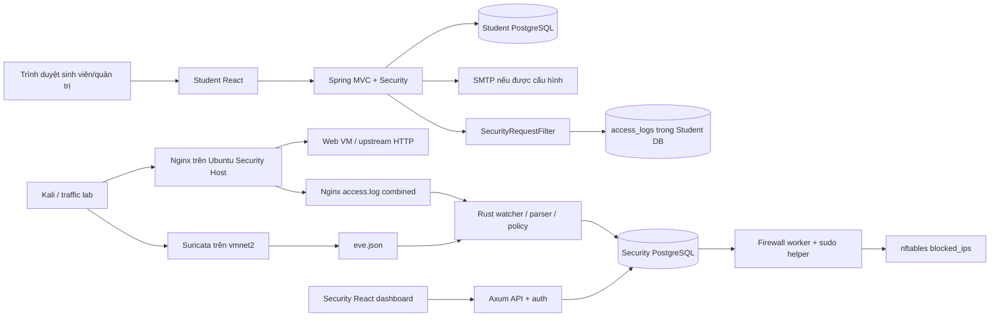

# 00 — Tổng quan dự án và tiến độ

**Mốc khảo sát:** 26/10/2026, múi giờ Asia/Ho_Chi_Minh. **Code nền:** `37bc4d2ae1552939659a10647898e2228f1b801f`.

**Phạm vi phiên này:** đọc và phân tích; chỉ thêm tài liệu trong `docs/`. Không sửa mã chức năng, không cài thư viện, không chạy training, server, migration, firewall, deploy hay gửi traffic thử nghiệm. Worktree sạch trước khi tạo bộ tài liệu. Đây là kết quả đọc tĩnh và thiết kế đề xuất, không phải chứng nhận hệ thống đang chạy hoặc đã đạt chuẩn doanh nghiệp.

## 1. Kết luận hiện trạng

Dự án có hai ứng dụng hoạt động độc lập về mã và dữ liệu: cổng quản lý sinh viên `student-web` và nền tảng giám sát/chặn `security-web`. Security engine đã xử lý **rule**, có checkpoint đọc log, chống ghi trùng, ghi nhận cảnh báo, hàng đợi tác vụ firewall trong PostgreSQL và dashboard điều tra. **Chưa có AI engine, tập dữ liệu IDPS đã chuẩn hóa, mã train, checkpoint model hoặc model triển khai trong phạm vi đã kiểm kê.**

Điểm cần sửa trong cách hiểu ban đầu: `student-web` **chưa xuất tệp `audit.log`**. Audit HTTP hiện vào bảng **`access_logs`** của Student DB. Security backend chỉ đọc Suricata EVE và Nginx combined; chưa thu bảng này, chưa đọc audit JSONL của student và không giữ tất cả traffic bình thường. Cần xây cầu nối dữ liệu trước khi có thể train hành vi thực tế. Xem bằng chứng và schema tại [02](02_DATA_STRATEGY_AND_FEATURE_ENGINEERING.md).

Tên repository có AWS, nhưng hiện trạng triển khai được mô tả và cấu hình là **Ubuntu Security Host + Kali VM + Web VM qua VMware vmnet2/vmnet3**. Không tìm thấy hạ tầng AWS bằng Terraform/CloudFormation, adapter WAF hay luồng CloudWatch trong mã dự án. AWS là hướng mở rộng sau khi chốt môi trường đích, không phải tính năng đã có.

## 2. Cách đọc bộ nhớ dự án

| Thứ tự | Tài liệu | Nội dung có thẩm quyền |
|---|---|---|
| 00 | Tệp này | Mốc code, trạng thái tổng thể, quy ước cập nhật |
| 01 | [SYSTEM_AUDIT_AND_ARCHITECTURE](01_SYSTEM_AUDIT_AND_ARCHITECTURE.md) | Bằng chứng code, rủi ro, kiến trúc dual-engine và IPS |
| 02 | [DATA_STRATEGY_AND_FEATURE_ENGINEERING](02_DATA_STRATEGY_AND_FEATURE_ENGINEERING.md) | Log thực có, schema đề xuất, features, thu/sinh/nhãn dữ liệu |
| 03 | [AI_MODEL_AND_TRAINING_PLAN](03_AI_MODEL_AND_TRAINING_PLAN.md) | Mô hình, giới hạn tài nguyên, resume và nghiệm thu training |
| 04 | [ROADMAP_AND_TEAM_TASKS](04_ROADMAP_AND_TEAM_TASKS.md) | Thứ tự triển khai, phụ thuộc, chủ sở hữu và tiêu chí hoàn thành |
| 05 | [DISCOVERY_EVIDENCE_AND_INVENTORY](05_DISCOVERY_EVIDENCE_AND_INVENTORY.md) | Phạm vi đọc, kiểm kê, giới hạn xác minh, manifest SHA-256 |
| 06 | [AI_HANDOFF_AND_RUN_LEDGER](06_AI_HANDOFF_AND_RUN_LEDGER.md) | Quy trình “Đọc lại project”, bàn giao, sổ train và decision log |

Các đường dẫn bằng chứng trong tài liệu tính từ gốc repo; số dòng gắn với commit khảo sát. Khi code thay đổi phải đọc lại đoạn liên quan, không coi số dòng cũ là bằng chứng mới. Tài liệu cũ trong từng service vẫn có giá trị lịch sử; khi mâu thuẫn, ưu tiên **code/config hiện tại + kết quả kiểm chứng có ghi thời điểm**, sau đó cập nhật `docs/`.

## 3. Bản đồ thư mục và công nghệ

| Vùng | Công nghệ / vai trò thực tế | Điểm vào cần đọc |
|---|---|---|
| `student-web/backend` | Java 25, Spring Boot 4.1.1 theo POM; Spring Security, MVC/JPA, PostgreSQL, Flyway, SMTP | `pom.xml`, `StudentWebApplication.java`, `configuration/`, `accesslog/`, `user/` |
| `student-web/backend/src/main/java/com/pbl4/studentweb` | Auth/session/CSRF và vai trò ADMIN/STAFF/STUDENT; hồ sơ, sinh viên, khoa/ngành/chương trình/lớp; liên hệ, địa chỉ, gia đình | `student/`, `faculty/`, `major/`, `trainingprogram/`, `studentclass/`, các module hồ sơ |
| `student-web/backend/src/main/resources` | Config dev/prod, Flyway V1, danh mục địa giới | `application*.yaml`, `db/migration/V1__initial_schema.sql` |
| `student-web/backend/docs` | API, các đợt chuyển schema/seed lịch sử, dữ liệu danh mục và hướng dẫn vận hành | Không coi 019 script SQL là 019 Flyway migration đã chạy |
| `student-web/frontend` | React + TypeScript + Vite, React Router; quản trị và self-service sinh viên | `src/App.tsx`, `api/`, `contexts/AuthContext.tsx`, `pages/` |
| `security-web/src` | Rust edition 2024, rust-version tối thiểu 1.88; Axum 0.8, Tokio, SQLx 0.8, PostgreSQL | `main.rs`, `auth.rs`, `ingest.rs`, `firewall.rs`, `metrics.rs` |
| `security-web/frontend` | React + TypeScript + Vite; API polling, alerts/search/detail, statistics, rules, trạng thái và firewall audit | `src/main.tsx`, `AlertDetail.tsx` |
| `security-web/migrations` | SQLx 0001/0002 cho security DB | `sql/schema.sql` là fixture schema cũ, không phải nguồn migrate chính |
| `security-web/config`, `suricata`, `nginx`, `scripts`, `deploy` | Suricata capture/rules, Nginx proxy, nftables helper, systemd template, probes/acceptance | `docs/HOST_SECURITY_SETUP.md`; `deploy.sh --deploy` hiện bị khóa |
| `docker` | PostgreSQL 16 cho student, không đóng gói đầy đủ ứng dụng | `docker-compose.yml` |
| `security-web/docker-compose.yml` | PostgreSQL 17 cho security | Host port mặc định trùng 5433 nếu cùng máy với Student DB |
| `.github/workflows` | Hai workflow CI student/security | `ci.yml`, `security.yml` |
| `deliverables/security-host` | Hai DOCX kế hoạch Ubuntu host ngày 25/10, có đoạn không còn khớp mã mới | Snapshot tham khảo, không chứng minh cài đặt thực tế |
| `.agents`, `skills-lock.json` | Bộ công cụ/skill hỗ trợ AI, không phải pipeline ML của IDPS | Có dữ liệu CSV thiết kế UI; không được tính là dataset tấn công |

Lockfile frontend thực tế ghi Student React 19.3.0 / Vite 8.3.0 / TypeScript 6.0.3; Security React 19.3.1 / Vite 8.3.5 / TypeScript 6.0.3. Đây là phiên bản trong snapshot lockfile, không tuyên bố là phiên bản mới nhất hay đã cài. `package.json` chứa khoảng phiên bản, xem manifest gốc khi tái lập môi trường.

## 4. Luồng chạy hiện tại

Không vẽ mũi tên từ `access_logs` sang Rust vì kết nối này chưa được triển khai. Nginx cấu hình upstream Web IP cổng HTTP 80; repo chưa cung cấp cấu hình web VM đầy đủ để xác nhận chuỗi serve Student SPA và reverse proxy tới Spring. Profile production của Spring bật TLS trực tiếp; cần chốt hợp đồng TLS trước nghiệm thu end-to-end.

Audit student hiện ghi mutation `/api/**` và request lỗi/exception, bỏ qua GET/HEAD/OPTIONS thành công; do đó không đủ tạo chuỗi hành vi đầy đủ. `user_agent` có trong entity nhưng writer hiện không gán. Nguồn IP hiện dùng `getRemoteAddr()`, chưa có hợp đồng trusted proxy. Retention audit student là 3 ngày, nên không thể đợi nhiều tuần rồi mới thu dữ liệu.

Security watcher đọc từng dòng, chỉ giữ EVE `alert` và request Nginx khớp regex SQLi. Alert, cursor và job phản ứng được commit cùng transaction. Firewall xử lý bất đồng bộ, kiểm IP lab/whitelist, helper có timeout; đã có đối chiếu DB/kernel. IDS ở đây là phát hiện từ log; chặn xảy ra sau khi quan sát, **không bảo đảm ngăn request đầu tiên**.

## 5. Tiến độ code theo bằng chứng

Quy ước trạng thái: **CÓ CODE** = tìm thấy triển khai; **CÓ TEST** = tìm thấy test tương ứng nhưng không có nghĩa đã chạy trong phiên này; **ĐỀ XUẤT** = chưa triển khai; **CHƯA XÁC MINH** = cần kiểm môi trường thật. Không gán % hoàn thành tùy ý.

| Hạng mục | Trạng thái ở mốc khảo sát | Bằng chứng / phần còn thiếu |
|---|---|---|
| Student CRUD, academic hierarchy, self-service | CÓ CODE + CÓ TEST | Controllers/services/entities và `StudentApiTests`, `StudentDatabaseTests` |
| Student session, CSRF, RBAC, activation/reset | CÓ CODE + CÓ TEST | `SecurityConfiguration`, `user/*`, PostgreSQL transaction/race tests có điều kiện môi trường |
| Student audit DB và retention | CÓ CODE + CÓ TEST | Filter/service/retention; thiếu successful reads và export an toàn |
| Student `audit.log` JSONL / collector | ĐỀ XUẤT | Không có file/writer/adapter này trong code đã kiểm kê |
| Suricata rules + Nginx SQLi parser | CÓ CODE + CÓ TEST parser | 8 SID lab; chưa đo recall/FP trên traffic đại diện |
| Durable ingestion/checkpoint/replay | CÓ CODE + CÓ TEST | `ingest.rs`, migration reliability; giới hạn rotation/.gz/oversized line |
| Firewall jobs, allowlist, RBAC, đối chiếu DB/kernel và startup restore | CÓ CODE + CÓ TEST với executor giả | Chưa reconcile định kỳ, TTL, global enforcement switch, freshness gate; chưa xác minh packet/kernel thật |
| Security dashboard/API | CÓ CODE | Dữ liệu từ backend; catalog rule tĩnh không chứng minh Suricata đã nạp rule |
| Correlation giữa student/proxy/flow | ĐỀ XUẤT | Thiếu request identity, schema chung và all-event stream |
| Shared rate-limit / behavioral hard rules | MỘT PHẦN | Student có limiter RAM theo process; chưa engine ngưỡng hành vi liên nguồn |
| AI features/model/inference | ĐỀ XUẤT | Không có training package hay model artifact |
| CI | CÓ CẤU HÌNH | Java/PG, Rust/PG, frontend build; chưa xác minh trạng thái run mới nhất |
| Ubuntu host deployment | CÓ CONFIG + HƯỚNG DẪN | Service/helper/config cần host acceptance; không áp dụng trong phiên này |
| AWS, HA, backup/restore đã diễn tập | ĐỀ XUẤT / CHƯA XÁC MINH | Không có IaC hoặc bằng chứng diễn tập trong repo |
| Bộ nhớ dự án | HOÀN THÀNH TRONG PHIÊN TÀI LIỆU | `docs/00`–`06`; cần duy trì theo mỗi PR/run |

## 6. Tiến độ AI và dữ liệu

| Sổ theo dõi | Giá trị đã biết |
|---|---|
| Dataset IDPS đã đăng ký | Chưa có trong repo đã kiểm kê |
| Bộ log `audit.log`/EVE/Nginx thật có mẫu đại diện | Chưa được cung cấp trong workspace; có fixture test, không phải corpus production |
| Labeled split / feature schema / normalizer | Chưa triển khai |
| Model baseline / champion / ONNX | Chưa có artifact được kiểm chứng |
| Ca train đã ghi nhận | **0 ca trong repo**; thời gian bên ngoài repo **chưa biết** |
| Giờ train có bằng chứng | **0 giờ được ghi nhận**; không suy diễn nhóm chưa từng train ở nơi khác |
| Latest / best checkpoint | Chưa có đường dẫn và checksum |
| Metrics PR-AUC/recall/FPR/latency | Chưa đo, không điền số giả |
| Ca tiếp theo | S0: benchmark tài nguyên + kiểm thử resume, sau khi hoàn tất schema/collector/data slice |

Thiết bị mục tiêu do người dùng cung cấp: ASUS Zenbook 14 OLED, RAM 32GB. Chưa biết SKU CPU, số luồng, OS train, GPU/NPU, dung lượng SSD trống hoặc thermal profile. Kế hoạch [03](03_AI_MODEL_AND_TRAINING_PLAN.md) dùng CPU-first, RAM dưới 16GB và ca 2–3 giờ; chưa lấy phần cứng máy thực thi chat làm thông số laptop.

## 7. Quy ước cập nhật cho hai thành viên và AI

1. Mỗi PR thay hành vi phải cập nhật ngay tài liệu chịu ảnh hưởng, dòng trạng thái ở đây và mục bàn giao trong [06](06_AI_HANDOFF_AND_RUN_LEDGER.md). Không đánh dấu DONE khi mới viết kế hoạch.
2. Ghi **commit/PR, owner, ngày giờ có múi giờ, đường dẫn bằng chứng, lệnh kiểm tra, kết quả và giới hạn**. Trạng thái test phân biệt `NOT_RUN`, `PASS`, `FAIL`, `SKIPPED`.
3. Sau mỗi ca train, cập nhật sổ 06 với run/session ID, dataset hash, config hash, checkpoint URI/hash, global step, giờ phiên/giờ tích lũy, metrics và lỗi. Không cộng giờ data prep hoặc export vào giờ optimizer training nếu chưa tách loại thời gian.
4. Model/checkpoint/dữ liệu thô để trong kho artifact được kiểm soát; Git chỉ lưu manifest, cấu hình đã khử bí mật, model card và báo cáo gọn. Chưa có kho đó thì ghi `chưa cấp`, không tạo link giả.
5. Mỗi task có một người thực hiện và một người review; dùng nhánh `codex/…` hoặc quy ước nhóm. Tránh hai người sửa cùng schema/hợp đồng; chốt version trước rồi làm song song.
6. Các mục tiêu/số đo đề xuất phải giữ nhãn **mục tiêu ban đầu — cần benchmark**. Chỉ chuyển thành measured khi có dữ liệu và báo cáo tái lập.
7. Không đưa mật khẩu, token, email/mã sinh viên, nội dung hồ sơ thật hoặc payload chưa khử bí mật vào docs. Những dữ liệu danh mục/seed trong repo không tự động đủ quyền để dùng làm corpus ML chia sẻ.
8. Khi mâu thuẫn tài liệu và code: ghi drift, đối chiếu code và tests, sửa docs trong cùng PR; không âm thầm đổi tiến độ. Quyết định đổi kiến trúc phải có decision entry ở 06.

## 8. Ưu tiên tiếp theo

Ưu tiên đầu là thống nhất hợp đồng triển khai/proxy/IP và đóng các khoảng trống IPS, sau đó thu audit và traffic bình thường theo schema có version. Chỉ bắt đầu train khi dữ liệu có nhãn/split sạch, sampler và checkpoint đã kiểm chứng. Lộ trình chi tiết và chia việc ở [04](04_ROADMAP_AND_TEAM_TASKS.md); không có thay đổi chức năng nào được thực hiện bởi bộ tài liệu này.
