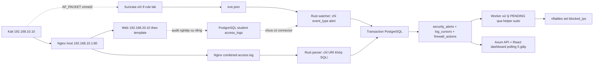
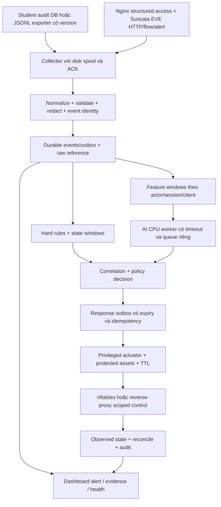

# 01 — Khảo sát hệ thống và kiến trúc nâng cấp IDPS

## Biên kiến trúc AI hiện hành — 2026-10-30T21:35:36.891996+07:00

Chỉ thay AI và tài liệu. **689 đường dẫn được bảo vệ** giữ SHA, gồm 366 file service/contract/docker và artifact/report lượt trước. Guard 4.233 artifact cũ từ lượt trước vẫn nguyên vẹn. Không đổi canonical v1.0, API, DB, Nginx, rule, firewall hoặc deployment của hai Web.

Có hai hợp đồng độc lập: `ai-features-5` gồm 207 cột dùng actor/flow/behavior thật; `request-structure-v1` gồm 70 cột URI/query structure/method dành cho nguồn thiếu context. Không nối vector đã scale riêng hoặc giả flow/time cho public data. Scaler của profile mới chỉ fit benign thuộc train. ONNX giữ hợp đồng FP32/FP64 reduction, rtol=1e-5 và atol=1e-6.

AI có adapter EVE opt-in trước mask: `project-request-eve.py`, JSONL giới hạn 64 KiB, chỉ xuất số và envelope đã khử bí mật. Input malformed/oversized báo lỗi không echo raw. Không tự nối adapter vào Web hoặc đổi sensor config đang chạy. `RequestInferencePipeline` kiểm tra profile/fingerprint/hash, nhận batch 1–4096, chỉ trả candidate nhị phân; family output tắt, 0 enforcement. Live receipt-time/TLS/IPS acceptance **NOT_RUN**.

Cohort mới nối đủ 1.935 request từ 3 nguồn, nhưng chỉ 1.567 request có **ngữ cảnh flow quá khứ đã hoàn tất** dùng được; 368 request có cột flow null. Không gọi là có flow chỉ vì dictionary có key. Private lab đã dừng. 53 HEAD/OPTIONS trả 403 được ghi nhận để chủ sở hữu Web rà soát ngoài phạm vi AI, không tự sửa Web.

[Báo cáo hiện hành](../ai-training/reports/REQUEST_PROFILE_20261030.json), [handoff](../ai-training/FINAL_TRAINING_HANDOFF.json), sổ bàn giao 06 mục 27. Các snapshot phía dưới là lịch sử.

## Biên tích hợp AI v5 — 2026-10-30T15:52:59+07:00

Nâng cấp chỉ trong AI: 207 numeric inputs, residual SwiGLU 9.675.784 tham số,
ONNX/reference preprocessing và offline shadow512 request. Canonical 1.0, schema/API
Student/Security và source của hai web giữ nguyên hash (366 file). Không gọi DB live,
firewall/block API hoặc sửa Nginx/Suricata/app config. Quyền CPU/RAM chỉ áp job AI.

Luồng đã thử: fused ordered request → FeatureExtractor v5 cùng scaler train-only →
ONNX → score/family candidate + telemetry. Shadow output chỉ event_key và kết quả,
không raw query/headers/PII, không ghi normalized_events hoặc phát enforcement.
Standalone raw EVE/canonical line chưa thay thế được fused contract. Receipt-time,
TLS vantage, source outage, auth/service rollout và live shadow cần nghiệm thu riêng;
nếu cần đổi web apps, chỉ đề xuất trong luồng sở hữu tương ứng. Hiện corpus 2M,
independent labels/environments và shared-scaler multi-corpus assembly chưa có.

134 tests/53 gate kỹ thuật và bounded pilot PASS; không coi đây là production-ready.
[Báo cáo](../ai-training/reports/SCALE_UPGRADE_20261030.json), ledger06 mục25.

## Kết quả AI revision 4.1 — 2026-10-30T09:08:21+07:00

45 campaign thuộc ba temporal bands đã tạo 69,345 HTTP request thật.
Nginx, Student audit và EVE cùng quan sát fixture riêng, được dựng từ commit
`fd0fea47dbc30a56dc8a9bed819b15cf3dc66d11`. Không sửa code/config Student hoặc Security;
không dùng credential hoặc DB live.

Bổ sung 41 cột cấu trúc, tổng 189 đặc trưng; mô hình sâu tối đa 445.448 tham số.
Projection chỉ trả về số sau khi loại dữ liệu nhạy cảm, trước redaction URL;
không đưa raw query, body, cờ rule hoặc SID vào model. Readiness
53/53 PASS,
118 tests PASS; cả bốn pilot đều resume chính xác và ONNX parity toàn bộ vectors.
Source snapshot, provenance và giới hạn 8 CPU / 16 GiB nằm trong [báo cáo](../ai-training/reports/PRETRAIN_EXPANDED_20261030.json).

Rust serving, góc nhìn TLS, receipt-time, mất nguồn, shadow và IPS còn cần nghiệm
thu riêng. Model dùng feature 4.1 không nhận profile v1 với 148 cột.

## Bổ sung kiến trúc adapter AI — 29/10/2026

Đường offline mới: HTTP thật trong lab riêng → PCAP → Suricata EVE qua Unix
socket → shared numeric projection → EVE đã redaction → snapshot/correlation →
featurev4 → model. Projection chạy trước khi URL mất query và chỉ xuất28 số;
không truyền raw payload, body hay rule decision vào model. Canonical1.0 và
đường ingestion của Student/Security được giữ nguyên.

| Hạng mục | Trạng thái đã kiểm |
| --- | --- |
| Privacy/adapter/correlation v4 | Có unit và end-to-end test tới weighted model/ONNX/reference streaming |
| Lab relay | Backlog128; test45 kết nối chờ; bootstrap stagger và bounded GET-CSRF retry có observer |
| Mô hình | Thêm train-only weighted CE, objective history và exact mid-epoch resume |
| Nghiệm thu live | Chưa có Rust projection/serving, receipt-time/TLS vantage hoặc missing-source fallback acceptance |
| Dữ liệu/pilot mới |46.230requests/198.765observations;48/48gatePASS;4model5epoch exactresume/ONNX46.134rowsPASS |
| Kiểm thử cuối |AI93/93,Java100/100,Rust50/50PASS; Java/Rust rerun trên HEADfd0fea4 với DB riêng |

Không dùng modelv4 với đầu vào v3 đã mask query. Shared Python transform làm
contract có thể tái lập cho luồng AI; triển khai consumer bền vững ở edge và kiểm
parity với Rust là hạng mục tích hợp tiếp theo. Score hiện là post-response,
không coi đây là bộ chặn trước request. Thiếu actor/flow có thể làm FPR tăng;
gate dữ liệu offline không thay thế nghiệm thu mất nguồn khi chạy thật.

Capture dùng Git export8171289; HEAD sau đó nhận fast-forwardfd0fea4 gồm các
thay đổi UI/email/firewall đã commit từ luồng khác. Không reset hoặc sửa chúng.
Report ghi21file trong inventory cũ đổi do các commit này, và không có diff ứng
dụng chưa commit tại thời điểm chốt.461artifact cũ vẫn nguyên byte.

## Ca residual đầu tiên — 29/10/2026

Đã chạy một experiment residual offline với trần150phút: data-readiness35/35PASS,
dừng sớm tại14epoch sau11,616giây bởi patience8, best tại6epoch. Checkpoint và
ONNX19.275/19.275PASS; chỉ tính chất lượng validation (recall44,20%,FPR0,943%).
Dataset/schema/features giữ nguyên; đây vẫn là lab có fixture giả, chưa champion,
Rust/live hoặc nghiệm thu endurance150phút. Xem [báo cáo ca residual](../ai-training/reports/FORMAL_RESIDUAL_20261029.json) và ledger06 mục22.
Các trạng thái “chưa train chính thức” trong snapshot28/10 bên dưới giữ ý nghĩa lịch sử.

## Cập nhật resource sau pilot — 28/10/2026

Ca tiếp theo dùng **8logicalCPU/16GiB RAM**, CPUQuota800%, MemoryHigh15GiB,
swap0,Nice10; BLAS/OpenMP8,ONNX intra8/inter1 sequential. CPU là50% của16luồng;
16GiB là**52,96% RAM OS-visible** trên máy32GB danh nghĩa, được user chỉ định rõ.
77testsPASS,35readinesschecksPASS, guardprobe0optimizerstep; **không train chính thức
hoặc chạy lại pilot corpus thật**. [Báo cáo resource](../ai-training/reports/RESOURCE_GUARD_20261028.json).

Dataset prepared và pilot-ready giữ nguyên hash; readiness-final cũ cũng được giữ.
Readiness mới`readiness-resource8` gắn source hiện hành và được handoff/script sử dụng.
Các metric/giới hạn2CPU/12GiB ở các snapshot pilot phía dưới là lịch sử. Các attempt
fail/stale/cache/NEXT_COMMANDS cũ đã dọn; giữ raw capture evidence, runtime và venv
cần thiết. Xem ledger06 mục21 cho kiểm tra, danh sách dọn và commit.

**Ngày khảo sát:** 2026-10-26, Asia/Ho_Chi_Minh. **Mốc code:** `37bc4d2ae1552939659a10647898e2228f1b801f`. **Phạm vi:** đọc source, cấu hình, SQL, test và tài liệu; không chạy ứng dụng, không chạm DB/firewall và không sửa code chức năng.

Đọc cùng [hiện trạng và tiến độ](00_PROJECT_OVERVIEW_AND_PROGRESS.md), [chiến lược dữ liệu](02_DATA_STRATEGY_AND_FEATURE_ENGINEERING.md), [AI/training](03_AI_MODEL_AND_TRAINING_PLAN.md) và [roadmap](04_ROADMAP_AND_TEAM_TASKS.md). Đường dẫn và số dòng bên dưới tính từ gốc repository tại mốc trên; phải đối chiếu lại khi code thay đổi.

## Cập nhật AI offline — 28/10/2026

**Trạng thái28/10/2026:** corpus mới có **19.275 request thật / 80.556 observations**, đủ Student audit + Nginx + Suricata EVE từ PCAP thật trong namespace lab. Split **11.565 / 3.855 / 3.855**, nhóm 9/3/3; mỗi campaign ≥420 giây, hai khoảng nghỉ 620 giây thật. Feature v3 / normalizer3, 148 cột, `edge_masked_v1`; canonical v1.0 giữ nguyên. Readiness **35 checks PASS**, **77 tests PASS / 0 skipped**. MLP/AE/residual đều chạy 2 epoch → tiến trình mới resume đến 5 epoch, exact với reference 5 epoch; ONNX parity toàn bộ prepared rows. Chỉ đánh giá validation; test metric chưa mở. [Report có hash](../ai-training/reports/PRETRAIN_PILOT_20261028.json).

Chưa chạy ca chính thức 2–3 giờ, chọn champion, port Rust hoặc bật AI response. Corpus vẫn là loopback với fixture giả / scripted intent; chưa đại diện production. Query bị mask thống nhất nên metadata AI không thấy nội dung payload. Flow chỉ lấy flow client đã kết thúc ≥65 giây trước đó, không backfill bằng đóng flow tương lai. Live receipt-time/TLS/feature parity và human realism review còn riêng.

LuồngA/Student/Security source/config vẫn giữ nguyên356SHA. Chỉ có lab riêng trongAI và quyền nhận signal của profile tcpdump do user tự cấp. Rust hiện chưa có port featurev3/live receipt-time correlation; không gán kết quả offline cho đường enforce.

## Foundation update — 26/10/2026, base `1925764`, working tree

Phần audit bên dưới được giữ làm **bằng chứng lịch sử tại `37bc4d2`**, không còn là mô tả đầy đủ code hiện tại. Đối chiếu thay đổi sau:

| Finding / capability | Trạng thái mới | Evidence |
|---|---|---|
| DATA-01/02: missing Student/normal traffic | Đã triển khai phần foundation | Java filter/JSONL, `events.rs`, `ingest.rs`, `0003_shared_foundation.sql`; COLLECT_ALL_EVENTS; successful reads bật mặc định |
| DATA-04: oversized stalls source | Đã xử lý | Bounded scans, persistent discard state, byte/hash quarantine, partial/rotation/replay/DB rollback tests |
| APP metadata / attribution | Đã triển khai | RequestAttribution + TrustedForwardingConfiguration; UA product family/request_id DB + DTO + JSONL; custom methods→OTHER; V2 Flyway không sửa V1; trước commit89 Java/50 Rust PASS |
| SEC-01 global stop | Đã xử lý bằng ENFORCEMENT_MODE=OFF mặc định | `process_one` dừng cả job pending/restore; MANUAL không áp AUTO/RESTORE |
| SEC-02/03 TTL + stale reaction | Đã thêm TTL/deadline cơ bản | Helper timeout tối đa300s, DB expiry, migration0004, event freshness60s, giữ expiry gốc khi restore; historical/null-deadline không enforce |
| SEC-04 SYN false-positive eligibility | Giảm rủi ro mặc định | Đổi tên SYN burst đúng semantics; bỏ SID1000001 khỏi allowlist auto mặc định; chưa có benchmark FP |
| SEC-05 broader networks / host safety | Đã bổ sung | `network.rs` discovery host/gateway, WEB_SERVER_IP, exact whitelist; helper root-owned policy độc lập, IPv4 private CIDR default; rootless nft syntax test |
| RULE-02 basic coverage | Đã mở rộng | Rust SQLi/XSS/traversal/command/scanner + durable auth burst; Suricata9SID kiểm PCAP offline |
| Deployment ports/local-first | Đã có config và smoke | Compose5433/5434, upstream8080/5173 + WebVM backup, private dev runtime, loopback bind thực |
| Quan sát audit trên dashboard | API/build/test PASS; UI trực quan NOT_RUN | `/api/application-audit` và `/{id}` chỉ đọc `normalized_events`; viewer/admin; UTC filters, snapshot count/page, strict Schema v1 + masking khi hiển thị; `ApplicationAudit.tsx`. Header Làm mới tải lại audit đang mở (ledger14.1); firewall audit `/api/audit` độc lập |

**Không tuyên bố đã hoàn tất enterprise:** chưa throughput/FP benchmark; chưa HA/outbox source/remote shipping/periodic full reconciliation; chưa auth identity provider, learned anomaly model hoặc disaster recovery drill. Kernel enforcement thật, VLAN/LAN/Wi-Fi/VM/AWS end-to-end chưa được thử. Chế độ dev cố ý OFF và `/api/ready` có thể degraded khi chưa cài helper/ruleset; `/health` chỉ chứng minh process sống.

Nginx query values bị loại trước khi ghi disk; các flag phát hiện được tính trong memory và tách khỏi input ML. Canonical evidence lưu metadata đã lọc, không giữ raw URL/body. EVE input có thể chứa thông tin ứng dụng nhạy cảm ở nguồn sensor: quản lý quyền/retention và không bật body/packet dump; collector không sao chép raw EVE vào DB. Không gọi đây là bảo đảm mọi log của phần mềm bên thứ ba không có bí mật.

Spring Boot giữ auto-forward strategy NONE, nhưng có **ForwardedHeaderFilter tùy biến được trust-gate trước khi rewrite**. Header từ peer không tin cậy không được dùng làm client identity. IPv6 được parse/collect và tự miễn trừ host, nhưng actuator hiện chỉ thực thi IPv4; không quảng bá enforcement IPv6.

Tham khảo cơ chế: [Spring trusted forwarding](https://docs.spring.io/spring-framework/reference/6.2/web/webmvc/filters.html), [Nginx retry semantics](https://nginx.org/en/docs/http/ngx_http_proxy_module.html), [nftables element timeouts](https://wiki.nftables.org/wiki-nftables/index.php/Element_timeouts). Implementation được kiểm trên stack thực ghi trong ledger06.

## 1. Kết luận kiến trúc dựa trên code

Đây là hệ thống lab có nền tảng IDS dựa trên chữ ký và phản ứng nftables đã được triển khai trong source; chưa phải IDPS hai lõi có AI. `security-web` chỉ đăng ký hai watcher **SURICATA** và **NGINX**, không có watcher/exporter cho audit ứng dụng sinh viên (`security-web/src/main.rs:228`). `student-web` đã lưu audit vào PostgreSQL; không nên giả định có sẵn file `audit.log`. Bài toán ưu tiên là hoàn thiện đường dữ liệu bình thường/bất thường và độ an toàn phản ứng, rồi mới huấn luyện AI trên dữ liệu đó.

Không có bằng chứng nghiệm thu runtime trong lần khảo sát này. Một test được tìm thấy trong source là **đã có kiểm thử được viết**, không đồng nghĩa test đã PASS ở commit/máy này. Tài liệu cũ nói log từng đọc được trên máy tác giả cũng không chứng minh workspace hiện tại có dịch vụ chạy.

| Nhãn dùng trong tài liệu | Ý nghĩa |
|---|---|
| **CÓ CODE** | Có implementation và đã đọc tĩnh; chưa khẳng định triển khai thành công |
| **CÓ TEST** | Có test source cho hành vi; chưa chạy lại trong phiên này |
| **KHOẢNG TRỐNG** | Chưa thấy đường thực thi/cấu hình cần thiết trong phạm vi đã đọc |
| **ĐỀ XUẤT** | Thiết kế tiếp theo, chưa được code hay nghiệm thu |
| **CHƯA XÁC MINH** | Cần runtime, dữ liệu, đo đạc hoặc xác nhận môi trường |

### 1.1 Luồng hiện có

Suricata đang là **NIDS quan sát** trên AF_PACKET; phản ứng là chặn các request/kết nối tiếp theo qua nftables sau khi xử lý log. Không gọi đây là Suricata inline IPS và không khẳng định request đầu tiên bị ngăn. Nginx ghi access log khi xử lý request kết thúc; đường phát hiện dựa trên access log vốn là đường phản ứng sau quan sát. [Tài liệu Nginx log module](https://nginx.org/en/docs/http/ngx_http_log_module.html) xác nhận ngữ cảnh ghi log; repo dùng `combined` tại `security-web/nginx/pbl4-proxy.conf:5`.

### 1.2 Thành phần, contract hiện có

| Thành phần | Hiện trạng đọc được | Bằng chứng |
|---|---|---|
| Security backend | Rust edition 2024, tối thiểu Rust 1.88, Tokio, Axum 0.8, SQLx 0.8, tracing; PostgreSQL pool tối đa 10 kết nối | `security-web/Cargo.toml:1`, `security-web/src/main.rs:208` |
| Security DB | PostgreSQL 17 Alpine trong Compose, port host loopback 5433; migrations tự chạy khi startup | `security-web/docker-compose.yml:3`, `security-web/src/main.rs:212` |
| Dashboard | React 19, TypeScript 6, Vite 8; Rust phục vụ `frontend/dist`; Vite dev proxy `/api`, `/health` | `security-web/frontend/package.json:1`, `security-web/frontend/vite.config.ts:1`, `security-web/src/main.rs:282` |
| NIDS | YAML ghi Suricata 8.0, AF_PACKET `vmnet2`, HOME_NET `[192.168.10.1/32,192.168.20.0/24]`; chỉ nạp `pbl4.rules` | `security-web/config/suricata/suricata.yaml:8`, `:18`, `:2302` |
| Rule cứng | 8 SID: SYN burst, SQLi boolean/union, SQLi functions/statements, XSS, traversal, command injection, sensitive-file probing, scanner UA | `security-web/suricata/pbl4.rules:7` tới `:28` |
| Rule Nginx | URL decode một lần, thay `+` bằng khoảng trắng rồi regex SQLi; non-match không lưu vào security DB | `security-web/src/ingest.rs:49`, `security-web/src/main.rs:458` |
| Student audit | `SecurityRequestFilter` ghi mutation hoặc lỗi `/api/`; `SecurityAuditService` lưu DB, không ghi JSONL file | `student-web/backend/src/main/java/com/pbl4/studentweb/configuration/SecurityRequestFilter.java:42`, `student-web/backend/src/main/java/com/pbl4/studentweb/accesslog/service/SecurityAuditService.java:16` |
| Firewall | Chỉ IPv4 lab `192.168.10.2–254`, exact-IP whitelist ở Rust; helper root giới hạn thao tác set trong table riêng | `security-web/src/main.rs:466`, `security-web/src/firewall.rs:8`, `security-web/scripts/pbl4-firewall:3` |
| AI | Chưa có inference worker, model registry, model artifact, feature pipeline hoặc training entry point trong `security-web` | Module declarations `security-web/src/main.rs:1`; dependencies `security-web/Cargo.toml:7` |

Template Nginx proxy tới `http://192.168.20.10` (cổng mặc định 80), không chứng minh Web VM đã phục vụ cả SPA và `/api` đúng cấu hình. Profile production của Spring bật TLS trực tiếp, còn Nginx template hiện dùng HTTP upstream. Cần chốt sơ đồ terminate TLS, port và reverse proxy trên Web VM trước nghiệm thu; không tự suy ra cấu hình runtime từ hai file (`security-web/nginx/pbl4-proxy.conf:8`, `student-web/backend/src/main/resources/application-prod.yaml:1`).

## 2. Những phần đã làm tốt và nên giữ

### 2.1 Ingestion có trạng thái và transaction

`ingest::process_file` mở file và định danh theo `source:device:inode`; mỗi transaction khóa cursor bằng `FOR UPDATE`, đọc tối đa 1 MiB, chỉ xử lý các dòng kết thúc bằng newline. Anchor SHA-256 gồm prefix và vùng cuối trước offset giúp phát hiện nhiều trường hợp truncate/ghi đè; generation tăng khi reset. `event_key` kết hợp file identity, generation, byte offset và hash dòng. Alert, job firewall và cursor được commit chung (`security-web/src/ingest.rs:174–255`).

Đây là nền at-least-once có hiệu ứng DB được khử trùng trong phạm vi identity đó, **không** là bảo đảm exactly-once trên toàn hệ thống. Cùng nội dung được copy sang inode khác có event key khác; Suricata và Nginx quan sát cùng request cũng có event riêng. Code đã lưu lỗi parse vào `ingestion_errors` thay vì giả vờ mọi dòng đều hợp lệ. Nếu DB fail giữa transaction, cursor không advance và lần sau đọc lại.

`scan_source` quét active log và rotation cùng prefix, bỏ `.gz`, ghi `last_success_at`, `last_data_at`, `pending_bytes` và lỗi nguồn. Không coi file rỗng là có dữ liệu mới. Giữ cơ chế này khi thêm collector; bổ sung origin/sensor identity và test chứ không bỏ checkpoint cũ.

### 2.2 Phản ứng tách khỏi HTTP handler

API block/unblock trả `202 Accepted` cùng job `PENDING`; worker mới thực thi. Có actor, reason, nguồn API/AUTO/RESTORE, liên kết alert bằng `event_id`, thời điểm hoàn tất và lỗi. `AUTO-BLOCK` chỉ cập nhật sau khi helper thành công (`security-web/src/main.rs:333`, `security-web/src/firewall.rs:117`).

Worker dùng advisory transaction lock toàn DB để tuần tự thao tác kernel, `sudo -n`, timeout 5 giây và `kill_on_drop`. Helper block/unblock idempotent trong trường hợp thông thường: kiểm tra phần tử có tồn tại rồi thêm/xóa, phân biệt thiếu phần tử với thiếu table/set. Kernel có thể đã thành công nhưng DB chưa commit; job vẫn pending và thực thi lại. Đây là thiết kế phù hợp lab một host; chưa có distributed actuator protocol.

Khi restart, worker tạo RESTORE cho IP active chưa có job pending, tránh ghi đè yêu cầu UNBLOCK đang chờ (`security-web/src/firewall.rs:166`). API trả trạng thái DB và kernel riêng, có `in_sync`; không dùng DB làm bằng chứng duy nhất đã chặn thực tế.

### 2.3 Auth và UI dùng dữ liệu thật

- Admin/viewer cấu hình qua Argon2 hash, không có mật khẩu admin mặc định; token ngẫu nhiên 256 bit, server giữ hash, expiry 1 giờ, tối đa 1.000 session; logout thu hồi (`security-web/src/auth.rs:35`, `:148`).
- Middleware xác thực mọi API dữ liệu; viewer chỉ GET/HEAD và logout. Login giới hạn 10 lần/phút toàn instance và xác minh Argon2 trong `spawn_blocking`; response dữ liệu có `Cache-Control: no-store` (`security-web/src/auth.rs:84`, `:109`).
- Frontend giữ Bearer token trong RAM, không localStorage/cookie tự đính kèm; reload/restart yêu cầu đăng nhập lại (`security-web/frontend/src/main.tsx:148`).
- Tìm kiếm/phân trang/bộ lọc được thực hiện qua API; chi tiết alert giữ evidence thô và hiển thị bằng React text, liên kết audit thực. CSV là trang hiện tại; có xử lý ký tự mở đầu công thức (`security-web/frontend/src/main.tsx:349`).
- Metrics đọc `/proc` và `df`: load average không bị gọi nhầm là CPU%; thiếu số đo trả null. `/health` là liveness; `/api/status` và `/api/ready` phân biệt báo cáo với HTTP readiness (`security-web/src/metrics.rs:96`, `:130`).

### 2.4 Migration và kiểm thử đã có source

`migrations/0001_initial.sql` giữ tương thích schema cũ; `0002_reliability.sql` thêm event key, cursor, lỗi ingest và trạng thái pending. `sql/schema.sql` là fixture legacy, không phải schema mới để người vận hành tự import. Có CI Rust fmt/clippy/test với PostgreSQL 17 và build frontend (`.github/workflows/security.yml:1`).

| Nhóm test | Hành vi được test trong source | Bằng chứng |
|---|---|---|
| Auth/RBAC | Anonymous 401, mật khẩu sai, viewer đọc nhưng không block, whitelist, logout, audit ERROR | `security-web/src/integration_tests.rs:53` |
| Ingest/replay | Rotation rename, partial line, cursor rollback/dedup, truncate, tạo job auto và update action sau thành công | `security-web/src/integration_tests.rs:191` |
| DB outage | Constraint giả lập lỗi khiến transaction thất bại, retry sau phục hồi, ghi lỗi parse | `security-web/src/integration_tests.rs:279` |
| Migration/restore | Nâng schema legacy giữ dữ liệu, migrate lặp; RESTORE không ghi đè pending unblock | `security-web/src/integration_tests.rs:310`, `:329` |
| Điều tra/metrics | Window 1h/24h/7d, aggregates, filters/detail/audit liên kết, status source lỗi và phục hồi | `security-web/src/integration_tests.rs:365`, `:417`, `:511` |
| Unit parser | Timestamp, combined log, SQLi basic, lab IP, non-alert EVE, nft JSON/range/prefix, session expiry | `security-web/src/main.rs:491`, `security-web/src/ingest.rs:257`, `security-web/src/firewall.rs:219`, `security-web/src/auth.rs:226` |

Integration test thay thao tác firewall bằng hàm giả lập, không kiểm packet thực hoặc nftables thật. Chưa có kết quả PASS mới trong phiên này; chưa có test train/resume/inference vì các thành phần này chưa tồn tại.

## 3. Khoảng trống và rủi ro theo ưu tiên

Mức P0 dưới đây nghĩa là **phải xử lý trước khi bật phản ứng tự động ở phạm vi rộng**, không phải tuyên bố đang có khai thác ngoài đời. P1 cần để pilot bền vững; P2 là mở rộng sau khi có số đo. Đây là kết luận tĩnh hoặc rủi ro thiết kế, không đánh đồng với lỗi đã tái hiện runtime.

| ID / ưu tiên | Phát hiện có bằng chứng | Hệ quả và hướng xử lý |
|---|---|---|
| SEC-01 / P0 | `AUTO_BLOCK=false` chỉ ảnh hưởng tạo job mới; worker vẫn khởi động, chạy PENDING và RESTORE (`main.rs:246`, `firewall.rs:166–190`) | Không dùng toggle này làm emergency stop. Bổ sung chế độ actuator OFF/DRY_RUN/MANUAL/ENFORCE rõ ràng, kiểm lại trước execute; xem xét job cũ và active blocks trước startup. |
| SEC-02 / P0 | Không TTL/`expires_at` trong `blocked_ips`; nft set chỉ `flags interval`, helper không đặt timeout hết hạn cho phần tử set (`migrations/0001_initial.sql:29`, `scripts/pbl4.nft:2`, `scripts/pbl4-firewall:17`) | False positive tồn tại đến manual unblock và có thể được restore sau restart. Thiết kế TTL kernel + desired expiry DB, không tự gia hạn vô hạn; phân biệt TTL phần tử với timeout 5 giây của tiến trình gọi helper. |
| SEC-03 / P0 | Replay lịch sử vẫn tạo auto job nếu policy cho phép; không so event time/freshness (`ingest.rs:235–240`) | Log cũ vừa được nhập có thể chặn IP hiện tại. Tách live/replay; replay không được phản ứng, kiểm TTL bằng event time ở cả decision và actuator. |
| SEC-04 / P0 | SID 1000001 đếm 10 TCP SYN trong 5 giây theo nguồn, không kiểm số port đích khác nhau; SID này mặc định auto eligible (`suricata/pbl4.rules:7`, `main.rs:86`) | Đây là SYN burst detector, có thể khớp hoạt động web bình thường. Đo FP, phân biệt port scan/connection burst; chưa đủ lý do để auto-block nguồn chia sẻ. |
| SEC-05 / P0 | Block nguồn ở INPUT và FORWARD cho mọi lưu lượng, whitelist chỉ exact-IP ở Rust; helper root không giữ whitelist đầy đủ (`scripts/pbl4.nft:9`, `:19`, `firewall.rs:8`) | IP proxy/NAT có thể đại diện nhiều người; whitelist ở backend là lớp duy nhất hiện có. Bổ sung asset/management policy độc lập ở actuator, scope dịch vụ và rate limit phản ứng. Không mở rộng dải IP trước khi có policy. |
| DATA-01 / P1 | Chỉ hai watcher; Suricata non-alert bị bỏ; Nginx non-SQLi bị bỏ (`main.rs:228`, `ingest.rs:28`, `:51`) | DB security không có baseline traffic đủ để train anomaly. Thu đủ normal HTTP/flow/audit qua collector riêng; không train chỉ trên alert. |
| DATA-02 / P1 | Audit sinh viên ở DB; chỉ mutation/lỗi, dùng `getRemoteAddr()`, không có payload/query/session hash trong producer (`SecurityRequestFilter.java:34`, `:42–45`) | Không có bằng chứng chuỗi GET thành công hoặc user/session đầy đủ; IP có thể là proxy. Chốt trusted proxy contract và log redacted trước feature engineering. Chi tiết ở tài liệu 02. |
| DATA-03 / P1 | `.gz` không được đọc; copytruncate không thể bảo đảm mất/trùng; source không còn log thì cursor không tái tạo được (`ingest.rs:125`, `:193`; README:68–75) | Cần retention theo ACK, spool disk có giới hạn/giám sát, chính sách rotate rename+delaycompress. Không tuyên bố lossless nếu file bị xóa trước ACK. |
| DATA-04 / P1 | Dòng >=1 MiB không có newline giữ cursor và báo lỗi; `process_file` lỗi làm `scan_source` dừng sớm (`ingest.rs:136`, `:205–209`) | Một dòng quá cỡ có thể chặn tiến độ nguồn và file theo sau. Cần quarantine có raw reference, source byte limit, operator recovery và metric stuck cursor; không lặng lẽ skip. |
| PERF-01 / P1 | Mỗi scan nghỉ 1 giây, mỗi file tối đa 1 MiB; từng alert/error/job chạy SQL tuần tự trong transaction; mỗi lượt còn quét rotated files (`ingest.rs:100`, `:121`, `:178`, `:225`) | Throughput cần benchmark; không suy ra số EPS từ code. Batch insert, hạn chế inactive-file rescans, tách collector khỏi feature/inference. |
| PERF-02 / P1 | Worker giữ DB transaction/lock trong lúc chạy helper tối đa 5 giây; một actuator tuần tự; lỗi helper kết thúc job ERROR, không tự backoff retry (`firewall.rs:122–163`) | Queue có thể dồn; failure cần người gửi lại. Thiết kế lease/claim ngắn và state machine retry hữu hạn, ưu tiên UNBLOCK; bảo toàn thứ tự theo IP và idempotency. |
| PERF-03 / P1 | Search materialize toàn bộ tập lọc và count, `%ILIKE%`, OFFSET; poll mỗi 5 giây sáu API ở mọi tab (`src/alert_search.sql:1`, `frontend/src/main.tsx:227`, `:268`) | DB/API load tăng theo số alert/người xem. Benchmark EXPLAIN, composite indexes và keyset pagination, pre-aggregate/cache có độ tươi rõ ràng, poll theo tab. |
| OPS-01 / P1 | Readiness kiểm `watching` và DB/kernel set đồng bộ, không kiểm lag/freshness/tuổi job/error rate (`metrics.rs:158–162`) | File tồn tại nhưng producer đã chết, backlog cao hoặc actuator đứng vẫn có thể chưa được phản ánh đúng readiness. Bổ sung heartbeat producer, lag SLO và worker heartbeat. |
| OPS-02 / P1 | RESTORE chỉ được chuẩn bị lúc worker startup; trạng thái kernel lệch chỉ được báo, chưa tự reconcile liên tục (`firewall.rs:171–190`, `:193`) | Firewall reset giữa phiên có thể làm block mất hiệu lực. Reconcile định kỳ theo generation/expiry; không reapply job stale hoặc lấn UNBLOCK. |
| OPS-03 / P1 | Auth/session/limit ở RAM, user env tĩnh, limit login global 10/phút (`auth.rs:29`, `:118`) | Restart logout; không HA; một nguồn có thể làm cạn limit người khác. Giữ một instance lab; pilot thêm quản trị identity, per-principal/per-client+global bounds và audit login. |
| OPS-04 / P1 | Chưa có retention/archive cho security alerts/errors/actions, backup/restore tự động, dashboard RBAC chi tiết raw evidence | DB/disk tăng vô hạn về thiết kế; evidence có URI/UA nhạy cảm. Quy định retention, mã hóa, least privilege, restore drill và quyền xem/export evidence. |
| OPS-05 / P1 | systemd là template `{{...}}`, chỉ có adm/LimitNOFILE, chưa khai báo nhiều giới hạn/hardening (`deploy/systemd/pbl4-security.service:8`) | Cần render có kiểm chứng, dịch vụ chuyên dụng, file root-owned, quyền đọc log tối thiểu. Không áp `NoNewPrivileges=true` máy móc khi còn dùng sudo helper; tách privileged actuator trước. |
| OPS-06 / P1 | `--check-config` chỉ nạp/kiểm auth rồi thoát, chưa kiểm DB/path/topology/policy (`main.rs:203–206`) | Tên dễ tạo cảm giác đã kiểm toàn bộ cấu hình. Đặt contract rõ cho preflight, báo riêng validated/skipped/error. |
| APP-01 / P1 | Hai cache CSRF độc lập ở `student-web/frontend/src/api/authApi.ts:17` và `student-web/frontend/src/api/client.ts:12`; login chỉ refresh cache auth (`authApi.ts:69`), generic cache chỉ clear lúc logout (`:83`) | Rủi ro stale CSRF sau public activation rồi login trong cùng SPA: mutation generic đầu tiên có thể 403. Chưa tái hiện runtime; thêm integration test chuỗi này rồi hợp nhất/invalidate cache theo lifecycle session. |
| APP-02 / P1 | UI tạo link `/activate?token=...` (`student-web/frontend/src/pages/UsersPage.tsx:212`), trang Activate chấp nhận cả hash và query rồi mới xóa URL (`ActivatePage.tsx:97`) | Request đầu có query token có thể vào access log trước JavaScript cleanup. Chuyển producer link sang fragment/one-time exchange; redact ở nguồn và không nhập token vào tập train. Đây là khác biệt giữa bảo vệ audit DB hiện tại với raw Nginx evidence. |
| RULE-01 / P1 | `/api/rules` dựng danh mục tĩnh, không đọc checksum/version rule đã cài (`main.rs:371`) | UI không chứng minh sensor đang nạp đúng 8 rule. Publish sensor manifest/rule hash/last reload và đối chiếu desired/observed. |
| RULE-02 / P1 | URI regex và một lần URL decode; payload/body/header context không được phân tích ở Rust; các rule HTTP lab tập trung URI/UA | Không bao phủ obfuscation, body JSON/form hoặc HTTPS mã hóa. Thêm parser source-aware có giới hạn decode và payload redaction, đo coverage trước thêm chữ ký. |
| SCALE-01 / P2 | Event identity chưa có sensor/tenant; actuator/advisory lock chung DB; log reader dùng Unix MetadataExt | Không scale ngang/multi-host bằng cách nhân bản process. Thiết kế sensor identity, partitioning và actuator riêng từng host; lab giữ một instance. |

`security-web/src/` không chứa TODO/mock lớn tương đương một AI engine bị bỏ dở; khoảng trống chính là **chưa có thành phần**, không phải chỉ bật một cờ là hoàn tất AI. Hàm firewall giả trong integration test là test seam có chủ đích, không phải mock đang chạy production. Không có số accuracy, EPS, latency, FP hay mức sẵn sàng doanh nghiệp đã được đo tại đây.

## 4. Chỗ tài liệu/cấu hình lệch cần ghi nhớ

1. `scripts/deploy.sh --deploy` bị chặn ngay dòng 11–15 trước sudo, nên `run_deploy` còn bên dưới là nhánh legacy không tới được qua mode này. Header và help dòng 649 vẫn mô tả auto deploy. Hướng dẫn đúng cho host hiện tại là `security-web/docs/HOST_SECURITY_SETUP.md`, không bỏ guard để chạy quy trình cũ.
2. `deploy.sh --check` gọi `suricata -T` không có `-S` tại dòng 140; `default-rule-path` trong YAML là `/var/lib/suricata/rules`. Vì vậy check này có thể kiểm bộ rule đã cài trên máy, không bảo đảm rule repository vừa sửa. Hướng dẫn host dùng `-S "$PWD/suricata/pbl4.rules"` để kiểm đúng source.
3. `--check` có thể exit 0 với nhiều warning, kể cả binary thiếu được skip; thông điệp “ready for deployment” ở dòng 395 không phải tiêu chí nghiệm thu toàn pipeline.
4. `.env` interface chỉ phục vụ một số runtime/preflight; IP/NIC vẫn hard-code trong rule, nginx và nft. Không coi đổi `.env` là render topology tự động (`security-web/README.md:60`).
5. Một số docs dùng “Security VM”, nhưng cấu hình mới và host guide dùng Ubuntu host với `vmnet2/vmnet3`. Đây là topology đề xuất trong repo, không bằng chứng runtime đang giống hệt.
6. `security-web/sql/schema.sql` thiếu các cột reliability mới do được giữ làm fixture legacy; dùng migrations làm nguồn chính thức. Không nạp lại schema fixture vào DB đã nâng cấp.
7. `stream.inline: auto` nằm trong YAML Suricata không biến AF_PACKET thụ động thành IPS inline; phải đối chiếu capture/deploy mode thực và đường packet.
8. Compose student (`docker/docker-compose.yml:14`) và Compose security (`security-web/docker-compose.yml:11`) đều bind `127.0.0.1:5433`. Không xung đột nếu ở hai máy/VM theo topology, nhưng không thể đồng thời chiếm port này trên cùng host. Default datasource Spring dùng 5432 nên local run phải có `DB_URL` đúng mapping; không tự sửa port trước khi chốt topology.
9. Security UI dùng `Promise.all` cho sáu API trong một refresh (`frontend/src/main.tsx:227`). Một API lỗi khiến cả nhóm giữ snapshot cũ cùng thông báo lỗi; thiếu timeout/cancel cũng có thể kéo dài refresh. Đây là rủi ro vận hành cần kiểm thử, chưa phải số đo chậm thực tế.

### 4.1 Trust boundaries cần chốt trước nâng cấp

Tài sản ưu tiên là tài khoản/PII sinh viên, khả dụng Student Web, integrity dữ liệu audit, quyền root của actuator và tính toàn vẹn model/rule. Client HTTP và header của client là untrusted. Nginx chỉ là trusted proxy nếu kết nối vào ứng dụng bị giới hạn tới proxy và proxy tự xây lại các header định danh; không tin mọi `X-Forwarded-For`. Student audit service, security collector, DB security, trainer và privileged helper là các principal khác nhau, không dùng chung credential quản trị.

Đe dọa cần kiểm thử gồm log injection/schema abuse, cố ý tạo backlog/disk exhaustion, spoof client identity, kích false positive để chặn nạn nhân, payload né normalization, data poisoning, thay model/rule/checkpoint, đánh cắp session quản trị và thao tác root ngoài policy. Training offline không tự học từ traffic chưa duyệt; model/rule artifacts cần checksum, quyền ghi hạn chế và provenance. Collector từ Web VM sang Security Host cần authenticated TLS/service identity và DB role đọc tối thiểu, không mở trực tiếp DB quản trị cho client. Những điều này là thiết kế bổ sung, chưa có connector/identity tương ứng trong repo.

Tên repository có AWS nhưng các file triển khai đã đọc chủ yếu là Ubuntu/VMware lab. Chưa lấy đó làm bằng chứng có AWS VPC/ALB/WAF/IAM hay cloud autoscaling. Chuyển cloud là quyết định riêng sau pilot; không đổi nftables thành AWS security group response mà thiếu thiết kế scope/rollback/rate limits.

## 5. Kiến trúc mục tiêu hai lõi — ĐỀ XUẤT

### 5.1 Hướng đi phù hợp dự án hiện tại

Giữ Rust làm collector/normalizer, policy và API; giữ Suricata/nftables như nền hiện có. Ban đầu bổ sung **durable event log/outbox trong PostgreSQL** và một AI worker riêng thay vì triển khai ngay Kafka/Kubernetes. Hai lõi độc lập sau chuẩn hóa: hard rule chạy sớm, AI chạy bất đồng bộ với giới hạn concurrency. AI chậm không được làm chậm hard rules hoặc request phục vụ sinh viên. Chỉ chuyển sang broker chuyên dụng khi benchmark cho thấy throughput/retention/consumer count vượt khả năng phương án đầu.

“Song song/bổ trợ” không nghĩa mọi request chờ kết quả cả hai lõi. Hard rule high-confidence có thể ra alert/decision sớm; AI bổ sung context và phát hiện ngoài chữ ký. Vẫn lấy mẫu benign và sự kiện đã rule-match vào AI/offline evaluation để quan sát blind spot, không chỉ đưa non-match thành “normal” mặc định. Policy engine là nơi duy nhất biến detection thành response; model không gọi helper.

### 5.2 Collector và contract sự kiện

- Chọn nguồn audit student chính thức sau thiết kế 02: read-only incremental exporter từ DB hiện có hoặc producer JSONL `audit.log` có contract; không cùng lúc đọc hai bản sao mà thiếu origin ID. Nếu triển khai exporter, cần cursor theo ID/watermark có overlap+dedup vì thời điểm commit có thể khác thứ tự cấp ID.
- Tên trường canonical lấy từ bảng schema v1 ở 02: `schema_version`, `source_instance`, `source`, `source_event_id`, `source_cursor`, `event_id`, `event_time_utc`, `observed_at_utc`, `request_id` nếu có, `raw_ref`, `redaction_version`, `replay` và provenance. `source_instance` định danh sensor/producer; không tạo thêm bộ tên đồng nghĩa riêng ở mỗi consumer. Không suy diễn request correlation chỉ từ IP+timestamp.
- `event_id` ổn định được tạo trước publish và giữ khi retry/replay; unique theo sensor/source/origin. Tách identity delivery với `request_id`, `flow_id` và `incident_id`: cùng request nhiều sensor vẫn là nhiều bằng chứng.
- Xác thực từng schema, giới hạn byte/field/decode depth; lỗi đưa quarantine có raw reference và lý do. Không giữ password, token, cookie, mã kích hoạt hoặc PII nguyên văn trong feature store. Missing phải là missing, không số 0 giả.
- Lưu đủ normal traffic cần thiết với sampling policy có version, giữ đầy đủ audit quan trọng. Raw object log và normalized analytic event có retention/quyền khác nhau. Không lấy `security_alerts` hiện tại làm “mọi request”.
- Tại mỗi chặng chỉ ACK sau ghi bền; checkpoint source chỉ advance sau event đã được spool/commit. Nếu DB/broker unavailable thì spool trên đĩa, bounded disk và alarm. Khi spool đầy, dừng ACK, báo rõ nguy cơ retention nguồn hết; không âm thầm drop hoặc chặn mọi client để giảm tải.

Suricata EVE hỗ trợ nhiều record type trong một stream, không chỉ alert. Vì thế nên giữ HTTP/flow normal khi cần feature, không cần bật raw packet/body vô hạn. [Tài liệu Suricata EVE](https://docs.suricata.io/en/latest/output/eve/eve-json-output.html) là tham khảo cơ chế; URL `latest` đang trỏ bản development lúc khảo sát nên implementation phải đối chiếu manual đúng Suricata 8 đã cài.

### 5.3 Hàng đợi, backpressure, ordering và khôi phục

| Hạng mục | Contract mục tiêu |
|---|---|
| Event store/outbox đầu tiên | Insert event + outbox chung transaction; consumer claim bằng lease hữu hạn; chỉ ACK sau kết quả commit. `FOR UPDATE SKIP LOCKED` có thể dùng cho work queue sau thiết kế thứ tự, không giữ transaction suốt inference. |
| Queue riêng | Ít nhất phân tách rule, feature/AI và response; backlog AI không chiếm hết pool DB/CPU của collector. |
| Ordering | State windows dùng event time; watermark và allowed lateness có version. Partition theo actor/session/client và source để giữ thứ tự cần thiết; không dựa vào thứ tự tên rotation hoặc alert ID. |
| Delivery | At-least-once, idempotent consumer theo `(event_id, processor_version)`; response dedup theo target/scope/decision generation. Không cam kết exactly-once DB+kernel. |
| Lease/retry | Claim/heartbeat/lease expiry, exponential backoff có jitter, max attempts, dead-letter có reason, replay operator có audit. UNBLOCK và safety expiry có độ ưu tiên cao hơn BLOCK thường. |
| Capacity | Đo event/s, byte/event và outage window. Dung lượng tối thiểu = tốc độ byte ingest × thời gian mất downstream × hệ số dự phòng; báo cả used bytes, oldest pending age, disk free. Không chốt kích thước GB trước benchmark. |
| Retention | Không trim/xóa event trước các consumer bắt buộc ACK hoặc trước khi có bản archive đã xác minh; có policy riêng cho raw, normalized, features, alerts và audit phản ứng. |
| Replay | Replay lịch sử gắn mode riêng, có version pipeline; không tạo response enforce. Đầu ra so sánh với bản cũ, không sửa nhãn train/test âm thầm. |
| Fail-open | AI timeout/unavailable: tiếp tục rule, ghi model status unavailable; không coi score thiếu là an toàn hay tự block vì timeout. Fail-open của nhánh AI không tự xóa chính sách hard-rule đang được duyệt. |

Tài liệu [PostgreSQL explicit locking](https://www.postgresql.org/docs/current/explicit-locking.html) mô tả khóa transaction/advisory; thiết kế queue cần đo lock contention và sử dụng manual tương ứng PostgreSQL 17 đang dùng. Việc có lock không thay thế retry, lease và idempotency.

### 5.4 Hard rules và correlation

Các lớp rule mục tiêu:

1. Signature đã có: quản lý rule hash/revision, test positive/negative, validity window và target scope. Không giả định signature độc lập với decoder hoặc sensor version.
2. Threshold: failed-login/activation/reset abuse theo client **và** username/session pseudonym; unique username per client, unique ports per source, endpoint novelty, error ratio. Threshold phải có baseline theo luồng chức năng và NAT.
3. Context: actor đã xác thực hay chưa, role, asset criticality, nguồn IP có đáng tin, action thành công/thất bại, session sequence. Không gom mọi 403 thành tấn công hay mọi 200 thành benign.
4. Correlation: gắn nhiều observation vào incident bằng request/flow IDs đáng tin khi có; heuristic matching phải có confidence và time bound, giữ event gốc để điều tra.

Detection lưu `rule_version/model_version`, evidence IDs, feature time range, score/calibration và reason codes. Policy lưu riêng threshold version, quyền phản ứng, freshness, allowlist result và quyết định cuối. AI score cao không phải bằng chứng khai thác thành công; alert severity và response eligibility là hai thuộc tính khác nhau.

### 5.5 IPS an toàn và state machine mục tiêu

Trình tự triển khai: **OBSERVE → SHADOW → MANUAL RESPONSE → LIMITED ENFORCE** sau khi đạt gate. Shadow vẫn tính “would block” để đo nhưng không tạo tác động kernel. Manual block hiện tại là thao tác admin, chưa phải hệ thống phê duyệt hai người.

Mỗi response phải có target đã chuẩn hóa, scope, actor/policy version, incident/evidence IDs, reason, created time, `expires_at`, idempotency key và generation. State machine đề xuất: `PENDING → CLAIMED → APPLIED` hoặc `RETRYABLE_ERROR → PENDING`/`FAILED`; sau đó `EXPIRED/REVOKED`. Tách desired/applied/observed state, không gọi kernel thành công là khẳng định packet bị drop nếu chưa có kiểm chứng đường mạng.

Các kiểm tra trước enqueue **và trước execute**:

- Enforce mode hiện tại, kill switch, job chưa hết hạn, bằng chứng còn đủ mới; replay/shadow không được đi qua actuator.
- Asset registry/allowlist quản trị, loopback, gateway, DNS/DHCP, database, reverse proxy, sensor và service phụ thuộc. Exact-IP và CIDR có version; protected policy ở actuator root độc lập với API.
- Client identity đã giải qua trusted proxy chain; không block IP proxy do tin header từ client. Với NAT/shared IP, ưu tiên challenge/rate-limit endpoint/session trước block toàn IP.
- Scope tối thiểu theo asset/service; giới hạn số block/phút, số IP active, thời gian block và circuit breaker khi có spike/FP. Không tự đổi IP lab validation thành cho phép toàn Internet.
- TTL kernel là lớp tự phục hồi khi backend ngừng; DB giữ expiry tương ứng, restart không restore block đã hết hạn. Tăng TTL cần evidence mới và trần tuyệt đối, không gia hạn chỉ vì job retry.
- UNBLOCK là tác vụ ưu tiên, được audit và idempotent; có đường operator phục hồi ngoài dashboard. Reconcile không được áp lại block cũ sau manual revoke hay expiry.
- Helper root-owned, API không ghi binary/config helper; không gọi shell với raw payload. Nếu tách actuator thành service, dùng IPC có auth và allowlist operation thay sudo tổng quát.

Rollout hạn chế chỉ cho rule đã đo precision cao, bằng chứng phù hợp asset và TTL ngắn. AI anomaly/payload ban đầu alert-only; cần kiểm thử benign traffic và phản hồi vận hành trước khi cho phép tham gia auto-response.

## 6. Quan sát, vận hành và tiêu chí sẵn sàng

### 6.1 Chỉ số phải thêm và đo

| Lớp | Chỉ số mục tiêu |
|---|---|
| Source | Producer heartbeat, source rate, last observed/last committed, byte lag, event-time lag, rotation/data-loss alarm |
| Normalizer | Valid/invalid/redacted/truncated count, schema versions, duplicate counts, quarantine age |
| Queue | Pending count/bytes, oldest age, retry/dead-letter, lease expiry, ACK lag theo consumer |
| Rule/AI | Per-rule matches, FP review rate, inference p50/p95/p99, timeout, queue wait, model/feature version, missing-feature and drift indicators |
| Response | Would-block/applied/error/expired/revoked, block duration, protected-target rejects, observed mismatch, worker heartbeat |
| Product | Alert-to-investigation, analyst verdict, incident merge/split, precision/recall theo nhãn có kiểm chứng; không dùng alert count làm attack count |
| Host | CPU thực, RAM/RSS, disk free/I/O, network drops và Suricata capture drops; training budget tách khỏi production budget |

SLO ban đầu là **đề xuất đo**, chưa có baseline: replay đúng không mất event đã ACK; không duplicate side effect sau crash; không block protected asset; AI failure không làm ngừng hard rules; detection và response latency phải báo thành các đoạn source→commit→decision→kernel. Chốt ngưỡng EPS/latency cụ thể sau benchmark đầu, không dùng con số quảng cáo.

### 6.2 Gate trước pilot và trước enforce

1. Nghiệm thu topology và log: packet đi đúng proxy/sensor, audit sinh viên xuất được có version, normal+attack được gắn source identity đúng, TLS boundary rõ.
2. Fault injection: DB outage, duplicate/reorder, rename rotation, partial/oversized/invalid line, compressed source, disk đầy, kill/restart collector/AI/actuator, inference timeout, clock skew.
3. Response: protected IP/CIDR luôn bị từ chối; stale/replay job không áp; BLOCK/UNBLOCK idempotent; TTL hết khi backend tắt; revoke không bị restore; DB/kernel sai lệch được phát hiện và phục hồi có audit.
4. Data/model: split chống leakage, benign representative, calibration và threshold có held-out evaluation; golden corpus rule/model so sánh có version. Details ở 02/03.
5. Operations: backup **và restore thử** DB/config/model manifest; retention, root-owned helper, secret rotation, rollback model/rule/schema tương thích và runbook sự cố.
6. Team: mỗi claim PASS có commit+command+environment+artifact, mỗi thay đổi schema/API có owner/reviewer và cập nhật `/docs`. Trạng thái chưa đo giữ `CHƯA XÁC MINH`.

## 7. Những gì chưa làm trong đợt khảo sát

Chỉ đọc và viết tài liệu. Không chạy `cargo run`, deploy, Suricata capture, probe tấn công, Compose, migration, test DB, helper hoặc lệnh nftables; không kiểm runtime hay tải dataset/model. Do vậy không có thay đổi firewall/DB/ứng dụng từ báo cáo này. Đo hiệu năng và nghiệm thu thật là công việc đầu roadmap, không phải kết quả đã hoàn thành.
