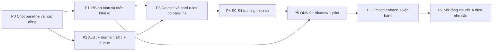

# 04 — Lộ trình kỹ thuật và phân chia công việc

## Cập nhật resource sau pilot — 28/10/2026

Ca tiếp theo dùng **8logicalCPU/16GiB RAM**, CPUQuota800%, MemoryHigh15GiB,
swap0,Nice10; BLAS/OpenMP8,ONNX intra8/inter1 sequential. CPU là50% của16luồng;
16GiB là**52,96% RAM OS-visible** trên máy32GB danh nghĩa, được user chỉ định rõ.
77testsPASS,35readinesschecksPASS, guardprobe0optimizerstep; **không train chính thức
hoặc chạy lại pilot corpus thật**. [Báo cáo resource](../ai-training/reports/RESOURCE_GUARD_20261028.json).

Dataset prepared và pilot-ready giữ nguyên hash; readiness-final cũ cũng được giữ.
Readiness mới`readiness-resource8` gắn source hiện hành và được handoff/script sử dụng.
Các metric/giới hạn2CPU/12GiB ở các snapshot pilot phía dưới là lịch sử. Các attempt
fail/stale/cache/NEXT_COMMANDS cũ đã dọn; giữ raw capture evidence, runtime và venv
cần thiết. Xem ledger06 mục21 cho kiểm tra, danh sách dọn và commit.

**Baseline:** 26/10/2026, commit `37bc4d2ae1552939659a10647898e2228f1b801f`. Đây là backlog đề xuất sau khảo sát, **chưa phải thay đổi code được thực hiện**. Không áp ngày hoàn thành cố định khi chưa có benchmark/data. Tham chiếu finding IDs trong [01](01_SYSTEM_AUDIT_AND_ARCHITECTURE.md), data contract [02](02_DATA_STRATEGY_AND_FEATURE_ENGINEERING.md), training gates [03](03_AI_MODEL_AND_TRAINING_PLAN.md).

## Cập nhật foundation 26/10/2026

Phiên mới đã cho phép và triển khai code trên `codex/foundation-audit-and-schema` (base1925764); đã chia commit theo phần, chưa push, xem ledger06 mục15. R02 canonical v1 đã khóa; phần R13 attribution/proxy, R20 JSONL/reads, R22 normal collection và R24 normalization có code/test. R10–R12 có chế độ OFF, TTL/deadline/freshness và safety protections cơ bản. R00 mới nghiệm thu local và failover mô phỏng; môi trường VM/LAN/AWS thật chưa xác minh. R21 mới là **hai sink DB/file độc lập**, không phải transactional outbox hoặc remote shipping hoàn chỉnh.

Có thể tách hai luồng theo contract đã khóa: A tiếp IPS/Infra/benchmark/reconcile; B dùng normalized_events + v1 schema để xây data manifests/labels/splits/ML feature library. Không sửa v1 tùy ý hoặc coi observation không alert là nhãn benign. R30–R34, model training và release gates vẫn chưa hoàn tất. Chi tiết test và worktree paths ở 06.

Phần lộ trình dưới đây giữ thứ tự/định nghĩa ban đầu; các câu “chỉ tạo tài liệu” là lịch sử, được yêu cầu triển khai của phiên mới thay thế.

## Cập nhật luồng AI 27/10/2026

Nhánh **`feat/ai-model-training`**, base`fbe078d`: package [`ai-training/`](../ai-training/README.md) đã triển khai offline. R24/R32 có adapters/labels/grouped temporal split/Parquet manifests/causal features; P4 có MLP/benign-onlyAE, first-class resume,42tests PASS; phần exportONNX/Pythonreference của P5 PASS960/960mẫu mỗi model trong S0synthetic. **Chưa coi R30–R34/P4/P5 hoàn tất cho dữ liệu thật**: public intake, real lab corpus, review nhãn, rule-only comparison, target-machine long benchmark, Rust port/parity/live shadow vẫn cần làm. Giờ train dữ liệu thật0; [06 mục16](06_AI_HANDOFF_AND_RUN_LEDGER.md#16-ai-data--training-pipeline--27102026) ghi bằng chứng.

Ranh giới user hiện hành: chỉ sửa `ai-training/` +docs, không sửa bất kỳ file Student/Security. Contract v1.0 giữ nguyên; branchname này do user chỉ định, thay ví dụ `codex/…` cho task AI. Không cần chờ thay đổi IPS/Infra để viết/rà soát pipeline offline, nhưng cần data-readiness trước train thật.

## Cập nhật pre-training27/10/2026

LuồngB đã bổ sung boundedlabrunner/observer, read-only snapshot, review/provenance,
readiness/capacity và planfirstpilot dướiAI. R31/R32 đạt phần **offline labpilot**,
không đồng nghĩa coverageđủmọinghiệpvụ, corpusproduction hoặc EVEcapture thật.
Featurev2/148cột vànormalizer2 nằm trongAI; schemaJava/Rust vẫn1.0. Trước train cần
reportREADY_FOR_OFFLINE_PILOT gắn dataset/source; kếhoạch5epoch chưa thực thi.
XemREADMEAI và ledger06 mục18. R30publicdata, R34load, fullrulecomparison,
Rustintegration và nghiệmthu ca dài vẫn là công việc riêng theo gate phụ thuộc;
không sửa luồngA/Student/Security trong task này.

## Cập nhật luồng AI28/10/2026

**Trạng thái28/10/2026:** corpus mới có **19.275 request thật / 80.556 observations**, đủ Student audit + Nginx + Suricata EVE từ PCAP thật trong namespace lab. Split **11.565 / 3.855 / 3.855**, nhóm 9/3/3; mỗi campaign ≥420 giây, hai khoảng nghỉ 620 giây thật. Feature v3 / normalizer3, 148 cột, `edge_masked_v1`; canonical v1.0 giữ nguyên. Readiness **35 checks PASS**, **77 tests PASS / 0 skipped**. MLP/AE/residual đều chạy 2 epoch → tiến trình mới resume đến 5 epoch, exact với reference 5 epoch; ONNX parity toàn bộ prepared rows. Chỉ đánh giá validation; test metric chưa mở. [Report có hash](../ai-training/reports/PRETRAIN_PILOT_20261028.json).

Chưa chạy ca chính thức 2–3 giờ, chọn champion, port Rust hoặc bật AI response. Corpus vẫn là loopback với fixture giả / scripted intent; chưa đại diện production. Query bị mask thống nhất nên metadata AI không thấy nội dung payload. Flow chỉ lấy flow client đã kết thúc ≥65 giây trước đó, không backfill bằng đóng flow tương lai. Live receipt-time/TLS/feature parity và human realism review còn riêng.

R31/R32 và P4 offline có thêm EVE thật, campaign dài, parity/resume trên corpus mới và residual candidate. Chưa hoàn tất R30publicdata, Rustintegration, humanrealism/cloud/receipt-time/thermal gates hoặc productionchampion. Quyền AppArmor do user cấp chỉ để dừngtcpdump; không triển khai IPS, cloud hoặc thay source/config luồngA. Bước tiếp là experiment chính thức bằng script được bàn giao, sau đó review errors/campaign, dữ liệu thực tế và shadow theo gate riêng.

## 1. Mục tiêu và thứ tự phụ thuộc

Mục tiêu là một pilot IDPS có bằng chứng: thu đủ log, phân tích hai lõi không chặn lẫn nhau, phản ứng có giới hạn/khôi phục, model nhẹ được đánh giá trên Student Web thật và hai thành viên tiếp tục công việc được qua `/docs`. “Enterprise-grade” trong lộ trình là tập năng lực kiểm chứng được, không phải nhãn chứng nhận hoặc lời hứa đạt ngay nhờ đổi model.

Có thể làm P1 và P2 song song sau P0; không train mô hình hành vi đầy đủ trước P2/P3 và không bật AI auto-block chỉ vì export ONNX thành công. Việc code ở pha sau được nhóm triển khai trong phiên riêng; phiên hiện tại chỉ tạo tài liệu.

## 2. Hai nhánh sở hữu chính

**Thành viên A** (gợi ý bạn): Rule/Backend/IPS/Dashboard/host. **Thành viên B** (gợi ý người bạn cùng làm): Data/Features/AI/Training. Đây là cách phân vai đề xuất, chưa gán danh tính thật và có thể đổi theo năng lực. Người không implement là reviewer của thay đổi có ảnh hưởng an toàn hoặc schema.

| Vùng sở hữu | A chủ trì | B chủ trì | Hợp đồng cần hai người review |
|---|---|---|---|
| Student backend | Auth/audit instrumentation/trusted proxy/outbox, migrations | Yêu cầu feature, data quality và golden fixtures | Event schema/coverage/redaction/retention |
| Rust security | Collector/inbox, rule state, policy/actuator/API | Inference adapter cùng A ở integration spike | Event/feature/decision version, timeout, queue ownership |
| Frontends | Health/stale status, policy, audit/TTL/model status, lỗi CSRF | Mô tả metrics model và data quality cần hiển thị | Không gắn UI “AI ready” khi chưa có artifact/gate |
| Data & ML package tương lai | Review integration/security | Thu/sinh/nhãn/split, features, trainer, model card/export | Input parity, license, release checklist có bằng chứng |
| Deployment/CI | Host/TLS/secrets, Rust/Java/FE checks | CPU launcher, resource test, training/export smoke | Lock/runtime compatibility, artifact integrity/rollback |
| Docs | 01 và phần code/status 00/04 | 02/03 và ledger training 06 | Mỗi người cập nhật việc của mình, reviewer đối chiếu |

Đã có `contracts/` cho canonicalv1 và `ai-training/` cho Python offline/data/features/trainer/tests/report. Quyết định D08 ở06 chốt layout và scope read-only; golden preprocessing vectors của AI nằm trong package, chưa portRust. Không nhân bản định nghĩa feature trong hai branch rồi merge theo tên gần giống.

## 3. P0 — Baseline, contract và môi trường

| Task | Owner | Kết quả review được | Điều kiện hoàn thành |
|---|---|---|---|
| R00 — Chốt topology lab | A, B review | Sơ đồ host/VM/IP/NIC/ports/TLS và data path | Xác nhận WebVM serve SPA/API ở đâu; prod Spring TLS vs proxy HTTP rõ; không áp config tự động |
| R01 — Baseline checks có kiểm soát | A | Commit/env/commands/results của Java/Rust/frontend, phân biệt DB tests | Runtime/test dependencies sẵn sàng; tests không chạm DB thật; ghi PASS/FAIL/SKIPPED đầy đủ |
| R02 — Contract event/feature/decision v1 | B, A review | JSON Schema/typed spec, missing/time/window/identity/redaction và golden examples | Hai phía thống nhất source availability, idempotency, causal windows; không dùng field chưa thu |
| R03 — Artifact/hardware contract | B | CPU/OS/RAM/SSD benchmark, artifact store path/ACL/hash policy | Xác minh laptop Zenbook thực, không dựa host chat; chốt quota và nơi giữ checkpoint |
| R04 — Doc drift/CI gaps | A | Danh sách lệch README/DOCX/deploy, task hoặc PR sửa docs đúng scope | Không xem `--check` exit0 là nghiệm thu; `.mjs` validation tests có lệnh rõ, không nói đã chạy khi chưa chạy |

R01 là task tương lai; audit hiện tại không chạy bộ test. Root README chỉ AWS, backend README còn schema/audit lỗi thời, DOCX ngày 25/10 có bước deployment legacy. Cập nhật những tài liệu đó thuộc PR code/docs kế tiếp, không bị sửa trong đợt tạo `/docs`.

## 4. P1 — Làm an toàn đường IPS trước auto-enforce

| Task | Finding | Owner | Definition of Done |
|---|---|---|---|
| R10 — Actuator mode/kill switch | SEC-01 | A | OFF/DRY_RUN/MANUAL/ENFORCE có contract; kiểm trước execute, kể cả PENDING/RESTORE; không làm mất audit; operator dừng tác động mới được |
| R11 — TTL và state machine | SEC-02, OPS-02 | A | DB expiry + kernel timeout; expiry hoạt động khi backend tắt; restore bỏ expired/revoked; UNBLOCK ưu tiên, idempotency/generation được test |
| R12 — Freshness/replay gate | SEC-03 | A | Live/replay tách; event cũ/clock skew/quá expiry không tạo tác động; kiểm lại policy khi dequeue |
| R13 — Protected assets và attribution | SEC-05, DATA-02 | A, B review | Trusted proxy chain, independent protected policy ở actuator; spoof headers bị từ chối; NAT/shared IP không bị block tùy tiện |
| R14 — Rule SYN và rule quality | SEC-04 | A | Đổi semantics scan/burst đúng tên, đo positive/negative; rule auto eligible cần precision và scope đã review |
| R15 — Host acceptance/rollback | OPS-05/06 | A | Suricata đúng source rule, nft/helper test lab, đường quản trị sống, backup/restore config; manual install theo guide hiện hành |

**Gate P1:** test replay/stale/protected target/kill switch/TTL khi backend ngừng/revoke-vs-restore đều có evidence. Không mở rộng IP ngoài lab hoặc sửa nftables của máy người dùng trong một phiên chưa có phạm vi triển khai rõ. Giữ manual recovery runbook bên ngoài dashboard.

## 5. P2 — Telemetry đầy đủ và hàng đợi bền vững

| Task | Owner | Thực hiện | Gate |
|---|---|---|---|
| R20 — Audit coverage và privacy | A, B review | Bổ sung successful reads phù hợp, route template, request identity, session/account pseudonym, auth outcome; redaction test | Chứng minh trường nào có/thiếu; không log secret canary hoặc PII body |
| R21 — Student export/ingest | A | Chọn read-only exporter có overlap/dedup cho pilot hoặc outbox/CDC nếu yêu cầu bền chặt; service identity/TLS | Không skip commit đảo ID; ACK sau persist; restart/outage/retention không âm thầm mất dữ liệu |
| R22 — All-event capture | A | Structured Nginx JSON và EVE HTTP/flow cần thiết; giữ benign, giới hạn payload | Không chỉ giữ alert; cap độ dài, schema/quarantine, source lag và rotation đúng |
| R23 — Durable queues | A | Event inbox/outbox, rule/AI/response queue riêng, lease/retry/idempotency/dead-letter; spool bounded | AI outage không kẹt rule/collector; không giữ DB tx suốt inference; full disk/backlog có alarm |
| R24 — Feature library/parity | B, A review | Windows 10s/1m/5m, event-time/late rules, missing masks, bounded cardinality; golden vectors | Offline/online cùng output với Unicode/late/duplicate/missing cases; không nhìn tương lai |
| R25 — Frontend/security data hygiene | A | Xác minh/sửa cache CSRF lifecycle, link activation query token, API error/stale UI | Browser integration cho activation→login→mutation; secret token không vào log/export; per-panel data age rõ |

`audit.log` là **phương án NDJSON cần lựa chọn**, không là đầu vào đã tồn tại. Nếu nhóm chọn giữ DB/outbox làm nguồn chính, vẫn đáp ứng mục tiêu khai thác audit ứng dụng; ghi ADR rõ để AI phiên sau không tạo thêm writer file trùng nguồn. Với successful GET sampling, giữ count đầy đủ và sampling metadata; không dùng sampled rate như count thật cho IPS.

**Gate P2:** replay deterministic, nguồn→inbox→consumer có số đếm đối chiếu; các khoảng mất/thiếu dữ liệu được giải thích; source/queue/worker health có độ tươi. Retention 3 ngày hiện tại không được xóa dữ liệu chưa được downstream giữ theo policy mới.

## 6. P3 — Tạo corpus đúng ứng dụng và rule baseline

| Task | Owner | Đầu ra | Gate |
|---|---|---|---|
| R30 — Public data intake | B | License/provenance/checksum, subset HTTP và flow tách riêng | Không trộn schema giả hoặc dùng mirror không rõ quyền; không tải toàn bộ PCAP nếu không cần |
| R31 — Lab runner/observer | B, A cấp lab contract | Benign đa role/think-time/NAT, attack attempt theo 02; mail sink và DB fixture giả | Allowlist target, rate/duration cap, CSRF đúng; observer labels tách detector |
| R32 — Labels/splits/manifests | B | Intent/outcome/source/quality; time/campaign groups, dedup/embargo, locked test | Unknown giữ nguyên; train/cal/test hash có review; không dùng SID làm nhãn độc lập |
| R33 — Golden corpus rule | A, B cung cấp data | Positive/negative mỗi SID, threshold context, FP review | Rule-only metrics và SYN benign burst; policy version có benchmark |
| R34 — Baseline load | A | RPS/EPS/bytes/lag/DB EXPLAIN và resource report | Chốt SLO/tải pilot dựa số đo; xung đột port5433 được giải quyết nếu co-host |

**Gate P3:** data-readiness mục 9 của 02 đạt, input của từng model branch thực có. Pilot vài nghìn request trước; ngân sách 100k–300k request chỉ là đề xuất thu thập, không là mẫu hiện có hay bảo đảm chất lượng. Không thêm lỗ hổng vào Student Web để “có dữ liệu attack thành công”.

## 7. P4 — Training ngắn, đo theo gate

B chủ trì S0→S4 của 03; A review launcher/feature parity và giúp giữ service lab ổn định. Khởi đầu 1 ca 2h kiểm quota/checkpoint/resume. Sau đó baseline SGD/aggregate trước Byte-CNN/TCN; chọn candidate theo lợi ích tại cùng FPR, không theo mức độ phức tạp.

| Deliverable | Evidence bắt buộc |
|---|---|
| Trainer resume | Model/optimizer/scheduler/RNG/sampler/data hash; continuous-vs-resumed tương đương; crash/disk-full/latest corruption recovery |
| Resource launcher | Cap cả process tree, khoảng nửa CPU, MemoryMax12GiB, measured peak; thermal/độ mượt được kiểm |
| Model experiments | Run/session IDs, commits/config/data/split hash, metrics theo family/campaign, giờ phiên và giờ optimizer tách |
| Champion selection | Rule-only/AI-only/dual comparison, held-out benign/hard negatives, calibration, ablation; reviewer ký decision entry |

**Gate P4:** chưa cần đủ 70h nếu baseline đã tốt; không tiếp tục train chỉ để đủ giờ khi overfit hoặc thiếu data. 60–80h là ngân sách có điều kiện, bản kế hoạch 30 ca/70h ở 03 gồm validation/export. Không tạo metrics, checkpoint URI hay train progress giả khi chưa có artifact.

## 8. P5 — ONNX, shadow và pilot quan sát

A và B cùng review boundary integration; B làm bundle/export/golden vectors, A làm Rust worker/queue/API/UI version-health. Model hash và feature version phải đi cùng từng decision; không ghi “AI online” khi model load lỗi.

Gate gồm ONNX-vs-training parity, preprocessing Rust-vs-Python parity, p95/p99 thực, thread/RAM bounded, inference timeout/worker crash và rollback. Chạy replay không enforcement rồi shadow traffic lab/pilot qua đủ workload: đăng nhập, cập nhật hồ sơ, tìm kiếm, batch quản trị, nhiều user chung NAT và outage test. Độ dài pilot theo số event/session/ngày và confidence coverage, không chốt “vài giờ là đủ”.

Quan sát drift/missing/abstain, false alert theo session/NAT và alert fatigue. Analyst feedback cần review/version trước retrain, không để rule→nhãn→model→auto-label thành vòng tự củng cố. Model mới chỉ được canary sau comparison report; champion cũ luôn có rollback reference.

## 9. P6 — Limited enforce và năng lực vận hành

| Năng lực | Tiêu chí review để gọi pilot sẵn sàng |
|---|---|
| IPS | P1 gates còn PASS trên commit mới; scope/TTL/allowlist/kill switch/budget phản ứng rõ; không block management/NAT thiếu attribution |
| Data health | Producer heartbeat, source lag, ACK/retention, quarantine/parse errors; absence-of-events không mặc định khỏe |
| App security | TLS/secure cookie/trusted proxy thống nhất; quản lý secrets và DB roles; CSRF/RBAC/browser workflows đã nghiệm thu |
| Storage | Retention/archive, dung lượng/tăng trưởng, backup và **restore drill** có hash/kết quả, quyền export raw evidence |
| Reliability | Single-instance giới hạn rõ; restart/dependency outage/replay/spool-full không tạo side effect trùng hoặc block stale |
| Supply chain | Pin locks và runtime, dependency/secret scan, SBOM/provenance theo nhu cầu; không nói CI hiện có đã làm các việc này |
| Model | Model card, license/data provenance, resource+parity reports, release/rollback, drift/retraining policy |
| Team | Owner/reviewer, runbook incident/unblock, tài liệu hiện trạng và ledger khớp commit/artifact |

Limited enforce khởi đầu chỉ rule đã đo đủ chắc; AI anomaly-only tiếp tục alert. Mở quyền AI vào response là một thay đổi policy riêng có evidence/rollback, không phải bước mặc định sau training.

## 10. P7 — Cloud/HA sau khi có nhu cầu và số đo

Chốt mục tiêu AWS/service availability trước: vị trí TLS/sensor, VPC/ALB/WAF, nguồn log, identity/KMS, retention và chi phí. nftables trên lab gateway không ánh xạ thẳng thành chặn IP ở cloud; Security Group, WAF và reverse proxy có semantics/scope khác nhau. Thiết kế adapter response với TTL/idempotency/rollback riêng và kiểm giới hạn API trên nguồn chính thức khi thực sự triển khai.

Chỉ chuyển PostgreSQL queue sang broker chuyên dụng khi backlog/retention/consumer count chứng minh cần; chỉ thêm HA khi shared auth/state, sensor/actuator ownership, partition ordering và failover đã có thiết kế. Không mang cả Kubernetes/Kafka lên laptop training 32GB vì tên “enterprise”.

## 11. Quy ước Git giúp hai người tránh xung đột

1. Nhánh nhỏ theo task (`codex/r10-actuator-mode`, `codex/r32-dataset-splits` là ví dụ tên, chưa được tạo); mỗi PR có trigger/before-after, evidence validation và docs delta. Không commit dataset/log/secret/checkpoint lớn.
2. Contract/schema/golden vectors có owner từng version; PR contract merge trước PR producer/consumer. Thay đổi breaking cần migration/version negotiation, không sửa field cũ âm thầm.
3. A giữ quyền điều phối Flyway/SQLx migration sequence; B đề nghị schema bằng contract PR, không cùng thêm migration trùng số. Không rewrite migration đã chạy ngoài môi trường disposable.
4. B giữ run IDs/model bundle immutable; A chỉ pin artifact version/hash trong deployment. Model mới không ghi đè artifact champion cùng tên.
5. A cập nhật trạng thái code, B cập nhật training ledger ngay trong PR/run tương ứng; 00 chỉ summary, chi tiết thuộc tài liệu chuyên trách. Nếu cùng sửa 00/04/06, cập nhật các row/mục riêng, rebase rồi reviewer đối chiếu.
6. Merge conflict phải dựa final code/data contract; không chọn nguyên một phía trong docs làm mất tiến độ. Sau merge đọc lại 00/06 và kiểm hash/version chain.
7. Các checks thực có hiện tại: student Java/PG tests+frontend lint/build; security Rust fmt/clippy/tests+frontend build+shell syntax. `.mjs` frontend validation, browser E2E, packet/kernel, training resume/export chưa được CI bao phủ đầy đủ; thêm theo từng task có chức năng, không viết test giả chỉ để tăng số lượng.

## 12. Ba công việc nên bắt đầu sau phiên tài liệu

1. **R00/R02/R03:** hai người chốt topology/TLS, nguồn audit và event schema v1, CPU/OS train cùng nơi lưu artifacts. Đây là điều kiện để ước lượng thực tế.
2. **A: R10–R13**, B đồng thời chuẩn bị R30/R31 trên contract lab: đóng đường phản ứng stale/không TTL trong lúc hoàn thiện thu dữ liệu.
3. **R20–R24 và R32–R34:** thu đủ benign/attack attempt, đối chiếu dữ liệu/feature/latency; sau gate mới mở S0 2h và ghi run đầu tiên vào [06](06_AI_HANDOFF_AND_RUN_LEDGER.md).

Không có task chức năng nào ở trên được đánh dấu DONE chỉ vì đã được mô tả. Bằng chứng hoàn thành phải cập nhật vào [00](00_PROJECT_OVERVIEW_AND_PROGRESS.md) và sổ bàn giao 06 khi nhóm thực hiện.
