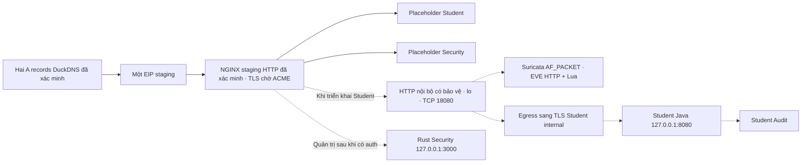

# R46 — AWS web gateway và chuẩn bị Suricata

**R46_AWS_INFRASTRUCTURE = PARTIAL** tại ngày 24/11/2026 giờ Việt Nam. Phiên tiếp tục R46 đã xác minh trực tiếp AWS, NGINX HTTP công khai và Suricata thụ động trên đúng EC2 staging. Phiên CLI đã hợp lệ khi bắt đầu lại. AWS MCP chưa khả dụng. Các cổng nghiệm thu HTTPS public, auto-stop và Cloud Resource Safety Profile còn tách riêng. [Nghiệm thu R45](130_T09_R45_AWS_INFRASTRUCTURE_ACCEPTANCE.md) · [Runbook staging](AWS_STAGING_OPERATIONS_HANDOFF.md)

## Inventory và trạng thái

| Hạng mục | Kết quả R46 và nguồn bằng chứng |
|---|---|
| AWS_IDENTITY, IAM | **Identity PASS, IAM PARTIAL**. Profile `websecurity-staging` trả đúng IAM user `Websecurity` trong account staging. Hai quyền lifecycle của operator trả `DryRunOperation` trên đúng ID. Quyền đọc/invoke cho auto-stop bị từ chối. |
| EC2, EBS, VPC_NETWORK, ELASTIC_IP, SECURITY_GROUP | **PASS**. Ba status checks EC2, system và EBS đạt `ok` trước khi dừng. Đọc API xác nhận `m7i-flex.large`, AMI Canonical Ubuntu 26.04 amd64, 2 vCPU và IMDSv2 Required. Root gp3 40 GiB mã hóa, 3.000 IOPS, 125 MiB/s, EIP gắn đúng instance, SG chỉ có TCP 80/443. SSM xác nhận guest Ubuntu 26.04.1 LTS, kernel `7.0.0-1018-aws`, default route qua `enp39s0`, DNS và HTTPS outbound tới CA trả 200. SSH port 22 chỉ có listener guest của hệ điều hành. Security group không có ingress 22. |
| SSM | **PASS**. Từ `notconnected` khi instance dừng sang `connected` lúc 10:26:39 ngày 24/11. Session Manager plugin `1.2.896.0` đã xác minh chữ ký AWS và thực thi shell guest bằng `sudo -n`. [Xác minh chữ ký plugin AWS](https://docs.aws.amazon.com/systems-manager/latest/userguide/install-plugin-linux-verify-signature.html) |
| DNS_STUDENT, DNS_SECURITY | **PASS**. Hai tên DuckDNS trả đúng một A record tới EIP staging và không có đáp án AAAA trên hai resolver ngày 24/11. Public HTTP kết nối tới đúng EIP đã đối chiếu bằng AWS. |
| NGINX_INSTALL, NGINX_CONFIGURATION, VIRTUAL_HOST_ROUTING | **PASS trên EC2**. Ubuntu package `1.28.3-2ubuntu1.14`. `nginx -t`, service active/enabled và SHA file khớp artifact R46. Hai hostname trả 200 và nội dung đúng, HTTP-01 trả 200 cả hai tên, IP trực tiếp trả 421. |
| REVERSE_PROXY_READINESS, REVERSE_PROXY_APPLICATION | **READY cho topology thử nghiệm**, **PENDING cho ứng dụng**. NGINX tạm trên EC2 chuyển HTTP nội bộ tới backend tổng hợp và ghi đè request ID của client. Gateway public vẫn phục vụ placeholder. |
| HTTPS_STUDENT, HTTPS_SECURITY, HTTP_REDIRECT, TLS_CERTIFICATE, TLS_RENEWAL | **BLOCKED**. HTTP-01 qua public đã đạt. Certbot `4.0.0-4` và plugin NGINX `4.0.0-3` đã cài. `certbot.timer` đã enabled, active, `Persistent=true`. Chưa có ACME production account tại guest nên đang chờ người vận hành đăng ký và tự chấp nhận điều khoản. Chưa bật redirect hay TLS mẫu trên EC2. |
| SURICATA_INSTALL, SURICATA_VERSION_COMPATIBILITY, SURICATA_LUA, SURICATA_CONFIG | **PASS trên EC2**. Ubuntu Suricata `1:8.0.3-1` khớp Local Beta. AF_PACKET và HAVE_LUA được xác nhận. `-T --disable-detection` nạp đúng profile và Lua đã đối chiếu SHA. |
| SURICATA_CAPTURE_READINESS, SURICATA_RESOURCE_USAGE | **PASS trên EC2 cho smoke**. Một GET trên loopback sinh đúng một EVE HTTP và một dòng Lua. Scope TCP, `flow_id`, `tx_id`, trusted request ID và generation khớp. File mode 0600, 556 byte evidence. Cgroup `cpu.max=100000 100000`, RAM cap 768 MiB, swap 0, PIDs 128. CPU dùng 105.711 μs, 0 lần throttle, cgroup memory peak 21.540.864 byte, VmHWM 301.108 KiB. Unit thử, worker và listener fixture đã dừng. Package service inactive/disabled. |
| LAMBDA, SCHEDULER, SCHEDULER_INVOKE, AUTO_STOP_DRY_RUN, AUTO_STOP_REAL_TEST, AUTO_STOP_8H | **BLOCKED**. Profile có identity hợp lệ nhưng Lambda GetFunction, GetFunctionConfiguration, GetPolicy, Invoke DryRun và Scheduler GetSchedule đều trả AccessDenied cho resource staging. Role Lambda bị từ chối GetRole, GetRolePolicy, ListRolePolicies và ListAttachedRolePolicies. Bốn bucket lúc 09:34, 09:49, 10:04, 10:19 cùng có 1 Lambda invocation và 1 attempt group `default`. Group metrics chưa quy được tới riêng schedule. R46 chưa đổi ngưỡng hay tự động dừng. Xem [quyền tối thiểu](AWS_STAGING_OPERATIONS_HANDOFF.md#9-quyền-nghiệm-thu-auto-stop-r46). |
| BILLING, MONTHLY_BUDGET | **PASS cho API đọc**. Free/Active và 139,844072 USD credit còn lại tại lần đọc trước Start. Budget 25 USD/tháng, actual hiển thị 0,01 USD. Dữ liệu billing có độ trễ. Hạn plan 18/04/2027, điều kiện của từng credit vẫn chưa đọc lại. |
| RESOURCE_SAFETY_PROFILE, AI_SCORER_READY | **BLOCKED**. Guest Intel Xeon Platinum 8488C dưới KVM, cgroup v2 có cpu/memory/pids và PSI. Hwmon chỉ thấy driver `nvme`, không có mapping nhiệt CPU package/core `coretemp`. Kernel cgroup đã qua smoke sensor, chưa có cloud profile riêng được duyệt cho scorer. |
| AI_IDPS_DEPLOYMENT | **PENDING**. Student Web/Audit, Security Web/Rust Hybrid, PostgreSQL, R37 và capture ứng dụng thực chưa triển khai trong R46. |

**EC2_FINAL_STATE = STOPPED.** LaunchTime 10:26:23, yêu cầu Stop 10:39:24, AWS xác nhận stopped 10:39:45 giờ Việt Nam ngày 24/11. Khoảng LaunchTime → yêu cầu Stop là 13 phút 1 giây, ước tính 0,0260 USD compute trước credit/thuế theo giá R45. Trước khi dừng đã xác minh guest rảnh, sensor/fixture đã sạch và SSM báo 0 active session. Sau khi dừng, API đọc lại đúng EIP và EBS gắn staging. Đây là Stop thủ công, không dùng làm bằng chứng Auto-Stop.

## Gateway và topology đã xác minh

- Bản Local Beta dùng NGINX/njs để cấp trusted request ID ở TLS edge. Capture đúng leg `127.77.0.1 → 127.77.0.2:18080` và chiều trả về trên `lo`. Egress chuyển sang TLS có xác minh origin tới `127.0.0.3:443` dùng tên `student.internal`. Student Java dùng `127.0.0.1:8080`, frontend tĩnh ở origin. Rust Security dùng `127.0.0.1:3000`, listener quản trị Local qua `127.0.0.1:9443`. PostgreSQL của profile dùng loopback `5432` và role riêng. [Profile Local](../security-web/deploy/local-r39/beta_profile.py) · [Cấu hình cài Local](../security-web/deploy/local-r39/manage.py) · [Egress proof](../security-web/scripts/prepare-proof-egress.py)
- Test sensor dùng đúng BPF hai chiều của leg TCP, một request tổng hợp, nhật ký mới và chỉ bật HTTP EVE cùng Lua. EVE giữ dữ liệu transaction, Lua đọc danh sách header cho phép. Không bật `dump-all-headers` để tìm `X-Request-ID`. Probe khớp request ID và flow/tx, còn production cần ownership, HMAC/receipt/generation, Student Audit và cutoff 1.000 ms với guard 1 ms. NIC public mang HTTPS mã hóa. Đo interface trên EC2 trước khi áp dụng capture profile. [Capture renderer](../security-web/scripts/prepare-suricata-post-proxy.py) · [Lua](../security-web/config/suricata/transaction-evidence.lua) · [EVE HTTP](https://docs.suricata.io/en/suricata-8.0.5/output/eve/eve-json-output.html)
- R37 URI100 nhận projection qua Unix socket, R36 là slot rollback. Rust đối soát evidence và Hybrid post-observation. C2 đóng và AI auto-ban OFF. Các test R42 vẫn mô tả Local Beta. [R42](126_T09_R42_FINAL_LOCAL_HANDOFF.md) · [Model registry](../ai-training/contracts/quality-freeze-r37/slots.json)

## Bằng chứng chạy live

- Setup qua SSM giữ backup riêng của `/etc/nginx` dưới `/var/backups/websentinel-r46.*` và lưu symlink mặc định. File hoạt động `/etc/nginx/conf.d/websentinel-staging.conf` được kiểm `nginx -t` và reload. SHA-256 mẫu HTTP đã đọc lại là `45d82a9e6ee08f42340dff7f2237f8ecb7b617dd76a6abb5e4597b1e0d06e021`.
- Probe ngoài EC2 kiểm cả hai nội dung placeholder, hai URL HTTP-01 và IP mặc định. File probe đã được gỡ sau lượt kiểm. Root FS dùng 2.444.636.160 byte, 7%, RAM available 7.238 MiB sau cài và probe. Cgroup NGINX báo MemoryPeak 6.602.752 byte và CPUUsageNSec 30.185.000 cho thời điểm đo sau các GET. Log NGINX package có rotation hằng ngày, giữ 14 bản.
- Sensor chạy trên `lo` với filter hai chiều đúng leg `127.77.0.1 ↔ 127.77.0.2:18080`. Startup, đọc kernel limit, file permissions và cleanup đã kiểm. Bộ đo một request không đại diện tải production. Profile và Lua có SHA-256 tương ứng `3c7372f5434f48ee959ac26ac98cc1aa85f86c27ac38b62b7c993b412e158b29` và `17e50f1b86154f24322da1ef976eb2810b8609b7be9da3b1eea3446831bfc6a6`.

## Trình tự nghiệm thu tiếp theo

1. Sau khi có cửa sổ tiếp theo, đọc lại identity, instance và session theo [runbook](AWS_STAGING_OPERATIONS_HANDOFF.md#2-vận-hành-ec2). Kiểm NGINX HTTP, xác nhận ACME account trên guest rồi chuyển sang bước cấp chứng thư.
2. Dùng gateway HTTP đã cài. Kiểm lại HTTP-01 trước khi cấp một cert có hai SAN. Nếu cần đăng ký tài khoản ACME, người vận hành nhập thông tin và xác nhận điều khoản trực tiếp. Dùng template HTTPS sau khi đã xác minh cert, giữ HTTP-01 và cấu hình renewal. [Runbook NGINX và TLS](AWS_STAGING_OPERATIONS_HANDOFF.md#7-nginx-và-https-r46)
3. Giữ mẫu sensor đã PASS và duy trì package inactive/disabled. Khi triển khai leg ứng dụng thật, kiểm lại scope, quota và log tăng trưởng trước khi bật thu dài hạn. [Runbook Suricata](AWS_STAGING_OPERATIONS_HANDOFF.md#8-suricata-r46)
4. Tách quyền đọc Lambda/Scheduler với quyền thử nghiệm. Khi có quyền, kiểm deployed SHA, env, Instance ID/tag guard, trust, quyền stop đúng instance và association giữa một tick Scheduler với request Lambda. Chỉ thử stop ngưỡng 1–2 phút sau khi hoàn tất thay đổi R46, người dùng xác nhận cửa sổ bảo trì và guest rảnh. Khôi phục và đọc lại `MAX_SESSION_MINUTES=480`, `DRY_RUN=false`, `rate(15 minutes)`, `ENABLED`, flexible window `OFF` sau nghiệm thu. [Quyền tối thiểu và kiểm thử](AWS_STAGING_OPERATIONS_HANDOFF.md#9-quyền-nghiệm-thu-auto-stop-r46)
5. Trước rollout AI, chốt profile cloud được duyệt với identity binding, cgroup limits/readback, watchdog, launch admission, RAM/swap/PIDs, pressure/oom, disk và ABSTAIN/fallback. Điểm đầu để đo là slice tối đa 150% CPU và 6 GiB RAM, scorer 50% CPU và 512 MiB RAM với swap 0. Giữ headroom cho hệ điều hành. Các giá trị này là proposal R44 dành cho pilot, cần đo lại trên đúng host và xét đủ tải Java/Rust/NGINX/Suricata. Không chạy scorer nếu thiếu safety gate.

## Chi phí, dữ liệu công khai và bằng chứng

Giữ mục tiêu 100 giờ/tháng. EBS và EIP khoảng 7,56 USD/tháng khi EC2 dừng, compute niêm yết 0,1197 USD/giờ theo R45. Với 100 giờ, dự toán gross R45 là 21,38 USD trước thuế và credit. Bắt đầu với NGINX log cục bộ xoay hằng ngày và 7 bản giữ, EVE smoke dùng thư mục tạm mode 0700, dừng sensor khi xong. Khi bật sensor dài hạn, đo ingest hằng ngày, đặt quota/rotation và cảnh báo disk trước khi bật export CloudWatch. HTTP-01 không cần DuckDNS token. [Dự toán R45](130_T09_R45_AWS_INFRASTRUCTURE_ACCEPTANCE.md#billing-và-ngưỡng-chi-phí)

Ảnh bàn giao có token DuckDNS hiển thị. R46 không sử dụng hay lưu token. Nên thay token trong DuckDNS và cập nhật những client đang dùng token cũ. Các tài liệu R45 được kiểm tra mẫu credential và giữ làm mốc lịch sử. Runbook đang dùng đã chuyển các ID AWS nội bộ sang biến. Không lưu ảnh, khóa TLS, khóa IAM, SSM session data hoặc raw guest logs trong Git.

| Kết luận | Trạng thái |
|---|---|
| INFRASTRUCTURE_READY | PARTIAL |
| WEB_GATEWAY_READY | EC2_HTTP_PASS / HTTPS_BLOCKED |
| SURICATA_READY | EC2_SMOKE_PASS |
| AUTO_STOP_READY | BLOCKED |
| AI_SCORER_READY | BLOCKED |
| APPLICATION_DEPLOYMENT_READY | PENDING |

Git dùng worktree R45 hiện có ở detached HEAD và đích `feature/ai-idps-https-ml-integration`. Ba commit R45 đã nằm trong nhánh đích từ lượt bàn giao trước. Không cần merge nhánh Codex cũ. [Mẫu gateway và sensor](../security-web/deploy/aws-r46/) · [Chỉ mục dự án](PROJECT_INDEX.md)
