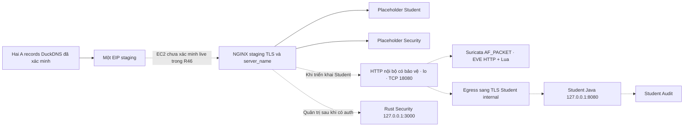

# R46 — AWS web gateway và chuẩn bị Suricata

**R46_AWS_INFRASTRUCTURE = PARTIAL** tại ngày 24/11/2026 giờ Việt Nam. Hai tên miền đã phân giải đúng. Mẫu gateway và đường capture thụ động đã qua kiểm thử cô lập trên Ubuntu. AWS CLI `2.42.1` trả `Your session has expired` cho profile `websecurity-staging` và AWS MCP không khả dụng trong phiên. Do đó các phép nghiệm thu trong guest EC2, HTTPS public, auto-stop và Cloud Resource Safety Profile vẫn có blocker. [Nghiệm thu R45](130_T09_R45_AWS_INFRASTRUCTURE_ACCEPTANCE.md) · [Runbook staging](AWS_STAGING_OPERATIONS_HANDOFF.md)

## Inventory và trạng thái

| Hạng mục | Kết quả R46 và nguồn bằng chứng |
|---|---|
| AWS_IDENTITY, IAM | **BLOCKED** ở R46. Phiên CLI hết hạn tại `sts get-caller-identity`. R45 đã xác minh IAM user `Websecurity` và hai thao tác lifecycle với `DryRun`. |
| EC2, EBS, VPC_NETWORK, ELASTIC_IP, SECURITY_GROUP | **Đã xác minh ở R45, chưa đọc lại ở R46**. Một EC2 `m7i-flex.large` 2 vCPU/8 GiB x86-64 ở Singapore AZ `ap-southeast-1a`, AMI Canonical Ubuntu 26.04 amd64. Ubuntu 26.04.1 là thông tin bàn giao, chưa đọc `/etc/os-release` trong guest ở R46. Root gp3 40 GiB mã hóa, 3.000 IOPS, 125 MiB/s. VPC/subnet có route IGW, một EIP gắn ENI staging, SG cho 80/443 ở R45, IMDSv2 Required, instance profile staging có trust EC2. Xem [inventory và quyền của R45](130_T09_R45_AWS_INFRASTRUCTURE_ACCEPTANCE.md#infrastructure-inventory). |
| SSM | **BLOCKED** ở R46. R45 có session thành công. Session Manager plugin Local `1.2.896.0` đã giải nén tạm sau khi xác minh chữ ký và fingerprint AWS. Chưa mở phiên guest R46. [Xác minh chữ ký plugin AWS](https://docs.aws.amazon.com/systems-manager/latest/userguide/install-plugin-linux-verify-signature.html) |
| DNS_STUDENT, DNS_SECURITY | **PASS**. `student-dut.duckdns.org` và `websentinal.duckdns.org` đều có một A record trỏ cùng IPv4 staging trong bàn giao, TTL 60 giây. Local resolver và `1.1.1.1` đều trả `NOERROR`, không có đáp án AAAA. Không đổi DuckDNS hoặc tạo Route 53. Kiểm egress/EIP và SG hiện hành đợi AWS identity. |
| NGINX_INSTALL, NGINX_CONFIGURATION, VIRTUAL_HOST_ROUTING | **BLOCKED trên EC2**. **PASS local** trên gói Ubuntu NGINX `1.28.3-2ubuntu1.14` được giải nén trong thư mục tạm. Hai host có nội dung riêng, đường HTTP-01 đọc được file probe, IP/default host trả 421. `nginx -t` đạt cho cả hai mẫu. |
| REVERSE_PROXY_READINESS, REVERSE_PROXY_APPLICATION | **READY cho topology thử nghiệm**, **PENDING cho ứng dụng**. Một proxy NGINX tạm đã chuyển HTTP nội bộ tới backend tổng hợp và ghi đè request ID do client gửi. Mẫu gateway public chỉ có placeholder và không trỏ tới upstream chưa tồn tại. |
| HTTPS_STUDENT, HTTPS_SECURITY, HTTP_REDIRECT, TLS_CERTIFICATE, TLS_RENEWAL | **BLOCKED trên EC2**. Probe từ ngoài tới cả hai host trên 80/443 timeout khi connect. Không suy ra state EC2 từ kết quả này. Local fixture xác minh hai SAN, SNI, redirect 308 và từ chối SNI lạ/cross-host bằng chứng thư thử nghiệm được tin cậy tường minh. Chưa cấp chứng thư Let's Encrypt hay thử renewal. |
| SURICATA_INSTALL, SURICATA_VERSION_COMPATIBILITY, SURICATA_LUA, SURICATA_CONFIG | **BLOCKED trên EC2**, **PASS local** cho gói Ubuntu `1:8.0.3-1` trùng bản Local Beta. Build có `AF_PACKET` và `HAVE_LUA`, test cấu hình `-T --disable-detection` nạp đúng Lua. |
| SURICATA_CAPTURE_READINESS, SURICATA_RESOURCE_USAGE | **PASS local smoke**, **BLOCKED trên EC2**. Một GET lành tính tạo đúng một EVE HTTP và một dòng Lua cùng `flow_id`, `tx_id`, request ID và generation trên loopback leg. Cả hai file có mode 0600. Đo sensor trong mẫu ngắn: peak RSS 301.472 KiB, CPU 0,08 giây, 560 byte evidence. Không dùng các số này cho sizing production. |
| LAMBDA, SCHEDULER, SCHEDULER_INVOKE, AUTO_STOP_DRY_RUN, AUTO_STOP_REAL_TEST, AUTO_STOP_8H | **BLOCKED**. Chưa đọc lại code, target, roles và env do AWS auth. R45 từng thấy `AccessDenied` riêng cho các API đọc/invoke. Chưa có stop thực tế, chưa có cửa sổ bảo trì được xác nhận và chưa đổi ngưỡng. |
| BILLING, MONTHLY_BUDGET | **Chưa đọc lại ở R46**. Mốc R45 là Free/Active, 139,999863 USD credit, plan hết hạn 18/04/2027. Budget 25 USD/tháng, không có action. Không có bằng chứng credit 35 USD được cấp lại hàng tháng. |
| RESOURCE_SAFETY_PROFILE, AI_SCORER_READY | **BLOCKED**. Chính sách hiện hành đòi mapping `coretemp` vật lý với đúng CPU đã duyệt. EC2 status checks, cgroup và CloudWatch giúp đo vận hành, không cung cấp nhiệt CPU vật lý cho guardian. |
| AI_IDPS_DEPLOYMENT | **PENDING**. Student Web/Audit, Security Web/Rust Hybrid, PostgreSQL, R37 và capture ứng dụng thực chưa triển khai trong R46. |

Không có lần Start/Stop do R46 thực hiện. **Running time do R46 phát sinh là 0 phút, chi phí compute tăng thêm do R46 là 0 USD.** Trạng thái EC2 cuối ở R46 chưa đọc được. State `stopped` là lần đọc R45. EBS và EIP vẫn có thể tính phí theo cấu hình đã giữ ở R45.

## Gateway và topology đã xác minh

- Bản Local Beta dùng NGINX/njs để cấp trusted request ID ở TLS edge. Capture đúng leg `127.77.0.1 → 127.77.0.2:18080` và chiều trả về trên `lo`. Egress chuyển sang TLS có xác minh origin tới `127.0.0.3:443` dùng tên `student.internal`. Student Java dùng `127.0.0.1:8080`, frontend tĩnh ở origin. Rust Security dùng `127.0.0.1:3000`, listener quản trị Local qua `127.0.0.1:9443`. PostgreSQL của profile dùng loopback `5432` và role riêng. [Profile Local](../security-web/deploy/local-r39/beta_profile.py) · [Cấu hình cài Local](../security-web/deploy/local-r39/manage.py) · [Egress proof](../security-web/scripts/prepare-proof-egress.py)
- Test sensor dùng đúng BPF hai chiều của leg TCP, một request tổng hợp, nhật ký mới và chỉ bật HTTP EVE cùng Lua. EVE giữ dữ liệu transaction, Lua đọc danh sách header cho phép. Không bật `dump-all-headers` để tìm `X-Request-ID`. Probe khớp request ID và flow/tx, còn production cần ownership, HMAC/receipt/generation, Student Audit và cutoff 1.000 ms với guard 1 ms. NIC public mang HTTPS mã hóa. Đo interface trên EC2 trước khi áp dụng capture profile. [Capture renderer](../security-web/scripts/prepare-suricata-post-proxy.py) · [Lua](../security-web/config/suricata/transaction-evidence.lua) · [EVE HTTP](https://docs.suricata.io/en/suricata-8.0.5/output/eve/eve-json-output.html)
- R37 URI100 nhận projection qua Unix socket, R36 là slot rollback. Rust đối soát evidence và Hybrid post-observation. C2 đóng và AI auto-ban OFF. Các test R42 vẫn mô tả Local Beta. [R42](126_T09_R42_FINAL_LOCAL_HANDOFF.md) · [Model registry](../ai-training/contracts/quality-freeze-r37/slots.json)

## Trình tự nghiệm thu tiếp theo

1. Làm mới đúng profile AWS và đối chiếu ARN với account staging. Đọc state, EIP association, EBS/IMDSv2, security group, session và Start/Stop DryRun trước một lần Start có kiểm soát nếu cần. Qua SSM đọc `/etc/os-release`, interface/routes, cgroup, PSI/OOM, disk, packages và listeners. Dùng [runbook](AWS_STAGING_OPERATIONS_HANDOFF.md#2-vận-hành-ec2).
2. Kiểm tra package candidate và cấu hình có sẵn. Cài gateway HTTP; thử hai host và default từ ngoài. Kiểm HTTP-01 trước khi cấp một cert có hai SAN. Nếu cần đăng ký tài khoản ACME, người vận hành nhập thông tin và xác nhận điều khoản trực tiếp. Dùng template HTTPS sau khi đã xác minh cert, giữ HTTP-01 và cấu hình renewal. [Runbook NGINX và TLS](AWS_STAGING_OPERATIONS_HANDOFF.md#7-nginx-và-https-r46)
3. Chạy Suricata passive ngắn trên leg synthetic đã kiểm, thu EVE/permissions/CPU/RAM, dừng sensor sau probe và ghi enable state. Đo log tăng trưởng khi có workload thật trước khi bật thu dài hạn. [Runbook Suricata](AWS_STAGING_OPERATIONS_HANDOFF.md#8-suricata-r46)
4. Tách quyền đọc Lambda/Scheduler với quyền thử nghiệm. Khi có quyền, kiểm deployed SHA, env, Instance ID/tag guard, trust, quyền stop đúng instance và association giữa một tick Scheduler với request Lambda. Chỉ thử stop ngưỡng 1–2 phút sau khi hoàn tất thay đổi R46, người dùng xác nhận cửa sổ bảo trì và guest rảnh. Khôi phục và đọc lại `MAX_SESSION_MINUTES=480`, `DRY_RUN=false`, `rate(15 minutes)`, `ENABLED`, flexible window `OFF` sau nghiệm thu. [Quyền tối thiểu và kiểm thử](AWS_STAGING_OPERATIONS_HANDOFF.md#9-quyền-nghiệm-thu-auto-stop-r46)
5. Trước rollout AI, chốt profile cloud được duyệt với identity binding, cgroup limits/readback, watchdog, launch admission, RAM/swap/PIDs, pressure/oom, disk và ABSTAIN/fallback. Điểm đầu để đo là slice tối đa 150% CPU và 6 GiB RAM, scorer 50% CPU và 512 MiB RAM với swap 0. Giữ headroom cho hệ điều hành. Các giá trị này là proposal R44 dành cho pilot, cần đo lại trên đúng host và xét đủ tải Java/Rust/NGINX/Suricata. Không chạy scorer nếu thiếu safety gate.

## Chi phí, dữ liệu công khai và bằng chứng

Giữ mục tiêu 100 giờ/tháng. EBS và EIP khoảng 7,56 USD/tháng khi EC2 dừng, compute niêm yết 0,1197 USD/giờ theo R45. Với 100 giờ, dự toán gross R45 là 21,38 USD trước thuế và credit. Bắt đầu với NGINX log cục bộ xoay hằng ngày và 7 bản giữ, EVE smoke dùng thư mục tạm mode 0700, dừng sensor khi xong. Khi bật sensor dài hạn, đo ingest hằng ngày, đặt quota/rotation và cảnh báo disk trước khi bật export CloudWatch. HTTP-01 không cần DuckDNS token. [Dự toán R45](130_T09_R45_AWS_INFRASTRUCTURE_ACCEPTANCE.md#billing-và-ngưỡng-chi-phí)

Ảnh bàn giao có token DuckDNS hiển thị. R46 không sử dụng hay lưu token. Nên thay token trong DuckDNS và cập nhật những client đang dùng token cũ. Các tài liệu R45 được kiểm tra mẫu credential và giữ làm mốc lịch sử. Runbook đang dùng đã chuyển các ID AWS nội bộ sang biến. Không lưu ảnh, khóa TLS, khóa IAM, SSM session data hoặc raw guest logs trong Git.

| Kết luận | Trạng thái |
|---|---|
| INFRASTRUCTURE_READY | PARTIAL |
| WEB_GATEWAY_READY | LOCAL_SMOKE_PASS / EC2_BLOCKED |
| SURICATA_READY | LOCAL_SMOKE_PASS / EC2_BLOCKED |
| AUTO_STOP_READY | BLOCKED |
| AI_SCORER_READY | BLOCKED |
| APPLICATION_DEPLOYMENT_READY | PENDING |

Git dùng worktree R45 hiện có ở detached HEAD và đích `feature/ai-idps-https-ml-integration`. Ba commit R45 đã nằm trong nhánh đích từ lượt bàn giao trước. Không cần merge nhánh Codex cũ. [Mẫu gateway và sensor](../security-web/deploy/aws-r46/) · [Chỉ mục dự án](PROJECT_INDEX.md)
