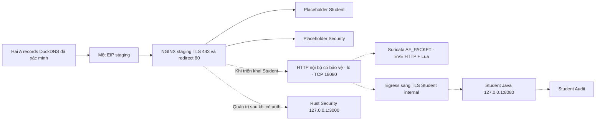

# R46 — AWS web gateway và chuẩn bị Suricata

**R46_AWS_INFRASTRUCTURE = PARTIAL** ngày 24/11/2026 giờ Việt Nam. HTTPS công khai, renewal/deploy hook, IAM audit và Lambda dry-run đã qua kiểm thử trực tiếp. Nghiệm thu Lambda dừng máy thật và xác định nguồn invocation theo schedule là các cổng riêng. Cloud Resource Safety Profile đã chốt thiết kế, còn chờ hiện thực và nghiệm thu trong giai đoạn ứng dụng. [Mốc R45](130_T09_R45_AWS_INFRASTRUCTURE_ACCEPTANCE.md) · [Runbook staging](AWS_STAGING_OPERATIONS_HANDOFF.md)

## Inventory và trạng thái

| Hạng mục | Kết quả R46 và nguồn bằng chứng |
|---|---|
| AWS_IDENTITY, IAM | **PASS cho quyền đã audit**. Profile `websecurity-staging` trả IAM user `Websecurity` trong account staging. Đọc trực tiếp code, cấu hình, trust, inline policy và managed policy của Lambda/Scheduler. Quyền audit CloudTrail và list schedules còn hạn chế. |
| EC2, EBS, VPC_NETWORK, ELASTIC_IP, SECURITY_GROUP | **PASS**. Ba status checks EC2, system và EBS đạt `ok` trước khi dừng. Đọc API xác nhận `m7i-flex.large`, AMI Canonical Ubuntu 26.04 amd64, 2 vCPU và IMDSv2 Required. Root gp3 40 GiB mã hóa, 3.000 IOPS, 125 MiB/s, EIP gắn đúng instance, SG chỉ có TCP 80/443. SSM xác nhận guest Ubuntu 26.04.1 LTS, kernel `7.0.0-1018-aws`, default route qua `enp39s0`, DNS và HTTPS outbound tới CA trả 200. SSH port 22 chỉ có listener guest của hệ điều hành. Security group không có ingress 22. |
| SSM | **PASS**. Từ `notconnected` khi instance dừng sang `connected` lúc 10:26:39 ngày 24/11. Session Manager plugin `1.2.896.0` đã xác minh chữ ký AWS và thực thi shell guest bằng `sudo -n`. [Xác minh chữ ký plugin AWS](https://docs.aws.amazon.com/systems-manager/latest/userguide/install-plugin-linux-verify-signature.html) |
| DNS_STUDENT, DNS_SECURITY | **PASS**. Hai tên DuckDNS trả đúng một A record tới EIP staging và không có đáp án AAAA trên hai resolver ngày 24/11. Public HTTP kết nối tới đúng EIP đã đối chiếu bằng AWS. |
| NGINX_INSTALL, NGINX_CONFIGURATION, VIRTUAL_HOST_ROUTING | **PASS trên EC2**. Ubuntu package `1.28.3-2ubuntu1.14`. `nginx -t`, service active/enabled và SHA file khớp artifact R46. Hai hostname trả 200 và nội dung đúng, HTTP-01 trả 200 cả hai tên, IP trực tiếp trả 421. |
| REVERSE_PROXY_READINESS, REVERSE_PROXY_APPLICATION | **READY cho topology thử nghiệm**, **PENDING cho ứng dụng**. NGINX tạm trên EC2 chuyển HTTP nội bộ tới backend tổng hợp và ghi đè request ID của client. Gateway public vẫn phục vụ placeholder. |
| HTTPS_STUDENT, HTTPS_SECURITY, HTTP_REDIRECT, TLS_CERTIFICATE, TLS_RENEWAL | **PASS trên EC2**. Hai URL HTTPS trả 200 với đúng placeholder. Public trust xác minh cả hai SAN trên cùng chứng thư Let’s Encrypt, TLS 1.2 và 1.3 đều đạt. HTTP 308 đúng hostname, HTTP-01 vẫn 200. `certbot renew --dry-run --run-deploy-hooks` đạt, hook reload NGINX thành công, leaf production giữ nguyên. |
| SURICATA_INSTALL, SURICATA_VERSION_COMPATIBILITY, SURICATA_LUA, SURICATA_CONFIG | **PASS trên EC2**. Ubuntu Suricata `1:8.0.3-1` khớp Local Beta. AF_PACKET và HAVE_LUA được xác nhận. `-T --disable-detection` nạp đúng profile và Lua đã đối chiếu SHA. |
| SURICATA_CAPTURE_READINESS, SURICATA_RESOURCE_USAGE | **PASS trên EC2 cho smoke**. Một GET trên loopback sinh đúng một EVE HTTP và một dòng Lua. Scope TCP, `flow_id`, `tx_id`, trusted request ID và generation khớp. File mode 0600, 556 byte evidence. Cgroup `cpu.max=100000 100000`, RAM cap 768 MiB, swap 0, PIDs 128. CPU dùng 105.711 μs, 0 lần throttle, cgroup memory peak 21.540.864 byte, VmHWM 301.108 KiB. Unit thử, worker và listener fixture đã dừng. Package service inactive/disabled. |
| LAMBDA, SCHEDULER, SCHEDULER_INVOKE, AUTO_STOP_DRY_RUN, AUTO_STOP_REAL_TEST, AUTO_STOP_8H | **Code và IAM PASS, dry-run PASS**. Scheduler enabled, chu kỳ 15 phút, flexible window OFF. Bằng chứng nhận diện nguồn invoke theo schedule còn thiếu. Trạng thái T01–T08 và cấu hình cuối ở dưới. |
| BILLING, MONTHLY_BUDGET | **PASS cho API đọc**. AWS Budget 25 USD/tháng, reported actual 0,156 USD ở lần đọc. Free plan active, dư credit 139,844072 USD. Billing có độ trễ và không cho biết riêng chi phí lần kiểm TLS. Hạn plan 18/04/2027, không có bằng chứng về khoản 35 USD định kỳ. |
| RESOURCE_SAFETY_PROFILE, AI_SCORER_READY | **Design chốt, runtime chưa triển khai**. Guest có cgroup v2/PSI và chỉ thấy hwmon `nvme`. Cloud physical CPU thermal monitoring là `NOT_APPLICABLE` theo thiết kế đã duyệt. Local Thermal Guardian giữ nguyên gate. AI scorer **BLOCKED** tới khi profile cloud được hiện thực và nghiệm thu. [Thiết kế và acceptance](AWS_STAGING_OPERATIONS_HANDOFF.md#10-cloud-resource-safety-profile) |
| AI_IDPS_DEPLOYMENT | **PENDING**. Student Web/Audit, Security Web/Rust Hybrid, PostgreSQL, R37 và capture ứng dụng thực chưa triển khai trong R46. |

**EC2_FINAL_STATE = STOPPED.** Phiên đầu R46 trước đây có 13 phút 1 giây và compute ước tính 0,0260 USD. Phiên cuối do người vận hành Start lúc 11:32:22. Operator Stop lúc 12:05:14 sau khi xác nhận guest rảnh và 0 phiên SSM active. AWS xác nhận Stopped lúc 12:05:33 giờ Việt Nam ngày 24/11. Toàn phiên cuối từ LaunchTime đến yêu cầu Stop là 32 phút 52 giây, compute ước tính 0,0656 USD. Phần từ lần kiểm đầu tiên của lượt nghiệm thu cuối đến Stop là 11 phút 13 giây, khoảng 0,0224 USD. Giá gross trước credit/thuế theo mốc R45. EIP và EBS vẫn gắn đúng staging sau Stop. Lần Stop này là thao tác operator.

## Gateway và topology đã xác minh

- Bản Local Beta dùng NGINX/njs để cấp trusted request ID ở TLS edge. Capture đúng leg `127.77.0.1 → 127.77.0.2:18080` và chiều trả về trên `lo`. Egress chuyển sang TLS có xác minh origin tới `127.0.0.3:443` dùng tên `student.internal`. Student Java dùng `127.0.0.1:8080`, frontend tĩnh ở origin. Rust Security dùng `127.0.0.1:3000`, listener quản trị Local qua `127.0.0.1:9443`. PostgreSQL của profile dùng loopback `5432` và role riêng. [Profile Local](../security-web/deploy/local-r39/beta_profile.py) · [Cấu hình cài Local](../security-web/deploy/local-r39/manage.py) · [Egress proof](../security-web/scripts/prepare-proof-egress.py)
- Test sensor dùng đúng BPF hai chiều của leg TCP, một request tổng hợp, nhật ký mới và chỉ bật HTTP EVE cùng Lua. EVE giữ dữ liệu transaction, Lua đọc danh sách header cho phép. Không bật `dump-all-headers` để tìm `X-Request-ID`. Probe khớp request ID và flow/tx, còn production cần ownership, HMAC/receipt/generation, Student Audit và cutoff 1.000 ms với guard 1 ms. NIC public mang HTTPS mã hóa. Đo interface trên EC2 trước khi áp dụng capture profile. [Capture renderer](../security-web/scripts/prepare-suricata-post-proxy.py) · [Lua](../security-web/config/suricata/transaction-evidence.lua) · [EVE HTTP](https://docs.suricata.io/en/suricata-8.0.5/output/eve/eve-json-output.html)
- R37 URI100 nhận projection qua Unix socket, R36 là slot rollback. Rust đối soát evidence và Hybrid post-observation. C2 đóng và AI auto-ban OFF. Các test R42 vẫn mô tả Local Beta. [R42](126_T09_R42_FINAL_LOCAL_HANDOFF.md) · [Model registry](../ai-training/contracts/quality-freeze-r37/slots.json)

## Bằng chứng chạy live

- Setup qua SSM giữ backup riêng của `/etc/nginx` dưới `/var/backups/websentinel-r46.*` và lưu symlink mặc định. File hoạt động `/etc/nginx/conf.d/websentinel-staging.conf` được kiểm `nginx -t` và reload. SHA-256 mẫu HTTP đã đọc lại là `45d82a9e6ee08f42340dff7f2237f8ecb7b617dd76a6abb5e4597b1e0d06e021`.
- Probe ngoài EC2 kiểm cả hai nội dung placeholder, hai URL HTTP-01 và IP mặc định. File probe đã được gỡ sau lượt kiểm. Root FS dùng 2.444.636.160 byte, 7%, RAM available 7.238 MiB sau cài và probe. Cgroup NGINX báo MemoryPeak 6.602.752 byte và CPUUsageNSec 30.185.000 cho thời điểm đo sau các GET. Log NGINX package có rotation hằng ngày, giữ 14 bản.
- Sensor chạy trên `lo` với filter hai chiều đúng leg `127.77.0.1 ↔ 127.77.0.2:18080`. Startup, đọc kernel limit, file permissions và cleanup đã kiểm. Bộ đo một request không đại diện tải production. Profile và Lua có SHA-256 tương ứng `3c7372f5434f48ee959ac26ac98cc1aa85f86c27ac38b62b7c993b412e158b29` và `17e50f1b86154f24322da1ef976eb2810b8609b7be9da3b1eea3446831bfc6a6`.

## HTTPS public và renewal

Chứng thư Let’s Encrypt issuer **YE2** có hai SAN `student-dut.duckdns.org` và `websentinal.duckdns.org`. Còn hạn tới **10:57:30 ngày 22/02/2027 giờ Việt Nam** (`03:57:30 UTC`). Dùng webroot HTTP-01 đã xác minh là `/var/lib/websentinel/acme`. Cấu hình đọc `fullchain.pem` và `privkey.pem` trong lineage `/etc/letsencrypt/live/websentinel-staging/`. Private key có quyền `root:600`. Fingerprint SHA-256 của leaf từ cả hai hostname là `8b6b52448f8c8ddedd7b9eda53876709ea52657acbf20d9dffd531dec386534b`.

Từ ngoài EC2, `curl` và `openssl s_client` xác minh hostname, chain và SNI. Mỗi hostname trả đúng body, HTTPS 200, redirect HTTP 308 và HTTP-01 200. Default host/IP trực tiếp và mismatch HTTP Host/SNI trả 421. SNI lạ hoặc thiếu SNI nhận TLS alert `unrecognized_name`. Đã xác minh TLS 1.2 và 1.3 trên mỗi hostname. SHA-256 cấu hình HTTPS trên guest là `22e4c12faaff75f2d012804dad5252b06fff460f95167dd38bc6da9d0b7af349`. Giữ backup HTTP dưới `/var/backups/websentinel-r46-tls.*`. Lần stage đầu dừng trước reload do lệnh `install /dev/stdin` thất bại. Đã tái sử dụng chứng thư vừa cấp và ghi mẫu vào file tạm đã đối chiếu SHA trước khi thay cấu hình.

`certbot.timer` enabled, active và `Persistent=yes`. `certbot renew --cert-name websentinel-staging --dry-run --run-deploy-hooks` mô phỏng gia hạn thành công. Journal xác nhận hook reload NGINX. Leaf production giữ nguyên sau dry-run. Hook root mode 0750 trong `/etc/letsencrypt/renewal-hooks/deploy/websentinel-staging-nginx` chạy riêng cho lineage staging. Probe file HTTP-01 đã gỡ. Root FS dùng 2.445.594.624 byte, 7%, và RAM available 7.278 MiB ở lần đọc cuối. Suricata package vẫn inactive/disabled. [Runbook TLS và rollback](AWS_STAGING_OPERATIONS_HANDOFF.md#7-nginx-và-https-r46)

## Auto-Stop và bằng chứng thực thi

Đọc package Lambda đang deploy và kiểm SHA Base64 `eEJLTRjf/xqAXiH4D9QyXhrSWExiP7dxV5xj6zJHRdI=`. Python 3.13, handler `lambda_function.lambda_handler`, 128 MiB. Mã chỉ gọi DescribeInstances và StopInstances ở Singapore. Cố định instance ID staging, kiểm running và Project tag, lấy thời gian từ LaunchTime. IAM xác nhận StopInstances giới hạn đúng instance và tag `Project=WebSentinel`, DescribeInstances giới hạn region. Trust đúng service principal của hai role. Scheduler invoke chỉ tới đúng Lambda và các alias/version của function, giữ `rate(15 minutes)`, `ENABLED`, flexible window `OFF`. Trust Scheduler role pin SourceAccount. Giới hạn SourceArn theo nhóm là điểm hardening có thể xem xét riêng. Không thay IAM, code Lambda hay Scheduler trong R46.

Đã bỏ ký tự tab trong `MAX_SESSION_MINUTES`, giữ các biến env, dùng RevisionId cho update và readback. Nâng timeout từ 3 lên 15 giây để có ngân sách cho hai lần gọi API và cold start. Các lượt đọc dưới 1 giây chỉ chứng minh hoạt động với cấu hình mới. Package đã qua năm nhánh thử offline bằng fake EC2 client, gồm sai Project tag và Stop đúng target. Cấu hình và backup gốc giữ ngoài Git.

| Test | Kết quả và phạm vi |
|---|---|
| T01 EC2 stopped | **PASS live**, sau Stop thủ công, invoke Lambda trả `SKIPPED` và `instance_state=stopped`. Handler 93,89 ms. |
| T02 running dưới ngưỡng | **PASS live**, operator invoke trả `RUNNING` ở 27,06 phút với ngưỡng 480, handler 436,46 ms. |
| T03 quá ngưỡng dry-run | **PASS live**, operator invoke trả `WOULD_STOP` ở 27,17 phút với ngưỡng tạm một phút, handler 374,83 ms. `DRY_RUN` giữ true. |
| T04 Lambda gửi Stop | **BLOCKED**. Chưa nhận xác nhận cửa sổ bảo trì. Nhánh offline đã kiểm đúng ID, chưa chạy Stop thật qua Lambda. |
| T05 EC2 stopping → stopped do Lambda | **BLOCKED theo Lambda**. State `running → stopping → stopped` đã quan sát khi operator thực hiện Stop. |
| T06 invocation từ đúng Scheduler | **BLOCKED về bằng chứng nguồn**. GetSchedule/target/role và invocation định kỳ đã thấy. Target không có context payload và handler không log nguồn. CloudWatch hiện chỉ có INIT/START/END/REPORT. Quyền đọc CloudTrail bị từ chối. Group metric không đủ nhận diện riêng schedule. |
| T07 EIP và EBS sau stop | **PASS cho Stop thủ công**. EIP liên kết đúng instance, gp3 40 GiB mã hóa vẫn gắn. Cần đối chiếu lại sau lần Lambda Stop. |
| T08 readback | **PASS cho rollback an toàn**. Đã đọc lại `MAX_SESSION_MINUTES=480`, `DRY_RUN=true`, timeout 15 giây, Scheduler `ENABLED / rate(15 minutes) / OFF`. Gate kích hoạt 8 giờ **BLOCKED**. |

Nếu không có bản ghi Lambda Invoke của CloudTrail đang tồn tại để truy nguồn trực tiếp, phương án tối thiểu là thêm schedule ARN, scheduled time và execution ID vào Scheduler payload, rồi log allowlist các trường này cùng Lambda RequestId, decision và EC2 StopInstances RequestId. Cần phê duyệt trước khi sửa payload hoặc code. Chỉ thử Stop thật trong cửa sổ bảo trì đã được xác nhận, sau khi kiểm guest và SSM rảnh. [Scheduler context](https://docs.aws.amazon.com/scheduler/latest/UserGuide/managing-schedule-context-attributes.html) · [Runbook](AWS_STAGING_OPERATIONS_HANDOFF.md#9-quyền-nghiệm-thu-auto-stop-r46)

## Trình tự nghiệm thu tiếp theo

1. Duy trì HTTPS placeholder. Khi Start EC2, kiểm chứng thư, timer và renew nếu đến hạn. Giữ package Suricata inactive/disabled cho tới khi có leg ứng dụng thật cần giám sát.
2. Hoàn tất T04–T06 trong cửa sổ được xác nhận. Lấy evidence nguồn đã tồn tại hoặc duyệt bổ sung telemetry tối thiểu. Phân biệt Stop của operator và Stop của Lambda. Đọc lại `480` phút, `DRY_RUN=false` và Scheduler không đổi chỉ sau khi nghiệm thu đủ. Thu hồi quyền test tạm khi kết thúc cửa sổ.
3. Trước rollout AI, hiện thực Cloud Resource Safety Profile với identity binding, kernel limit readback, watchdog, RAM/swap/PIDs, PSI/OOM, disk và ABSTAIN. Giữ hai profile tách biệt. Model, threshold, capture thụ động và Local guard dùng cấu hình hiện hành. [Cloud safety acceptance](AWS_STAGING_OPERATIONS_HANDOFF.md#10-cloud-resource-safety-profile)

## Chi phí, dữ liệu công khai và bằng chứng

Giữ mục tiêu 100 giờ/tháng. EBS và EIP khoảng 7,56 USD/tháng khi EC2 dừng, compute niêm yết 0,1197 USD/giờ theo R45. Với 100 giờ, dự toán gross R45 là 21,38 USD trước thuế và credit. Bắt đầu với NGINX log cục bộ xoay hằng ngày và 7 bản giữ, EVE smoke dùng thư mục tạm mode 0700, dừng sensor khi xong. Khi bật sensor dài hạn, đo ingest hằng ngày, đặt quota/rotation và cảnh báo disk trước khi bật export CloudWatch. HTTP-01 không cần DuckDNS token. [Dự toán R45](130_T09_R45_AWS_INFRASTRUCTURE_ACCEPTANCE.md#billing-và-ngưỡng-chi-phí)

Ảnh bàn giao có token DuckDNS hiển thị. R46 không sử dụng hay lưu token. Nên thay token trong DuckDNS và cập nhật những client đang dùng token cũ. Các tài liệu R45 được kiểm tra mẫu credential và giữ làm mốc lịch sử. Runbook đang dùng đã chuyển các ID AWS nội bộ sang biến. Không lưu ảnh, khóa TLS, khóa IAM, SSM session data hoặc raw guest logs trong Git.

| Kết luận | Trạng thái |
|---|---|
| INFRASTRUCTURE_READY | PARTIAL |
| WEB_GATEWAY_READY | EC2_HTTPS_PASS |
| SURICATA_READY | EC2_SMOKE_PASS |
| AUTO_STOP_READY | BLOCKED |
| AI_SCORER_READY | BLOCKED |
| APPLICATION_DEPLOYMENT_READY | PENDING_CLOUD_RUNTIME_ACCEPTANCE |

Git dùng worktree R45 hiện có ở detached HEAD và đích `feature/ai-idps-https-ml-integration`. Ba commit R45 đã nằm trong nhánh đích từ lượt bàn giao trước. Không cần merge nhánh Codex cũ. [Mẫu gateway và sensor](../security-web/deploy/aws-r46/) · [Chỉ mục dự án](PROJECT_INDEX.md)
