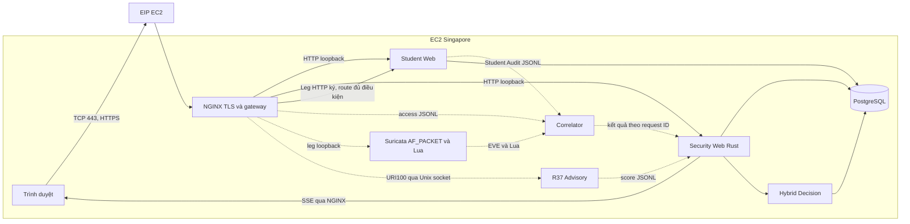
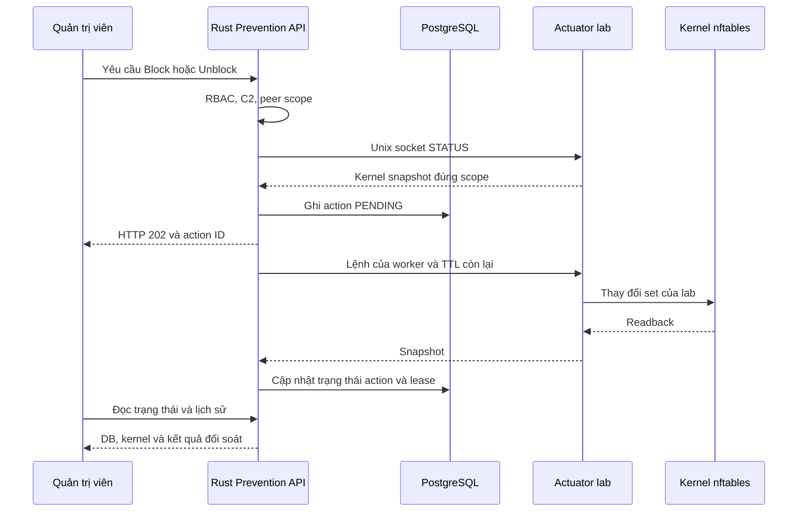

# R56 — Kiến trúc triển khai và nghiệm thu WebSentinel

Tài liệu bàn giao PBL4 cho các phần Mạng máy tính, Lập trình mạng và Hệ điều hành. Bằng chứng R53–R55 và số liệu R56 có phạm vi ghi riêng. [R55](141_T09_R55_FINAL_PROJECT_COMPLETION.md) · [AWS runbook](AWS_STAGING_OPERATIONS_HANDOFF.md)

## 1. Kiến trúc AWS staging

Hai tên miền dùng một địa chỉ IP. Client mở TCP và gửi TLS ClientHello chứa SNI để NGINX chọn virtual host và chứng chỉ. Sau TLS termination, NGINX chuyển HTTP tới ứng dụng trên loopback. HTTP public đi qua cấu hình redirect của gateway. NGINX xác lập request ID phía server. Student Web xử lý session, nghiệp vụ và phát audit. Security Web phục vụ dashboard và các API có xác thực. [Cấu hình HTTPS](../security-web/deploy/aws-r46/nginx-https.conf) · [NGINX HTTPS](https://nginx.org/en/docs/http/configuring_https_servers.html)

Loopback là interface mạng nội bộ của network namespace. Suricata chụp gói tại leg HTTP sau TLS theo filter endpoint/cổng, sử dụng Linux AF_PACKET. Cùng một TCP flow có thể chứa nhiều HTTP transaction. Ghép EVE và Lua dùng sensor generation, flow ID và transaction ID. Sau proxy, địa chỉ gói ở leg này thuộc proxy. Trusted request ID xác minh tương quan HTTP, trong khi thực thi chặn đòi bằng chứng riêng về địa chỉ peer. [Gateway](../security-web/deploy/aws-r48/gateway.py) · [Correlator](../security-web/deploy/aws-r48/correlate.py) · [Linux packet sockets](https://man7.org/linux/man-pages/man7/packet.7.html)

## 2. IPC, tương quan và xử lý bất đồng bộ

| Kênh | Bên gửi và bên nhận | Dữ liệu và kiểm soát |
|---|---|---|
| TCP stream | Client → NGINX và NGINX → Spring/Rust | HTTPS public và HTTP trên loopback. TLS kết thúc tại NGINX. |
| Unix domain socket | NGINX → R37 receiver | Projection URI100 trong allowlist. Đường dẫn socket có quyền filesystem. |
| JSONL và cursor | NGINX, Student, Suricata, scorer → pipeline | Evidence theo nguồn, generation và offset. Parser kiểm schema, chống replay và giữ provenance. |
| PostgreSQL | Student Web và Security Web → DB tương ứng | Hai database trên cùng instance. Security lưu alert, correlation, decision audit và lịch sử thao tác. |
| LISTEN/NOTIFY và SSE | PostgreSQL → Rust → trình duyệt | Sau commit, Rust phát thông báo theo luồng SSE. Khi mất kết nối hoặc backlog, client lấy lại snapshot qua API. |
| Unix socket lab | Rust không đặc quyền → actuator lab | Kernel cung cấp peer UID qua SO_PEERCRED. Actuator kiểm namespace và scope trước khi xử lý. |

API Rust/Axum dùng Tokio cho kết nối và các tác vụ I/O. Watcher ingest các nguồn độc lập. Hybrid refresh đánh giá evidence đã ghi và ghi decision theo request ID. Quyết định giữ danh sách nguồn và alert ID, dùng severity cao nhất để tính phần rule risk. R37 có quyền advisory. Thiếu nguồn hoặc ngoài schema có thể tạo ABSTAIN, và alert rule vẫn có thể được ghi nhận. [Rust runtime](../security-web/src/main.rs) · [Hybrid](../security-web/src/hybrid.rs) · [SSE](../security-web/src/realtime.rs) · [PostgreSQL NOTIFY](https://www.postgresql.org/docs/18/sql-notify.html) · [Linux Unix sockets](https://man7.org/linux/man-pages/man7/unix.7.html)

Correlator kiểm receipt ký, method/target trên wire, nguồn, clock và cutoff 1.000 ms với guard 1 ms theo contract hiện hành. Evidence sau cutoff được giữ riêng theo trạng thái. Allowlist R54/R55 bao phủ danh tính và các read route danh mục đủ điều kiện. Hồ sơ, liên hệ, quản trị tài khoản và phục hồi mật khẩu giữ đường trực tiếp. Số 89 là số cặp method/route đã phân loại. [Bảng Request Coverage](140_T09_R54_FINAL_SYSTEM_COMPLETION.md#prevention-hybrid-và-phạm-vi-quan-sát)

## 3. systemd, cgroups và network namespace

systemd quản lý từng service, startup và watchdog. cgroup v2 áp dụng giới hạn CPU, RAM, swap và số process lên cả cây service. Cloud Profile đọc lại `cpu.max`, counters OOM và PSI trước và trong lúc scorer chạy. CPU host trên Dashboard lấy chênh lệch hai mẫu `/proc/stat`. RX/TX lấy từ `/proc/net/dev` cho interface của tuyến IPv4 mặc định. [Profile AWS](../security-web/deploy/aws-r47/cloud_profile.py) · [Linux cgroup v2](https://docs.kernel.org/admin-guide/cgroup-v2.html)

Network namespace có interface, loopback, route và ruleset riêng. Lab R56 yêu cầu unit systemd cô lập với chỉ loopback trước khi dựng cặp veth. API ở loopback và một TCP listener nhận kết nối từ peer lab. nftables lọc chỉ interface, địa chỉ peer, đích và cổng listener đó. Timeout của set element được kernel thực thi. [Lab R56](../security-web/deploy/aws-r48/r56_prevention_lab.py) · [Linux network namespaces](https://man7.org/linux/man-pages/man7/network_namespaces.7.html)

## 4. Ranh giới đóng băng

C2 cho AWS public đóng theo bản build mặc định. Capability lab cần feature build riêng, thư mục và socket root-owned, network namespace khác host, chế độ MANUAL và AUTO_BLOCK=false. Rust xác minh peer root của socket. Actuator chỉ xử lý lệnh từ UID của Security Web trong cùng namespace. Thao tác theo cảnh báo cần danh tính peer đã xác minh. Thiếu actuator hoặc readback thì API từ chối, và giao diện phải giữ trạng thái offline rõ ràng. R37 và Hybrid scoring giữ nguyên. [C2 gate](../security-web/src/prevention.rs) · [Worker](../security-web/src/firewall.rs)

Triển khai public enforcement cần đánh giá riêng về trusted identity từ ingress tới vị trí kernel thực thi, thiết kế actuator có quyền tối thiểu, protected targets, deadline, rollback, thao tác khi restart và phê duyệt quản trị viên. Cấu hình AWS hiện hành giữ `ENFORCEMENT_MODE=OFF` và `AUTO_BLOCK=false`.

## 5. Bằng chứng thực nghiệm đã có

| Phạm vi | Bằng chứng |
|---|---|
| AWS serving R55 | Request `943dcc184ac6268522d4f640bbeaf2d1`, ba nguồn hợp lệ trước cutoff, R37 SCORED, Hybrid LOG_ONLY. Firefox kiểm SSE. |
| AWS lab R55 | Request `1e88fc9bd2cfcd4870ea480276a25aaa`. Suricata marker thật và hai nguồn fixture. Một incident REVIEW, risk 90, không có firewall action. |
| AWS kernel R53 | Block, Unblock, TTL và cleanup trong namespace. Bằng chứng actuator ở cấp kernel. |
| PostgreSQL R55 | 55 hồ sơ sinh viên và 56 tài khoản sau nhập. Dữ liệu giả lập có tài khoản tắt và giữ quan hệ lớp/ngành/chương trình. |

Thông số này là mẫu đo đã nghiệm thu trên staging. Báo cáo về recall/FPR của R37 phải dùng nguồn, split và protocol tương ứng. [R53](139_T09_R53_FINAL_PROJECT_COMPLETION.md) · [R55](141_T09_R55_FINAL_PROJECT_COMPLETION.md)

## 6. Acceptance R56

| Gate | Trạng thái | Evidence |
|---|---|---|
| R56_FINAL_COMPLETION | PARTIAL | Hai bản build và cập nhật mã nguồn hoàn thành. Nghiệm thu cuối trên EC2 phụ thuộc phiên AWS. |
| C2_GATE_STATUS | PASS cho mặc định fail-closed | Test mặc định và feature lab đều từ chối khi thiếu capability. Test PostgreSQL kiểm 401/403 và gate admin. |
| ACTUATOR_INTEGRATION | PARTIAL | Bản lab đầu trên AWS đã khởi động API và đạt kiểm tra readiness trước khi script lỗi vì body 403 rỗng. Bản sửa harness và capability đã build. |
| MANUAL_PREVENTION_E2E | BLOCKED | Chưa chạy thành công bản sửa từ request ghi đến nftables trong namespace EC2. |
| RULE_BASED_PREVENTION | PARTIAL | R55 đạt đến REVIEW. R56 đã chuẩn bị kiểm thử alert Suricata từ request lành tính đi trực tiếp qua veth, yêu cầu admin duyệt trước khi ghi. Chưa có kết quả kernel của ca này. |
| BLOCK_UNBLOCK_TTL | BLOCKED R56 | Có bằng chứng riêng R53 ở cấp actuator. Test R56 kiểm API, lịch sử và kết nối thực tế cần hoàn tất. |
| DB_AUDIT_KERNEL_CONSISTENCY | PARTIAL | Regression kiểm contract đồng bộ và không tạo action vượt gate. Chưa có readback lab R56 sau commit, restart hoặc hết TTL. |
| PUBLIC_ENFORCEMENT_STATE | OFF | R55 serving giữ OFF. Regression build mặc định xác nhận C2 vẫn đóng. |
| MULTI_SOURCE_ALERTS | PASS theo phạm vi R55 | Runtime, aggregation và SSE đã đạt với một marker native và hai fixture. Sáu test correlator vẫn đạt. Chưa có bộ ba alert native trên cùng request. |
| AWS_DEPLOYMENT | BLOCKED | CLI trả `Your session has expired`. Public HTTPS hai website vẫn trả 200 với chứng chỉ hợp lệ. |
| GIT_PUSH / REMOTE_HEAD | Xem nhánh tích hợp | Source đồng nghiệp `798e66a` đã là ancestor trước R56. |
| REPORT_ARCHITECTURE_DOCUMENT | PASS | Tài liệu này và hai sơ đồ bên trên. |
| EC2_FINAL_STATE | RUNNING theo lần kiểm gần nhất | AWS 3/3 checks trước khi xác thực hết hạn. HTTPS smoke sau đó vẫn đạt. |

Kiểm thử local dùng PostgreSQL 18 tạm với port chỉ bind loopback. Hai test tích hợp xác nhận quyền và đóng gate, hai unit test kiểm contract readback và guard C2. Build lab chạy thêm test thiếu capability. Sáu test correlator đạt. Lab AWS đầu có invocation `465574b5a1f44da19d3d6422691ef5df`. Lỗi parser 403 đã được sửa trong harness. Phiên AWS hết hạn trước lượt kiểm cuối.

Bundle đã build chứa hai binary riêng. SHA binary mặc định `a06982dfaf6599e728bbcf94ec6a286ae5eab5cd3eac843b1ebce625eef49e85`. SHA binary lab `1a7bc1d6f40aeb586ded3ecddb0228b76174dd14611e304d17524e4621eb069d`. Với bundle đúng SHA, stage qua SSM và chạy `r56_stage.sh lab` trước. Sau PASS mới chạy `r56_stage.sh deploy` để cập nhật bản mặc định. Runner deploy sao lưu R55 và tự rollback khi health check thất bại. [Runner](../security-web/deploy/aws-r48/r56_stage.sh)

Còn thiếu xác thực AWS, lượt lab cuối, kiểm Dashboard xuyên qua thao tác ghi, readback namespace sau cleanup và deploy có backup. Public enforcement cần phê duyệt riêng sau khi đáp ứng các điều kiện ở mục 4.
