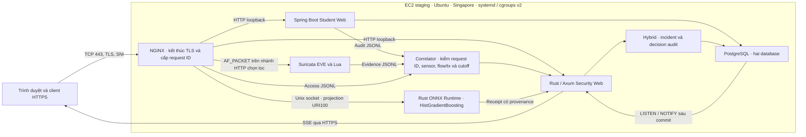
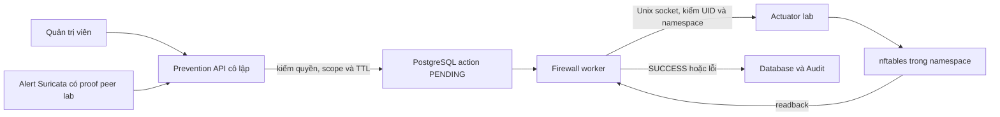
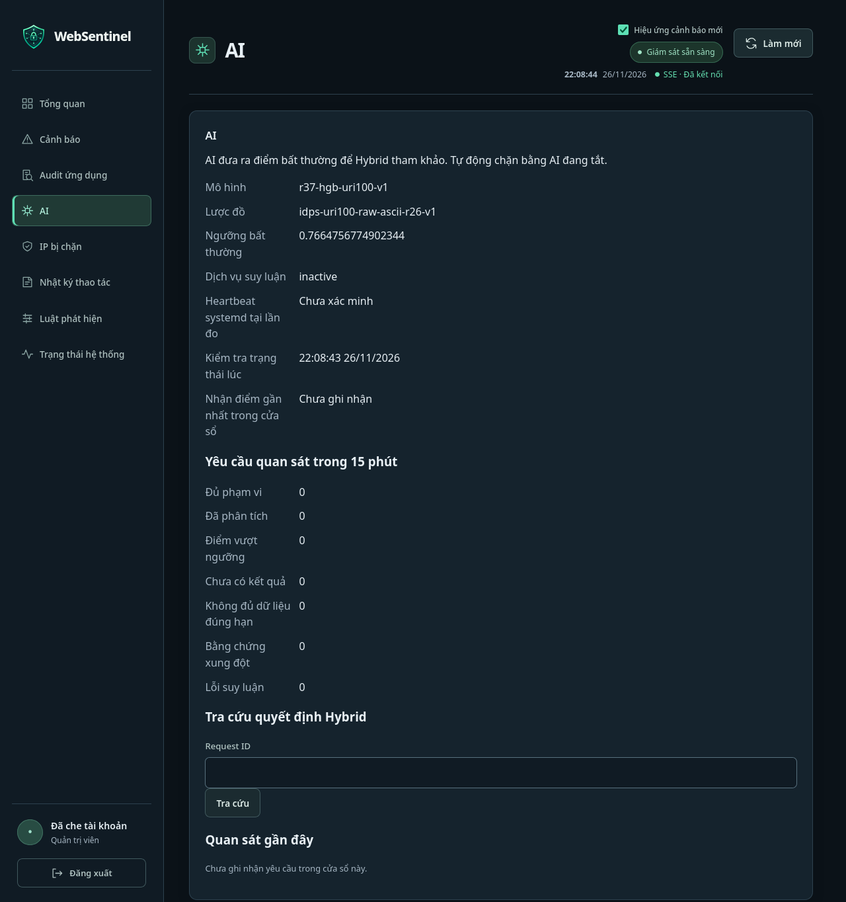
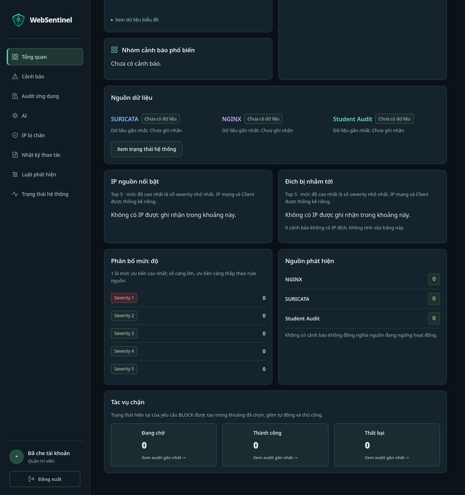

# R57 — WebSentinel AWS staging và nghiệm thu cuối

Ngày nghiệm thu 26/11/2026. Phạm vi là EC2 staging tại Singapore và các bài kiểm thử cô lập. R57 giữ model R37, preprocessing, ngưỡng, policy Hybrid, dữ liệu Student Web và khả năng rollback về R36. Public firewall enforcement và AI auto-ban giữ **OFF**. [Nghiệm thu R56](142_T09_R56_FINAL_ARCHITECTURE_AND_ACCEPTANCE.md) · [Runbook](AWS_STAGING_OPERATIONS_HANDOFF.md#19-r57--vận-hành-dashboard-ai-và-rollback)

## Kiến trúc thực tế

- Cổng HTTPS định tuyến theo virtual host. NGINX xử lý TLS và ghi ID phía server. Spring Boot xử lý session và nghiệp vụ. Suricata quan sát leg HTTP nội bộ bằng AF_PACKET. Correlator dùng proof và transaction identity để phân biệt các request trên cùng flow TCP.
- Rust/Axum và Tokio xử lý REST, watcher và SSE bất đồng bộ. Ingest lưu cursor, deduplicate theo identity và nối alert với request hoặc sensor transaction có bằng chứng. Hybrid duy trì một incident mỗi request. Trình duyệt resync qua API sau khi mất luồng SSE.
- Cloud Resource Safety Profile đọc giới hạn kernel và theo dõi watchdog của unit. Prevention lab dùng namespace mạng riêng, Unix socket, SO_PEERCRED và nftables. Luồng public thiếu quyền thực thi theo thiết kế. [Chi tiết TCP, IPC, namespace và cgroups](142_T09_R56_FINAL_ARCHITECTURE_AND_ACCEPTANCE.md) · [Cloud Profile](../security-web/deploy/aws-r47/cloud_profile.py)

## Detection và AI

Trước triển khai, truy vấn tổng hợp trên EC2 ghi nhận **512 quan sát NGINX, 382 Suricata và 711 Student Audit** trong 24 giờ theo mốc ingest. Bảng alert có **16 Suricata**. Không có hàng NGINX hoặc Student Audit. Mẫu xác nhận cả ba nguồn có ingest. Một HTTP request được quan sát có thể chưa thỏa điều kiện một rule phát cảnh báo.

R57 sửa bất nhất giữa tổng theo nguồn, biểu đồ và bộ lọc đối với nhãn Student Audit lịch sử APPLICATION. Bảng nguồn luôn hiện đủ ba nhóm. Khi cảnh báo tổng hợp NGINX hoặc Student Audit được tạo, alert và link request được ghi cùng transaction nếu bản ghi kích hoạt có ID và thỏa điều kiện cửa sổ. Lỗi gateway phạm vi toàn proxy và late event không có proof kích hoạt riêng được giữ ở cấp episode. Các ngưỡng rule và dedup hiện hành được giữ nguyên. Tests PostgreSQL kiểm cả replay lẫn late event.

Mục **AI** dùng API xác thực /api/ai. Profile AWS vô hiệu hóa watcher, nguồn điểm Hybrid và endpoint nghiên cứu cũ. Archive nghiên cứu vẫn được giữ. Security Web trên AWS chỉ nhận tài khoản Admin đã cấu hình. Phiên cũ kết thúc khi Security Web restart. Student giữ ADMIN, STAFF và STUDENT.

- Model **r37-hgb-uri100-v1**, ABI **idps-uri100-raw-ascii-r26-v1**.
- SHA-256 **91fe8bad280f7c103adc3601579e350fccd1e3b0de65d43c062aec5b34e60aff**.
- Điểm bất thường khi score > 0.7664756774902344. Decision cutoff 1.000 ms, guard 1 ms.
- Tách tín hiệu watchdog systemd và giờ nhận score. Thống kê 15 phút đếm theo request ID từ gateway đã ký hoặc receipt hợp lệ của model. Giữ riêng đã chấm điểm, chưa có kết quả, không đủ dữ liệu kịp thời, xung đột và lỗi suy luận. Receipt cũ thiếu phân loại lỗi chi tiết. Các bản ghi NGINX trước R57 thiếu cờ projection.
- Luồng tư vấn giữ nguyên. Điểm xuất hiện trong incident cùng request ID. Một kết quả xung đột hoặc lỗi không đóng góp điểm. [Model và nguồn đánh giá R37](121_T09_R37_FINAL_AI_QUALITY_AND_MODEL_FREEZE.md) · [Truy vấn AI](../security-web/src/ai_report.sql)

## Firewall cô lập

Bản lab trước đó nhận EVE chứa đúng peer và transaction. Ingest đã truyền xác minh peer trực tiếp vào cột PostgreSQL dành riêng cho attribution sau proxy, nên bị ràng buộc verified_suricata_client từ chối. R57 giữ ràng buộc đó và chỉ đọc proof peer trực tiếp từ canonical evidence trong bản build isolated-c2. API kiểm capability, đúng peer lab, flow/tx, nguồn Suricata, tuổi của alert và bảo vệ đối tượng. Quản trị viên phải gửi yêu cầu chặn. AI giữ vai trò advisory. [API và kiểm tra capability](../security-web/src/firewall.rs) · [Runner lab](../security-web/deploy/aws-r48/r56_prevention_lab.py)

## Ảnh giao diện

Ảnh Firefox của bản R57 chạy với PostgreSQL cô lập. Tên tài khoản được che. Cơ sở dữ liệu trống nên các chỉ số trong ảnh minh họa trạng thái chưa có dữ liệu. Bằng chứng inference thực tế được ghi riêng theo request ID.

## Giới hạn đánh giá model

WAF development holdout ghi nhận **recall 86,04%, FPR 0,41%**, precision 99,84%. Khoảng bootstrap 95% tương ứng là 79,09–91,37% cho recall và 0–1,55% cho FPR. Đó là nhãn publisher của WAF. Chuyển nguyên ngưỡng sang SR-BH TUNING cho recall 70,93% và FPR 2,07%. Notes TUNING cho 55,36% và 17,89%. Chưa có native cohort hai lớp độc lập đủ T07. Bài kiểm thử HTTPS lành tính chỉ xác minh vận hành. [Kết quả R37 theo cohort](121_T09_R37_FINAL_AI_QUALITY_AND_MODEL_FREEZE.md#chuyển-nguồn-sau-khi-khóa) · [Giao thức T07](../ai-training/contracts/evaluation-v1/protocol.json)

## Bằng chứng thực tế trên EC2

- Unit cô lập hoàn tất trong **50,9 s**, peak **148 MiB**. Native Suricata phát SID 156001 từ GET lành tính của peer lab. API ghi Block #1, Unblock #2 và Block có TTL #3 tham chiếu alert #1. Cả ba action có Audit SUCCESS. Connection bị chặn và mở lại theo trạng thái kernel thực tế. Sau restart API, block và lịch sử vẫn có hiệu lực. Hết TTL, Database và kernel cùng rỗng. Bài thử xác minh từ chối khi không có quyền, khi sai scope và khi actuator offline. Namespace và tài nguyên lab đã dọn. Không chạy tự động chặn từ cảnh báo. [Evidence R57](evidence/r57/acceptance.json)
- Deploy staging có backup hai DB và release. Unit triển khai thoát 0. Hai hostname public trả HTTPS 200, kiểm CA thành công và HTTP chuyển hướng 308. Bảy unit hoạt động, EC2 **running**, ba status check **ok**. Kiểm trực tiếp DB Student có **55 hồ sơ, 56 tài khoản**. Scorer có watchdog 3 giây, kernel đọc lại quota 25% của một CPU, RAM tối đa 768 MiB, swap 0, pids 64, OOM kill 0.
- GET CSRF lành tính qua HTTPS có request ID **c24901392f208f0772ef71c519106358**. Correlator trả MATCHED cho NGINX, Suricata, Student Audit và cờ late=false. Rust ghi score **0,1253570318222046** của đúng model, proof sẵn sàng sau **2,7698 ms** theo clock hợp đồng. Hybrid ghi một incident **LOG_ONLY**. DB public ghi 0 firewall action. [Evidence R57](evidence/r57/acceptance.json)
- Build production Rust và Vite PASS. Bộ kiểm tra chọn lọc có 34 lượt Rust trên hai target, 19 test frontend và 8 test Python. Firefox với DB tạm xác minh đăng nhập Admin, Viewer bị từ chối, AI và thống kê nguồn, SSE, endpoint legacy bị đóng. Browser không thực hiện thao tác ghi firewall trên AWS. [Triển khai và rollback](AWS_STAGING_OPERATIONS_HANDOFF.md#19-r57--vận-hành-dashboard-ai-và-rollback)

## Bảng nghiệm thu

| Hạng mục | Trạng thái | Bằng chứng và phạm vi |
|---|---|---|
| NGINX Detection | PASS lab, PARTIAL AWS | Rule engine và liên kết alert PASS với PostgreSQL cô lập. AWS có access evidence và source identity, chưa có cảnh báo dương tính độc lập từ NGINX. |
| Suricata Detection | PASS AWS cô lập | Native EVE, SID 156001 và peer/transaction hợp lệ trong lab. Bảng public có 16 alert ở mẫu trước deploy. |
| Student Audit Detection | PASS lab, PARTIAL AWS | Fixture security signal, ngưỡng và dedup PASS. AWS có Audit cùng request thật, chưa có cảnh báo dương tính độc lập từ Student Audit. |
| AI Runtime | PASS AWS | Scorer hồi phục sau restart, SHA đúng, proof tại cutoff, advisory cùng request. |
| AI Legacy Cleanup | PASS profile AWS | Loại watcher và đường điểm cũ khỏi profile chính thức. Firefox với profile tương đương xác minh API cũ bị đóng. |
| Correlator và Hybrid | PASS AWS cho mẫu lành tính | Ba nguồn, một incident, dedup và late qua regression. Chưa quan sát cùng lúc alert dương tính thật từ cả ba nguồn trong R57. |
| SSE | PASS lab | Kết nối Firefox và phát sau commit trong regression PostgreSQL. Bằng chứng browser AWS của R55 được giữ nguyên. |
| Firewall Actuator, Block, Unblock, TTL | PASS AWS cô lập | C2 capability, action 1–3, kernel readback, offline fail-closed, restart và cleanup. |
| Manual Prevention E2E và rule-based | PASS API lab, PARTIAL browser | Quản trị viên gọi API gắn với native alert và kernel. Chưa ghi nhận thao tác ghi từ trình duyệt xuyên suốt trên AWS ở R57. |
| Database, Audit, kernel nhất quán | PASS AWS cô lập | Danh sách active khớp kernel, lịch sử 3 SUCCESS, cleanup. |
| Authentication/RBAC | PASS lab | Admin và từ chối Viewer cho profile chính thức. Lab C2 kiểm 401 và 403. |
| Student Web | PASS health AWS | HTTPS 200, request Audit hợp lệ và kiểm đếm DB. Các kết quả CRUD R54–R55 kế thừa theo phạm vi cũ. |
| Dashboard UI | PASS browser lab | Mục AI và tổng nguồn chạy với binary thật, DB tạm, ảnh đã che tài khoản. |
| System Status | PASS AWS | Bảy unit active, watchdog, kernel limits, OOM 0. |
| Regression Tests | PASS có chọn lọc | Rust, Vite, Python, Firefox và lab EC2. |
| AWS Deployment | PASS staging | Backup, SHA, health và đối soát một request sau cập nhật. |
| Public Enforcement | OFF | Policy public, C2 và AI auto-ban giữ OFF. |
| Report Documentation | PASS | Báo cáo này, ảnh và runbook. |
| Project Freeze | PARTIAL | Bản staging đã khóa cho bàn giao giám sát. Nghiệm thu dương tính đa nguồn trên AWS, thao tác ghi qua browser và chất lượng AI độc lập còn mở. |
