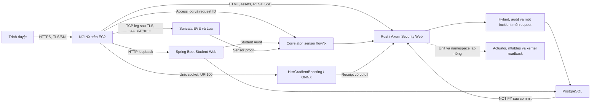
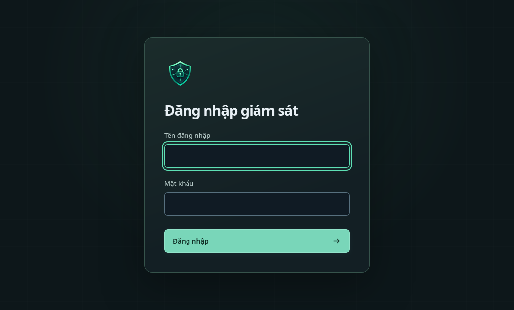

# R58 — WebSentinel, nghiệm thu AWS và đóng băng

**Ngày nghiệm thu 26/11/2026.** Phạm vi là WebSentinel trên EC2 staging tại
Singapore. Hệ thống giám sát đang hoạt động. Thực thi chặn IP công khai và AI
auto-ban giữ **OFF**. Model HistGradientBoosting URI100, preprocessing, ngưỡng
và chính sách Hybrid giữ nguyên. [Nghiệm thu R57](143_T09_R57_FINAL_PROJECT_COMPLETION.md)

## Sai lệch giao diện và cách khắc phục

Đối chiếu NGINX, thư mục phục vụ Rust và TLS public xác nhận đầu phiên AWS
đang trả đúng binary và HTML R57. JavaScript được HTML tham chiếu lúc đó
không chứa màn hình AI Shadow, GLU207, Worker v2 hoặc API AI cũ. HTML thiếu
Cache-Control và static root còn giữ assets của những đợt trước. Không có
snapshot của phiên trình duyệt đã gặp lỗi nên nguyên nhân chính xác của
phiên đó chưa được xác định. R58 áp dụng `Cache-Control: no-cache` cho HTML,
triển khai đồng bộ binary, HTML và assets, đồng thời chuyển thư mục build
cũ ra khỏi static root để rollback. [Mã triển khai R58](../security-web/deploy/aws-r48/r58.py) · [Ngữ nghĩa HTTP cache](https://developer.mozilla.org/en-US/docs/Web/HTTP/Guides/Caching)

Mục **AI** chỉ hiển thị trạng thái hoạt động, số lượt phân tích, số lượt bất
thường, biểu đồ, kết quả gần đây và tra cứu theo Request ID. Cả dữ liệu tổng
hợp lẫn tra cứu được lọc bằng model version và SHA. Tên slot, schema và metadata
nghiên cứu không xuất hiện trong giao diện. Khi quyết định Hybrid được lưu với
model khác, tra cứu giữ đúng trạng thái thiếu quyết định. Dashboard tiếp tục
báo lỗi thu thập, SSE và Firewall. Audit, trạng thái hệ thống và danh mục luật
đã bỏ các đoạn giải thích triển khai trùng lặp.

## Sơ đồ triển khai

WebSentinel dùng TCP/TLS cho public, HTTP trên loopback và Unix socket cho
scorer. PostgreSQL lưu quan sát, cảnh báo, quyết định và audit. Daemon
systemd quản lý vòng đời service, watchdog và cgroup v2. [Kiến trúc hệ điều hành và mạng](142_T09_R56_FINAL_ARCHITECTURE_AND_ACCEPTANCE.md)

## Bằng chứng live AWS

- Firefox mới tải `index-2ItA9aSI.js` từ hostname public. Phiên trình duyệt
  đăng nhập thực tế truy cập mục **AI**, Audit ứng dụng và Trạng thái hệ
  thống. SSE báo **Đã kết nối**. Tra cứu request
  `0b350ae6ef5a802fb6fc2496c9c5d8d7` hiển thị **0,125357** và
  **LOG_ONLY**, khớp receipt và incident trong PostgreSQL.
- Request đó khớp đúng **NGINX, Suricata, Student Audit**, không có late
  evidence trong kết quả correlation. Proof AI sẵn sàng sau **1,9323 ms**
  tại cutoff 1.000 ms, guard 1 ms. PostgreSQL ghi một incident, 0 firewall
  action public.
- Tại snapshot browser 24 giờ, các nguồn có **515 quan sát NGINX, 385
  Suricata, 714 Student Audit**. Dashboard ghi **16 cảnh báo**, cả 16 thuộc
  Suricata. Số quan sát được hiển thị riêng với số cảnh báo.
- Kiểm tra data có **55 hồ sơ sinh viên và 56 tài khoản**. Bảy unit đang
  hoạt động. Scorer đọc lại quota 25% của một CPU, trần RAM 768 MiB, swap 0,
  pids 64, OOM kill 0. Checksum backup và ba file cấu hình Student, Security,
  scorer khớp trước và sau triển khai. [Evidence R58](evidence/r58/acceptance.json)

Ảnh phiên Firefox mới trên hostname AWS. Bằng chứng giao diện AI sau đăng
nhập và đối soát Request ID nằm trong lần nghiệm thu trực tiếp của R58.

## Detection cô lập trên EC2

Chạy đúng Student Web, NGINX, Suricata, Rust, AI và PostgreSQL tạm trong
namespace riêng. Tạo mười lượt GET vào upstream lab ngừng và năm lần gửi
form rỗng đến endpoint được CSRF bảo vệ. Suricata dùng GET lành tính và
marker rule chỉ có trong lab. Không sửa ngưỡng NGINX hoặc Student Audit,
không chèn cảnh báo vào PostgreSQL và không gửi traffic kiểm thử tới gateway
public.

| Nguồn | Quan sát API | Cảnh báo DB/API | Bằng chứng |
|---|---:|---:|---|
| NGINX | 16 | 1 | GATEWAY_ERROR_BURST do kết nối upstream lab bị từ chối. Episode toàn proxy không gắn tùy tiện vào một request. |
| Suricata | 2 | 1 | SID 153001, EVE thật, một link sensor transaction. |
| Student Audit | 7 | 1 | APP-1018 do Student Web xác nhận CSRF_INVALID. Alert nối với ID của request bị từ chối. |

GET `457d936c22ae8d1432a597f01260658e` được ghép ba nguồn và scorer trả
điểm hợp lệ. Hybrid trả ALERT cho marker, một alert được phát qua SSE,
không phát sinh firewall action. [Runner kiểm thử](../security-web/deploy/aws-r48/r58_detection_lab.py)

## Firewall và nghiệm thu trình duyệt cô lập

Firefox chạy trong namespace EC2 giới hạn tài nguyên, dùng bản build R58
cùng backend có capability C2 dành cho lab. Từ Dashboard, quản trị viên
chặn peer lab với TTL 75 giây, bỏ chặn, sau đó chặn lại với TTL 9 giây.
Trình duyệt hiển thị trạng thái active, thời điểm hết hạn, bỏ chặn và
lịch sử sau cùng. Kiểm tra độc lập xác nhận kết nối bị chặn khi lease còn
hiệu lực, hoạt động lại sau Unblock và sau hết TTL. Ba action 1–3 ghi Audit
SUCCESS. Database và tập nftables cùng rỗng sau khi hết hạn. Unit thoát 0
và namespace được dọn. Ảnh Firefox headless của lab gặp lỗi phông chữ nên
không đưa vào tài liệu trình diễn. [Kết quả máy đọc](evidence/r58/acceptance.json) · [Bài kiểm tra browser](../security-web/deploy/aws-r48/r58_browser_test.py)

Bảng trạng thái trên website public hiển thị chặn IP đang tắt và trạng thái đối soát
kernel chưa xác minh. Việc giám sát, chấm điểm và SSE hoạt động độc lập.
Môi trường public đang quan sát phía sau TLS proxy. Request ID và điểm AI
không đủ để xác minh địa chỉ peer dùng cho enforcement. Chặn public cần
capability và actuator được phê duyệt riêng, nguồn IP đáng tin trước proxy,
allowlist bảo vệ hạ tầng, phạm vi được kiểm, thời hạn và rollback an toàn.
[Phân tích C2 và scope](142_T09_R56_FINAL_ARCHITECTURE_AND_ACCEPTANCE.md)

## Acceptance gates

| Hạng mục | Trạng thái | Bằng chứng |
|---|---|---|
| Frontend thực tế trên AWS | PASS | Firefox mới tải asset đúng SHA. Phiên đăng nhập nghiệm thu trực tiếp các màn hình AI, Audit và trạng thái. |
| AI Runtime, Legacy Cleanup, Legacy Data Visibility | PASS trong profile AWS | R37 receipt đúng SHA và Hybrid. Endpoint và JS cũ trả 404. Các truy vấn chính thức lọc lịch sử AI cũ. |
| Dashboard Simplification | PASS trên AWS | AI có trạng thái, hai số đếm, biểu đồ và tra cứu. Audit và trang trạng thái đã tinh giản. |
| Detection đa nguồn | PASS trên EC2 cô lập | Một cảnh báo độc lập mỗi nguồn. PostgreSQL và API khớp, Dashboard AWS đếm quan sát riêng. |
| Correlator, Hybrid, Incident, Dedup | PASS theo mẫu | Request public khớp ba nguồn và một incident. Marker trong lab có một link sensor, một alert và được phát SSE. |
| Firewall Actuator, Block/Unblock/TTL, Browser E2E | PASS trên EC2 cô lập | Firefox thao tác với backend và kernel thật. 3/3 action SUCCESS. |
| Database, Audit, Kernel | PASS trên EC2 cô lập | Readback sau khi thêm, xóa và TTL. Không còn IP sau cleanup. |
| Authentication/RBAC | PASS theo phạm vi | Admin đăng nhập AWS. RBAC 401/403 trong lab và regression kiểm route đã đóng. |
| Student Web | PASS smoke AWS | HTTPS 200, GET CSRF sinh bằng chứng, DB giữ 55 hồ sơ và 56 tài khoản. Kế thừa nghiệm thu nghiệp vụ R54–R55. |
| SSE và System Status | PASS | SSE kết nối trên browser AWS, delivery sau commit trong lab. Bảy unit và watchdog hoạt động, không OOM. |
| AWS Deployment | PASS | Cấu hình, backup, binary, bundle và asset SHA đối chiếu. Rollback runner đã cài. |
| Regression | PASS | 18 lượt Rust, 19 test frontend và kiểm syntax runner. |
| Documentation | PASS | Báo cáo, runbook, evidence và sơ đồ. |
| Git Push | Xem remote HEAD khi bàn giao | Push thường lên nhánh tích hợp hiện có. |
| Project Freeze | PASS cho bản giám sát và phạm vi lab | Public enforcement và AI auto-ban OFF. |

## Phạm vi chất lượng AI

Kết quả lịch sử R37 trên WAF development holdout là recall **86,04%** và
FPR **0,41%**. Khi chuyển ngưỡng sang SR-BH TUNING, kết quả là **70,93%** và
**2,07%**. Chưa có cohort native hai lớp độc lập đạt giao thức T07. Nghiệm
thu R58 xác nhận vận hành và tương quan. Chất lượng tổng quát hóa độc lập
vẫn BLOCKED. [Nguồn số liệu R37](121_T09_R37_FINAL_AI_QUALITY_AND_MODEL_FREEZE.md) · [Protocol T07](../ai-training/contracts/evaluation-v1/protocol.json)

**Kết luận R58_FINAL_COMPLETION = PASS cho phạm vi giám sát staging và
Prevention cô lập.** EC2 tiếp tục Running. Bản production giữ chặn công khai OFF.
