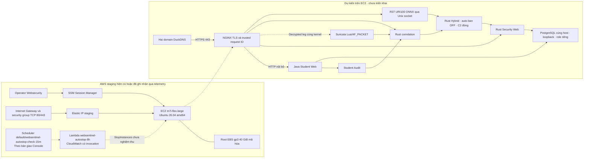

# AWS staging — Vận hành và bàn giao

[Cloud Beta R48](133_T09_R48_AWS_CLOUD_BETA.md) ghi cấu hình nền, cách truy cập và rollback. [Nghiệm thu R51](137_T09_R51_FINAL_COMPLETION.md) ghi luồng giám sát và hướng dẫn demo. [Nghiệm thu R50](136_T09_R50_FINAL_PROJECT_ACCEPTANCE.md) ghi bằng chứng email.

Bắt đầu với [kết quả R46](131_T09_R46_AWS_WEB_INFRASTRUCTURE_SETUP.md) và [nghiệm thu R45](130_T09_R45_AWS_INFRASTRUCTURE_ACCEPTANCE.md) để biết kết quả và quyền còn thiếu. Đọc [handoff AWS](127_T09_AWS_MIGRATION_HANDOFF.md) và [Local Beta.2](126_T09_R42_FINAL_LOCAL_HANDOFF.md) trước khi lên kế hoạch triển khai. R45 xác minh hạ tầng staging. State của AWS và các thành phần ứng dụng phải được nghiệm thu riêng trên đúng host. Không dùng tài khoản root cho các thao tác dưới đây.

## Kiến trúc



Local Beta đã kiểm tra HTTPS, correlation ba nguồn, R37 và Hybrid post-observation trên topology Local. R36 là slot rollback. Bản cài Local đòi phần cứng và thermal sensor đã xác minh. Chọn đúng artifact từ registry, loại bỏ việc copy dữ liệu nghiệp vụ Local sang staging và giữ T07 CAL/TEST độc lập. [Evidence Local R42](../security-web/deploy/local-r42/evidence/acceptance.json) · [Model slots](../ai-training/contracts/quality-freeze-r37/slots.json) · [T07 protocol](../ai-training/contracts/evaluation-v1/protocol.json)

## 1. Phiên thao tác và inventory

Trong Console chọn account staging đã bàn giao, IAM `Websecurity` và region `Asia Pacific (Singapore)`. CLI dùng AWS CLI v2 và Session Manager plugin cho phiên tương tác. Nếu phiên CLI hết hạn, chạy `aws login --profile websecurity-staging`, hoàn tất xác thực trình duyệt và đọc lại caller identity trước khi thao tác. Trước mỗi thao tác ghi, xác nhận contract không đổi và hồ sơ trả đúng account/ARN. Các block dưới đây dùng Bash và `jq` để đọc JSON khi cần. Đặt các biến inventory từ cấu hình staging đã được bàn giao trước khi chạy.

```bash
profile=websecurity-staging
region=ap-southeast-1
account="${WEBSENTINEL_AWS_ACCOUNT_ID:?Set WEBSENTINEL_AWS_ACCOUNT_ID from staging inventory}"
instance="${WEBSENTINEL_STAGING_INSTANCE_ID:?Set WEBSENTINEL_STAGING_INSTANCE_ID from staging inventory}"
volume="${WEBSENTINEL_STAGING_ROOT_VOLUME_ID:?Set WEBSENTINEL_STAGING_ROOT_VOLUME_ID from staging inventory}"
allocation="${WEBSENTINEL_STAGING_EIP_ALLOCATION_ID:?Set WEBSENTINEL_STAGING_EIP_ALLOCATION_ID from staging inventory}"
fn=websentinel-autostop-8h
schedule=websentinel-autostop-check-15m
group=default

aws_staging() { aws --profile "$profile" --region "$region" --no-cli-pager "$@"; }

check_identity() {
  local identity
  identity=$(aws_staging sts get-caller-identity --query Arn --output text) || return 1
  if [[ ! "$account" =~ ^[0-9]{12}$ || "$identity" != "arn:aws:iam::$account:user/Websecurity" ]]; then
    printf 'Unexpected AWS caller: %s\n' "$identity" >&2
    return 1
  fi
}

check_identity &&
aws_staging ec2 describe-instances --instance-ids "$instance" --query \
  'Reservations[0].Instances[0].{State:State.Name,Type:InstanceType,AMI:ImageId,LaunchTime:LaunchTime,EIP:PublicIpAddress,PrivateIP:PrivateIpAddress,Profile:IamInstanceProfile.Arn,IMDS:MetadataOptions.HttpTokens,Tags:Tags}'

aws_staging ec2 describe-volumes --volume-ids "$volume" --query \
  'Volumes[0].{Type:VolumeType,GiB:Size,Encrypted:Encrypted,AttachedTo:Attachments[0].InstanceId,DeleteOnTermination:Attachments[0].DeleteOnTermination}'
aws_staging ec2 describe-addresses --allocation-ids "$allocation" --query \
  'Addresses[0].{PublicIP:PublicIp,PrivateIP:PrivateIpAddress,Instance:InstanceId}'
aws_staging ec2 describe-instance-attribute --instance-id "$instance" --attribute disableApiTermination
aws_staging ec2 describe-instance-attribute --instance-id "$instance" --attribute disableApiStop
aws_staging ssm describe-sessions --state Active --filters "key=Target,value=$instance" \
  --query 'Sessions[].{Status:Status,StartDate:StartDate}'
```

Dùng các IDs VPC, route, IGW, subnet và SG trong [inventory R45](130_T09_R45_AWS_INFRASTRUCTURE_ACCEPTANCE.md#infrastructure-inventory) cho lệnh Describe cùng tên. Đối chiếu route `0.0.0.0/0` và EIP/ENI nếu SSM không kết nối. Tách kết quả kiểm tra API khỏi kết quả trong guest.

## 2. Vận hành EC2

**Start thủ công trong cửa sổ vận hành đã thống nhất.** Lệnh `--dry-run` là phép thử quyền an toàn. Thông báo `DryRunOperation` có exit status khác 0 và xác nhận AWS sẽ cho phép request, vì vậy chạy riêng. Sau start, tách trạng thái `running`, system/instance/EBS checks và SSM online.

```bash
check_identity && aws_staging ec2 start-instances --instance-ids "$instance" --dry-run
```

```bash
check_identity && aws_staging ec2 start-instances --instance-ids "$instance" &&
aws_staging ec2 wait instance-running --instance-ids "$instance" &&
aws_staging ec2 wait instance-status-ok --instance-ids "$instance"
aws_staging ec2 describe-instance-status --instance-ids "$instance" --include-all-instances
aws_staging ssm get-connection-status --target "$instance"
check_identity && aws_staging ssm start-session --target "$instance"
```

Trong SSM, đọc cấu hình và xác nhận các phiên đang hoạt động trước khi kết thúc cửa sổ. Kiểm DNS/outbound theo endpoint AWS cần dùng. Một HTTP status 4xx từ endpoint AWS có thể xác nhận kết nối TLS, còn trạng thái registration cần kiểm riêng qua SSM.

```bash
cat /etc/os-release
uname -m
nproc
free -h
lsblk -o NAME,SIZE,TYPE,FSTYPE,MOUNTPOINTS
stat -fc %T /sys/fs/cgroup
uptime
who
systemctl --no-pager --type=service --state=running
systemctl --no-pager list-timers --all
ss -lnt
getent ahostsv4 ssm.ap-southeast-1.amazonaws.com
curl -sS -o /dev/null -w 'HTTP %{http_code}\n' --connect-timeout 5 \
  https://ssm.ap-southeast-1.amazonaws.com/
```

**Stop thủ công chỉ khi xác nhận staging rảnh.** Trao đổi với người giữ cửa sổ, đối chiếu SSM active sessions, user/process/timer trong guest và trạng thái ghi dữ liệu. Danh sách SSM rỗng chỉ chứng minh không thấy phiên SSM, vẫn có thể có workload. Thoát phiên của chính mình, stop thường để guest có thể shutdown, đợi `stopped` rồi xác nhận EIP và EBS. Giữ termination protection và tránh `TerminateInstances` vì root EBS có `DeleteOnTermination=true`. [Vòng đời EC2 và dữ liệu giữ lại](https://docs.aws.amazon.com/AWSEC2/latest/UserGuide/how-ec2-instance-stop-start-works.html)

```bash
check_identity && aws_staging ec2 stop-instances --instance-ids "$instance" --dry-run
```

```bash
check_identity && aws_staging ec2 stop-instances --instance-ids "$instance" &&
aws_staging ec2 wait instance-stopped --instance-ids "$instance" &&
aws_staging ec2 describe-addresses --allocation-ids "$allocation" &&
aws_staging ec2 describe-volumes --volume-ids "$volume"
```

| Triệu chứng | Kiểm tra và xử lý |
|---|---|
| `TargetNotConnected` / `notconnected` | Kiểm region, EC2 state/status và đúng instance profile. Đọc role cho quyền `AmazonSSMManagedInstanceCore` hoặc tương đương. Khi có kênh được phép, kiểm unit/agent logs và outbound 443 tới `ssm` và `ssmmessages`. Không mở SSH Internet để khắc phục SSM. |
| `AccessDenied` | Chạy `check_identity`, ghi action/ARN và thời gian, kiểm trust, identity policy, permission boundary/SCP nếu có. Chỉ cấp đúng read/action thiếu. Quyền operator, EC2 role, Lambda role và Scheduler role có phạm vi khác nhau. |
| Guest không ra Internet hoặc DNS lỗi | Kiểm EIP association, egress SG, subnet ACL, effective route tới IGW và DNS của VPC. Trong guest kiểm resolver, interface, route và TLS theo từng endpoint như trên. Không tạo NAT hoặc gắn EIP thứ hai để thử. |

[SSM prerequisites](https://docs.aws.amazon.com/systems-manager/latest/userguide/session-manager-prerequisites.html) · [Role cho EC2](https://docs.aws.amazon.com/AWSEC2/latest/UserGuide/iam-roles-for-amazon-ec2.html)

## 3. Auto-stop tám giờ

Scheduler dự kiến kiểm mỗi 15 phút và chỉ gọi Lambda. Người dùng Start EC2 theo nhu cầu. Thiết kế yêu cầu hàm chỉ xử lý đúng instance staging tại Singapore, kiểm `running`, ID và tag `Project=WebSentinel`, rồi tính tuổi phiên dựa trên `LaunchTime`. AWS cập nhật trường này sau stop/start. Nghĩa của 480 phút là một phiên chạy liên tục. Chu kỳ 15 phút, flexible window, delivery/retry và graceful shutdown có thể làm thời điểm `stopped` muộn hơn mốc tám giờ. Auto-stop không quản lý tổng giờ/tháng. [LaunchTime](https://docs.aws.amazon.com/AWSEC2/latest/UserGuide/Stop_Start.html) · [Scheduler timing](https://docs.aws.amazon.com/scheduler/latest/UserGuide/schedule-types.html)

### Đọc cấu hình và log

Các get Lambda/Scheduler sau hiện cần quyền bổ sung hẹp. Câu lệnh chỉ truy xuất các trường vận hành cần đối chiếu. Duyệt code tải qua `lambda:GetFunction` trong thư mục bảo mật, tính SHA-256 Base64 đối chiếu `CodeSha256` và giữ backup ngoài repo. URL tải code có thời hạn và không được đưa vào terminal transcript. Tuân thủ cùng nguyên tắc với payload, env đầy đủ và output chứa bí mật.

```bash
aws_staging lambda get-function-configuration --function-name "$fn" --query \
  '{Runtime:Runtime,Handler:Handler,Memory:MemorySize,Timeout:Timeout,Role:Role,SHA:CodeSha256,Revision:RevisionId,Update:LastUpdateStatus,MaxMinutes:Environment.Variables.MAX_SESSION_MINUTES,DryRun:Environment.Variables.DRY_RUN}'
aws_staging scheduler get-schedule --name "$schedule" --group-name "$group" --query \
  '{State:State,Expression:ScheduleExpression,Window:FlexibleTimeWindow,Target:Target.Arn,Role:Target.RoleArn,Retry:Target.RetryPolicy,DLQ:Target.DeadLetterConfig.Arn}'
aws_staging logs describe-log-streams --log-group-name "/aws/lambda/$fn" \
  --order-by LastEventTime --descending --max-items 5
aws_staging logs tail "/aws/lambda/$fn" --since 1h --format short
```

Trong CloudWatch, chọn `AWS/Lambda` theo `FunctionName` và đọc `Invocations`, `Errors`, `Duration`. Xem `AWS/Scheduler` theo `ScheduleGroup` với `InvocationAttemptCount`, `TargetErrorCount`, `InvocationDroppedCount`. Metric group có thể gom nhiều schedule. Ưu tiên log từ handler chứa schedule ARN, scheduled time, execution ID, request ID Lambda, state, tuổi phiên và outcome. Có thể truyền các context attributes qua `Target.Input` sau khi kiểm code chấp nhận schema, phân biệt chúng với invocation thủ công. Chỉ log metadata qua allowlist. [Bằng chứng CloudWatch R45](130_T09_R45_AWS_INFRASTRUCTURE_ACCEPTANCE.md#bằng-chứng-cloudwatch) · [Scheduler context](https://docs.aws.amazon.com/scheduler/latest/UserGuide/managing-schedule-context-attributes.html)

### Quyền tối thiểu và acceptance

| Principal | Phạm vi cần xác nhận hoặc cấp khi tái tạo |
|---|---|
| Operator `Websecurity` | Describe cần thiết, EC2 Start/Stop giới hạn đúng instance/tag staging, SSM StartSession trên đúng instance và session document cần dùng. Điều tra R45 cần `lambda:GetFunction`, `lambda:GetFunctionConfiguration`, `scheduler:GetSchedule` trên resource cụ thể, đọc trust/policy của đúng roles và CloudWatch. `lambda:InvokeFunction`, `lambda:UpdateFunctionConfiguration` hoặc `scheduler:UpdateSchedule` chỉ cấp cho người chạy bài test và khôi phục. |
| EC2 role `WebSentinel-Staging-EC2-Role` | Trust `ec2.amazonaws.com`, profile cùng tên. Attach `AmazonSSMManagedInstanceCore` hoặc policy tương đương đã kiểm. |
| Lambda role `<LAMBDA_EXECUTION_ROLE>` | Trust `lambda.amazonaws.com`. `ec2:DescribeInstances` dùng Resource `*` vì action này không hỗ trợ instance ARN. `ec2:StopInstances` dùng instance ARN `arn:aws:ec2:ap-southeast-1:<ACCOUNT_ID>:instance/<INSTANCE_ID>`, thêm điều kiện tag `Project=WebSentinel` và `Environment=Staging`. Quyền log chỉ trong group/function cần dùng. Audit `WebSentinel-AutoStop-EC2Policy` và cả policy đính kèm, để phát hiện đường stop rộng, quyền terminate hoặc start. |
| Scheduler execution role | Trust `scheduler.amazonaws.com`. Giới hạn confused deputy bằng `aws:SourceAccount` và `aws:SourceArn` theo group đã chọn, đồng thời kiểm chỉ schedule được quản lý có quyền dùng role. Cho phép `lambda:InvokeFunction` đúng function ARN hoặc alias đã pin. Operator `iam:PassRole` chỉ trên role và service cần dùng. |

[EC2 IAM actions](https://docs.aws.amazon.com/service-authorization/latest/reference/list_amazonec2.html) · [Scheduler execution role và confused deputy](https://docs.aws.amazon.com/scheduler/latest/UserGuide/cross-service-confused-deputy-prevention.html)

1. Ghi cấu hình đã đọc của EC2, EIP, EBS, Lambda và Scheduler, commit/digest triển khai, Lambda `RevisionId`, toàn bộ env và Scheduler `Target`, flexible window, retry/DLQ, timezone, trạng thái. Lưu phục hồi ở thư mục ngoài Git, quyền `0700` và file `0600`. Xác minh đủ quyền khôi phục trước khi thay bất kỳ biến nào.
2. Review code đúng SHA. Test offline các nhánh stopped, running chưa đủ 480 phút, tới ngưỡng, clock âm/sai, thiếu tag/sai ID, config lỗi, lệnh Stop bị từ chối và retry/duplicate. Fake EC2 client để xác minh nhánh lỗi, không gọi API ghi. Xác nhận code re-read trạng thái và chỉ phát lệnh stop khi guard đạt, với timestamp hiện hành.
3. Khi đã audit scope, test thủ công `stopped` để thấy `SKIPPED`. Đặt ngưỡng ngắn 1–2 phút và `DRY_RUN=true` trong cửa sổ staged maintenance. Dùng `UpdateFunctionConfiguration` với map env đầy đủ và `--revision-id`. Đợi `lambda wait function-updated-v2` và đọc lại. Khi EC2 rảnh, start một lần và xác minh SSM/users/workload. Thấy `running` chưa đủ ngưỡng được skip và sau ngưỡng có bằng chứng dự kiến stop trong dry-run. EC2 phải còn running, vì app `DRY_RUN` khác AWS API `DryRun`.
4. Chỉ khi staging rảnh, IAM scope đã xác minh và có quyền khôi phục, đặt `DRY_RUN=false` cho ngưỡng ngắn. Quan sát một tick Scheduler thật, lưu correlation schedule → Lambda → `StopInstances` outcome, và state `stopping/stopped` của đúng instance. Chờ `instance-stopped`, đọc lại EIP allocation/association, volume và tags.
5. Khôi phục env bằng revision mới và config đã sao lưu. Nếu có thay đổi đồng thời, dừng việc ghi và đối chiếu revision. Chỉ sau nghiệm thu Stop mới chốt `MAX_SESSION_MINUTES=480`, `DRY_RUN=false` và đọc lại Scheduler `ENABLED`, `rate(15 minutes)`, target/window không bị đổi. Nếu fail trước khi xác lập trạng thái chính thức, khôi phục nguyên trạng và để gate BLOCKED/FAIL tương ứng.

**Bật/tắt hoặc đổi kỳ hạn.** Dùng `GetSchedule` ngay trước `UpdateSchedule` và giữ tất cả thuộc tính ghi được, đặc biệt `Target` gồm role, input, retry/DLQ, flexible window và timezone. API dùng giá trị mặc định cho thuộc tính bỏ trống. Để tạm tắt, đổi `State=DISABLED`, đọc lại và tính tới sự kiện đã giao hoặc đang retry. Để bật, dùng `State=ENABLED` sau khi đủ điều kiện nghiệm thu. Để đổi tuổi phiên, cập nhật `MAX_SESSION_MINUTES` cùng toàn bộ env có backup/revision, không đổi chu kỳ nếu chỉ cần đổi tuổi phiên. Hai thao tác có thể ảnh hưởng EC2 đang chạy. [UpdateSchedule](https://docs.aws.amazon.com/scheduler/latest/APIReference/API_UpdateSchedule.html) · [UpdateFunctionConfiguration](https://docs.aws.amazon.com/lambda/latest/api/API_UpdateFunctionConfiguration.html)

## 4. Chi phí và Billing

Dự toán Singapore tháng 31 ngày của R45 khoảng **7,56 USD** cho EBS/EIP kể cả khi EC2 dừng, chưa tính lưu log, snapshots và auto-stop. 80/100/110/160 giờ lần lượt khoảng **18,98 / 21,38 / 22,57 / 28,56 USD** theo kịch bản gross. Bắt đầu ở **100 giờ/tháng**, kiểm budget trước mỗi cửa sổ kéo dài. `Free / Active` còn **139,999863 USD** tại lần đọc R45. Hạn plan 18/04/2027 giờ Việt Nam, hạn từng credit và thông tin 35 USD chưa xác minh do giới hạn Billing. Budget alert quan sát chứ không tự stop. [Chi tiết phép tính và ngưỡng R45](130_T09_R45_AWS_INFRASTRUCTURE_ACCEPTANCE.md#billing-và-ngưỡng-chi-phí)

Trong Console mở Billing → Credits để xem từng credit, expiry và eligible services, rồi chọn Budgets và Cost Explorer để xem actual/forecast theo dịch vụ. Nếu operator bị từ chối quyền Billing, dùng bản kết quả đã lọc từ người có quyền hiện hữu. Hai lệnh dưới kiểm được bằng profile R45.

```bash
aws --profile "$profile" --region us-east-1 freetier get-account-plan-state
aws --profile "$profile" --region us-east-1 budgets describe-notifications-for-budget \
  --account-id "$account" --budget-name WebSentinel-Monthly-Budget
```

## 5. Tái tạo môi trường tương đương

Đây là thứ tự chuẩn bị cho account được phép và một cửa sổ đã phê duyệt. Tra cứu theo region, ID và tags trước mỗi Create. Một EC2, một gp3 và một IPv4 là cấu hình dự toán.

1. Kiểm đúng identity/region, plan, budget và quota `L-1216C47A`. Chốt AMI Ubuntu Server x86-64 chính thức của Canonical trong AZ, 2 vCPU/8 GiB, và khả năng dùng SSM. Ghi nguồn AMI, price và quyết định EIP cố định.
2. Kiểm VPC, subnet và effective route tới IGW đang có. Tạo staging SG riêng nếu chưa có, giữ ingress đóng cho tới khi cần HTTP/HTTPS. Chỉ mở 80/443 theo kế hoạch TLS. Egress đủ SSM TLS, DNS và nguồn package đã duyệt. Không mở SSH, DB hoặc backend công khai.
3. Tạo hoặc dùng lại IAM profile EC2, kiểm trust và SSM. Tạo một EC2 với IMDSv2 Required, 40 GiB gp3 mã hóa, termination protection, stop protection phù hợp auto-stop và tags `Project=WebSentinel`, `Environment=Staging`. Xác nhận có phương án backup trước khi chấp nhận root disk xóa khi terminate. Đối chiếu EIP theo allocation/association hiện có trước khi cấp mới.
4. Chạy operator Start/SSM/Stop acceptance và xác minh EIP/EBS. Tạo hoặc dùng lại Lambda và Scheduler với roles tối thiểu. Bắt đầu DRY_RUN, nghiệm thu theo mục 3 rồi mới chốt cấu hình thực. Xác nhận không có lịch Start, scope/DLQ/retry đúng và budget alerts hiện hữu.
5. Không tự động clone ứng dụng, chuẩn bị DNS/TLS, mở public listener hoặc bật nhiều dịch vụ trong bootstrap chưa được nghiệm thu. Duyệt giá trước khi áp dụng snapshot retention, log export hay tài nguyên quản lý mới.

## 6. R46 — Checklist theo cổng

| Nhóm | Điều kiện bắt đầu và nghiệm thu |
|---|---|
| A. Domain, DNS, NGINX và HTTPS | Xác nhận quyền với `student-dut.duckdns.org` và `websentinal.duckdns.org`, EIP ổn định và cửa sổ staging được phép. DNS, EIP, vhost, TLS public, renewal mô phỏng và redirect 80 → 443 đã qua nghiệm thu R46. Xác minh listener công khai ở edge, không publish upstream. |
| B. AI-IDPS | Phê duyệt AWS Resource Safety Profile dành riêng EC2. Xác minh instance identity, cgroup v2, top-level quota riêng cho stack, kernel readback, PSI/OOM, guardian watchdog, disk/log bounds, fault cleanup và ABSTAIN. EC2 status/CPU metrics không được dùng làm nhiệt độ vật lý. Điểm bắt đầu để đo sau khi profile được phê duyệt là slice ứng dụng 150% CPU và 6 GiB RAM, scorer 50% CPU và 512 MiB, swap 0, PID giới hạn. Các mức này là đề xuất R44, cần đo headroom và latency toàn stack trên EC2. Tái dùng R37 URI100 và R36 rollback kèm SHA, setup PostgreSQL roles/database và bind loopback, kiểm NGINX/njs và Suricata Lua/AF_PACKET trên decrypted leg, đưa stack systemd lên đúng host. C2 đóng, AI auto-ban OFF. |
| C. Acceptance, monitoring, backup, rollback | Trước mở traffic, chứng minh end-to-end HTTPS trên đúng host và cùng trusted request ID qua NGINX, Suricata, Student Audit, R37 và Rust Hybrid. Ghi masks, cutoff 1.000 ms, guard 1 ms, ABSTAIN, parity, cold/warm latency và quota thực. Kiểm tài nguyên trong hạn 2 vCPU/8 GiB, log rotation, restore DB đã diễn tập, rollback R36 và graceful stop. T07 independent evaluation vẫn ràng buộc việc phát hành model mới. |

Vận hành HTTPS đã nghiệm thu theo mục 7. Nghiệm thu Auto-Stop theo mục 9 trong cửa sổ staging rảnh sau khi SSM và quyền audit đã xác minh.

## 7. NGINX và HTTPS R46

R46 đã cài NGINX trên EC2, cấp chứng thư Let’s Encrypt hai SAN và kiểm HTTPS công khai cho cả hai hostname. Cả hai A record trỏ đúng EIP và không có AAAA. Khởi động lại NGINX hiện dùng cấu hình đã ghi tại `/etc/nginx/conf.d/websentinel-staging.conf`. Lineage `websentinel-staging` dùng webroot `/var/lib/websentinel/acme`. Hạn chứng thư hiện tại **10:57:30 ngày 22/02/2027 giờ Việt Nam**. Dùng `certbot certificates` để lấy hạn mới sau mỗi lần renew. [Kết quả R46](131_T09_R46_AWS_WEB_INFRASTRUCTURE_SETUP.md) · [HTTP](../security-web/deploy/aws-r46/nginx-http.conf) · [HTTPS](../security-web/deploy/aws-r46/nginx-https.conf)

1. Qua SSM, kiểm `ss -lnt`, `systemctl is-active nginx`, package candidate qua `apt-cache policy nginx certbot python3-certbot-nginx`, disk và các vhost hiện có. Dùng Ubuntu APT đã xác minh và chỉ cài package cần thiết. Không đổi SG khi 80/443 đã sẵn sàng. Nếu có service khác hoặc config ngoài R46 đang dùng 80/443, giữ nguyên và kiểm quyền sở hữu trước khi chuyển.
2. Sao lưu `/etc/nginx` vào thư mục root-only trên EBS với timestamp, ghi lại các file và symlink sẽ thay. Chỉ bỏ symlink `sites-enabled/default` nếu đúng cấu hình mặc định của package và chưa được dùng. Không ghi đè site ngoài R46. Đặt một file do R46 sở hữu tại `/etc/nginx/conf.d/websentinel-staging.conf`, bắt đầu bằng mẫu HTTP. Tạo webroot `/var/lib/websentinel/acme/.well-known/acme-challenge` có quyền đọc cho worker. Chạy `nginx -t` rồi reload. Nếu lỗi, khôi phục riêng file và symlink vừa thay, chạy `nginx -t` trước reload. Kiểm nginx enabled và active trước khi kết thúc.
3. Từ ngoài EC2, thử `curl -fsS http://student-dut.duckdns.org/` và host Security để phân biệt nội dung. IP trực tiếp/default host trả 421. Tạo một file probe không nhạy cảm ở webroot rồi đọc qua cả hai hostname, xóa file sau test. Khi domain đổi, cập nhật DNS, `server_name`, SAN và test hostname/SNI trước cutover.
4. Cài `certbot` và `python3-certbot-nginx` nếu guest chưa có. Dùng HTTP-01 `webroot` để giữ quyền kiểm soát vhost rõ ràng. Khi chưa có account production, người vận hành chạy `sudo certbot register` trực tiếp trong SSM, tự nhập email và chấp nhận điều khoản Let's Encrypt. Sau đó chạy cấp cert một lần, dùng đúng lineage và hai SAN. Không dùng khóa thử nghiệm cho public. [HTTP-01](https://letsencrypt.org/docs/challenge-types/) · [Certbot](https://eff-certbot.readthedocs.io/en/stable/using.html)

```bash
sudo certbot certonly --webroot --webroot-path /var/lib/websentinel/acme \
  --cert-name websentinel-staging \
  -d student-dut.duckdns.org -d websentinal.duckdns.org
sudo certbot certificates
sudo openssl x509 -in /etc/letsencrypt/live/websentinel-staging/fullchain.pem \
  -noout -issuer -dates -ext subjectAltName
sudo stat -L -c '%U:%G %a %n' \
  /etc/letsencrypt/live/websentinel-staging/privkey.pem
```

5. Chỉ sau khi verify cả hai SAN và quyền private key, thay file gateway bằng mẫu HTTPS, `nginx -t` và reload. Xác minh `curl -fsS` dùng trust store hệ thống cho hai URL HTTPS, `curl -sSI` trên HTTP trả 308 đúng hostname, HTTP-01 vẫn phục vụ file, direct IP/unknown SNI bị từ chối. Dùng `openssl s_client -verify_return_error -verify_hostname` với đúng `-servername` nếu cần tách lỗi DNS/SNI/chain.
6. Xác minh `certbot.timer` hoặc lịch tương đương, dùng deploy hook root-only chạy `nginx -t && systemctl reload nginx` khi renew thành công. Sau khi port 80 và challenge đạt, dùng `sudo certbot renew --cert-name websentinel-staging --dry-run --run-deploy-hooks` và kiểm `journalctl -t websentinel-certbot`. Đã xác minh CA staging và hook reload giữ leaf production. Khi cert đến cửa sổ renew, chạy `sudo certbot renew --cert-name websentinel-staging`. Timer không làm việc trong lúc EC2 Stopped. R46 đọc thấy `Persistent=true`, lịch 00:00 và 12:00 theo giờ guest, `RandomizedDelaySec=43200`. Kiểm thời hạn mỗi lần Start và chủ động renew trong cửa sổ running khi đến hạn, vì độ trễ ngẫu nhiên có thể dài hơn phiên ngắn.
7. Giữ access log staging `/var/log/nginx/websentinel-staging-access.log` với định dạng chỉ gồm thời gian, server name, method, status và duration. Kiểm `/etc/logrotate.d/nginx` quản lý file, đề xuất xoay hằng ngày/giữ 7 bản. Dùng `journalctl -u nginx` và error log để xử lý lỗi mà không xuất cookie / body / credential. Chỉ đưa upstream thật vào khi health ở loopback và auth Security Web đã kiểm chứng.

## 8. Suricata R46

Smoke đã đạt trên EC2 với Ubuntu Suricata `1:8.0.3-1`, đúng version của Local Beta, EVE JSON HTTP cùng output Lua trên `lo`. Interface public chỉ dùng để đối chiếu route. R46 đã nghiệm thu một sensor thụ động hữu hạn trên leg tổng hợp `127.77.0.1 → 127.77.0.2:18080`. Trước khi chạy, xác nhận `lo`, port fixture và các endpoint thật bằng `ip -br addr` và `ss -lnt`. Không copy `eth0`/`vmnet3` từ cấu hình cũ, không bật inline, không capture ngoài leg đã giới hạn. [Mẫu sensor](../security-web/deploy/aws-r46/suricata-smoke.yaml) · [Lua Local](../security-web/config/suricata/transaction-evidence.lua)

- Khi cài lần đầu trên guest, kiểm unit hiện có trước. Ngăn auto-start mặc định của package cho sensor chưa nghiệm thu. Nếu unit đã có và thuộc người khác, dừng bước cài thay vì đổi trạng thái. Kiểm `suricata --build-info` có AF_PACKET và HAVE_LUA. Stage mẫu và Lua được pin tại `/etc/suricata/websentinel-staging` bằng quyền root, giữ config hệ thống cũ để rollback.
- Chạy `suricata -T --disable-detection --af-packet --runmode single -c PROFILE -l PRIVATE_DIR`. Sau đó chạy một transient unit hữu hạn, dùng `--disable-detection` và cùng profile. Khi chưa có Student backend, chỉ dùng một loopback fixture do nhóm sở hữu, cấp request ID ở proxy và kiểm đúng một HTTP transaction cho một GET. Tạo thư mục log riêng `0700`, `UMask=0077`, request ID tổng hợp. Dùng tối đa một thread capture, CPUQuota 100%, MemoryMax 768 MiB của profile Local làm giới hạn trên cho smoke. Đọc quota/RSS peak và disk từ cgroup thuộc unit.
- Kiểm mode `0600` cho EVE và Lua, khớp `flow_id`, `tx_id`, generation, request ID và địa chỉ/cổng. Đọc journal, kernel drops, memory và CPU trên đúng EC2. Dừng unit thử khi xong và xác minh không có sensor tạm còn chạy. Sensor package nên idle/disabled khi chưa có tải mục tiêu. Với vận hành dài hạn, chuyển về profile release đã duyệt và xác minh rotation, cursor, disk upper bound, privacy và scope trước khi bật.
- Với production request correlation, R42 yêu cầu proof/receipt ký, nguồn Student Audit, trusted ID, generation và cutoff. Giữ Security Web xác thực và upstream loopback. Một fixture EVE/Lua không chứng minh native NSA hay hiệu lực Hybrid trên AWS.

## 9. Quyền nghiệm thu auto-stop R46

Đã xác minh quyền đọc Lambda, Scheduler và execution roles của operator ở R46. Policy kiểm thử và thay đổi Lambda là quyền riêng, cấp tạm sau audit. Các mẫu dưới là tham chiếu khi tái tạo môi trường. Vào IAM → Users hoặc Role của operator → Permissions → Add permissions → Create inline policy → JSON, thay placeholders và review Resource trước khi lưu. `REGION` của staging là `ap-southeast-1`. Tìm tên Scheduler role qua `GetSchedule` rồi thêm role thực vào scope đọc. Với managed policies được liệt kê, bổ sung `iam:GetPolicy` và `iam:GetPolicyVersion` theo từng ARN nếu cần đọc nội dung. Các policy mẫu dưới đây dùng cho principal nghiệm thu, không gắn vào execution roles. [Lambda actions](https://docs.aws.amazon.com/service-authorization/latest/reference/list_awslambda.html) · [Scheduler actions](https://docs.aws.amazon.com/service-authorization/latest/reference/list_amazoneventbridgescheduler.html) · [IAM actions](https://docs.aws.amazon.com/service-authorization/latest/reference/list_awsidentityandaccessmanagementiam.html)

```json
{
  "Version": "2012-10-17",
  "Statement": [
    {
      "Effect": "Allow",
      "Action": [
        "lambda:GetFunction", "lambda:GetFunctionConfiguration", "lambda:GetPolicy"
      ],
      "Resource": "arn:aws:lambda:<REGION>:<ACCOUNT_ID>:function:<FUNCTION_NAME>"
    },
    {
      "Effect": "Allow",
      "Action": "scheduler:GetSchedule",
      "Resource": "arn:aws:scheduler:<REGION>:<ACCOUNT_ID>:schedule/default/<SCHEDULE_NAME>"
    },
    {
      "Effect": "Allow",
      "Action": [
        "iam:GetRole", "iam:GetRolePolicy", "iam:ListRolePolicies", "iam:ListAttachedRolePolicies"
      ],
      "Resource": [
        "arn:aws:iam::<ACCOUNT_ID>:role/<LAMBDA_ROLE_PATH_AND_NAME>",
        "arn:aws:iam::<ACCOUNT_ID>:role/<SCHEDULER_ROLE_PATH_AND_NAME>"
      ]
    }
  ]
}
```

Sau khi audit code và có cửa sổ bảo trì, dùng quyền tạm riêng sau cho invoke thủ công và đổi/khôi phục env. Nếu cần `UpdateSchedule` để điều phối chính schedule hiện có, chỉ cấp trên đúng ARN schedule đó và kiểm dependency `iam:PassRole` cho đúng execution role với `iam:PassedToService=scheduler.amazonaws.com`. Thu hồi quyền tạm sau readback rollback. Chưa có bằng chứng cần cấp quyền update code.

```json
{
  "Version": "2012-10-17",
  "Statement": [
    {
      "Effect": "Allow",
      "Action": ["lambda:InvokeFunction", "lambda:UpdateFunctionConfiguration"],
      "Resource": "arn:aws:lambda:<REGION>:<ACCOUNT_ID>:function:<FUNCTION_NAME>"
    }
  ]
}
```

Mục tiêu cuối cùng là `480` phút, `DRY_RUN=false`, `ENABLED`, `rate(15 minutes)` và flexible window `OFF`. Phân biệt app dry run và AWS DryRun. Chỉ thử stop rút ngắn khi đã hoàn tất setup R46, người dùng xác nhận cửa sổ và staging rảnh. Sau test, đối chiếu CloudWatch/Scheduler context, lệnh Stop và state, EBS/EIP. Khôi phục ngay cấu hình chính thức khi PASS, hoặc cấu hình ban đầu đã sao lưu khi có lỗi. Xem [trình tự an toàn](#3-auto-stop-tám-giờ).

Thu hồi quyền thử nghiệm trong IAM → Users → Websecurity → Permissions. Tìm inline policy `WebSentinel-AutoStop-TemporaryTestPolicy` và chọn Remove/Delete. Giữ quyền chỉ đọc để tiếp tục đối soát. Nếu cửa sổ thử dừng thật còn pending, thu hồi quyền tạm lúc không dùng và cấp lại trên đúng function khi cửa sổ được phê duyệt.


## 10. Cloud Resource Safety Profile

**Thiết kế đã chốt trong R46. Triển khai và nghiệm thu runtime thuộc giai đoạn ứng dụng.** Chọn profile tường minh lúc triển khai. Trước startup, xác minh môi trường EC2 và danh tính instance đối chiếu inventory staging từ control plane đã xác thực. Kiểm vị trí cgroup mà service thực sự thuộc về, controller delegation và các limit kernel. Khi profile không khớp môi trường hoặc thiếu telemetry bắt buộc, chặn startup hoặc chuyển ABSTAIN theo policy của đường inference.

| Profile | Điều kiện và bảo vệ |
|---|---|
| `LOCAL_PROFILE` | Giữ nguyên Thermal Guardian, CPU platform binding, mapping `coretemp`, nhiệt độ và hardware alarm. Giữ nguyên giới hạn cgroup và các gate của Local Beta. |
| `AWS_CLOUD_PROFILE` | Giám sát nhiệt vật lý **NOT_APPLICABLE** theo quyết định thiết kế staging. Dùng cgroup v2, CPU, RAM, swap, PID, PSI, OOM, disk, watchdog và inference deadline. Không giả lập `coretemp` hoặc giá trị nhiệt. Không vận hành scorer theo profile này cho đến khi implementation và acceptance đạt. |

### Phân bổ khởi điểm để đo trên m7i-flex.large

Đơn vị CPU là quota systemd, 100% tương ứng thời lượng của một vCPU. Đây là trần thử nghiệm, không phải sizing production. App slice dùng tối đa **150% CPU, 6.144 MiB RAM, swap 0, 512 tasks**. Giữ 50% CPU cho hệ điều hành và SSM. Với MemTotal đo được 7.775 MiB, ngoài trần app slice còn 1.631 MiB. Audit nằm chung tiến trình Student và dùng budget log riêng, không cộng trùng quota.

| Thành phần | CPUQuota | MemoryMax MiB | TasksMax |
|---|---:|---:|---:|
| NGINX | 20% | 128 | 32 |
| Student Web và Student Audit | 40% | 1.536 | 160 |
| PostgreSQL | 25% | 1.536 | 96 |
| Suricata passive | 25% | 768 | 64 |
| Security Web / Rust Hybrid | 15% | 512 | 64 |
| AI R37 scorer | 25% | 768 | 64 |
| Tổng trần theo service | 150% | 5.248 | 480 |

Cấu hình thử theo systemd với `MemoryHigh` dưới `MemoryMax`, swap hạn chế cho cả slice, và quyền chỉ đọc metrics cho supervisor. Giữ `MemoryHigh` linh hoạt sau đo startup JVM, PostgreSQL cache, cold load ONNX và Suricata. Không tăng quota bằng cách giảm headroom SSM hoặc thay đổi guard của Local. Lượt smoke R46 đã đọc quota 100% CPU/768 MiB của sensor thử riêng; bảng trên chưa được kiểm với workload đầy đủ.

### Acceptance trước khi kích hoạt scorer

1. Đối chiếu danh tính EC2, profile tường minh, cgroup v2 và placement của main PID cùng child. Đọc lại `cpu.max`, `memory.high`, `memory.max`, `memory.swap.max`, `pids.max` cho app slice và từng unit. Khi sai profile hoặc readback, chặn service và giữ gateway hoạt động an toàn.
2. Đo cold/warm load và tải đồng thời benign có kiểm soát. Ghi CPU throttling, RSS, `memory.peak`, PSI CPU/memory/I/O, `memory.events`, OOM, p95/p99, free disk và log rate. Xác định ngưỡng admission disk/PSI theo baseline đo và restore budget, ưu tiên quota local cùng log rotation trước khi xuất log.
3. Kiểm watchdog theo heartbeat thật của tiến trình và IPC timeout. Đặt timeout theo phần còn lại của cutoff 1.000 ms, giữ guard 1 ms. Kiểm scorer chậm, chết, restart, OOM và missing response đều cho ABSTAIN/fallback hợp lệ. Scorer failure không làm mất request ID hoặc cho phép vượt kiểm soát ứng dụng.
4. Kiểm khả năng quản trị qua SSM trong các bài pressure có giới hạn. Diễn tập graceful Stop và khôi phục vị trí journal sau boot. Kiểm scoring shadow trên giao dịch benign trước khi mở rộng workload. Giữ C2 đóng, AI auto-ban OFF và registry R37/R36 theo R42.

## 11. R49 — Phạm vi quan sát và rollback

Gateway ký proof cho bốn thao tác auth của R48 và bốn GET đọc danh mục của R49 với request target chính xác. Student API ngoài danh sách vẫn phục vụ qua origin. Journal ghi metadata đã ẩn query/body cho NGINX, khi thiếu proof thì giữ ở nguồn NGINX. Xem một mẫu qua **AI Shadow → Tra cứu** bằng trusted request ID trong báo cáo. Public enforcement và AI auto-ban ở `OFF`. [Bảng bằng chứng R49](135_T09_R49_FINAL_PROJECT_COMPLETION.md#bằng-chứng-aws)

Để rollback riêng R49, kết nối đúng EC2 qua SSM, kiểm tra backup root-only và chạy:

```bash
sudo python3 -B /opt/websentinel-r48/runtime/refresh.py rollback
```

Lệnh xác minh staging, SHA backup và gateway R48 trước khi nạp lại cấu hình. Sau đó xác nhận `nginx -t`, hoạt động của correlator và HTTPS smoke. Lần update R49 bảo toàn database, TLS và ba file môi trường của dịch vụ. Logical dumps thuộc phạm vi backup và chỉ dùng khi có quy trình phục hồi riêng. [Vận hành EC2](#2-vận-hành-ec2)

## 12. R50 — Gmail và kiểm tra readiness

Student Web dùng STARTTLS tới `smtp.gmail.com` trên TCP 587. Cấu hình SMTP nằm trong `/etc/websentinel-r47/student.env` quyền `0600`. Biến `PUBLIC_APP_URL` trỏ domain Student HTTPS. Cả thư kích hoạt và thư khôi phục đi qua Gmail và đã được xác nhận từ Inbox. Tra bằng request ID trong báo cáo và kiểm riêng `SMTP_AUTHENTICATION_FAILED`, `MAIL_PREPARATION_FAILED` hoặc `SMTP_DELIVERY_FAILED` trong journal nếu có lỗi. Giữ giá trị bí mật giữa Gmail và secret file trên staging. [Nghiệm thu email R50](136_T09_R50_FINAL_PROJECT_ACCEPTANCE.md#gmail-và-xác-thực-tài-khoản)

Security `/api/status` và SSE phản ánh DB và các watcher quan sát đang hoạt động. `/api/ready` kiểm thêm actuator. Khi profile observation đặt `OFF`, endpoint này trả HTTP 503 với `ACTUATOR_OFFLINE`. Theo dõi health quan sát bằng status của database và sáu watcher; dùng `/api/ready` để đánh giá profile có actuator. [Readiness implementation](../security-web/src/metrics.rs)

Rollback độc lập trong SSM của đúng staging EC2, chọn lệnh phù hợp:

```bash
sudo python3 -B /opt/websentinel-r48/runtime/r50_gateway.py rollback
sudo python3 -B /opt/websentinel-r48/runtime/mail_config.py rollback
```

Rollback gateway phục hồi cấu hình R49 và restart correlator. Rollback mail phục hồi file Student trước R50, tắt email theo baseline và restart Java. Sau mỗi rollback, kiểm tra HTTPS và unit health. Backup root-only có manifest SHA và bản logical dump. [Bằng chứng AWS R50](136_T09_R50_FINAL_PROJECT_ACCEPTANCE.md#evidence-theo-trusted-request-id)

## 13. R51 — Giám sát và demo

Qua session Security Web đã xác thực, dùng `/api/ready/monitoring` để kiểm DB và watcher. `/api/ready` vẫn kiểm toàn bộ profile có firewall. Trong chế độ observation, màn hình trạng thái hiển thị Prevention `DISABLED` và giữ lỗi readback `ACTUATOR_OFFLINE` ở dòng Firewall. Một source missing hoặc late thuộc evidence của request và cần tra theo request ID. [Nghiệm thu R51](137_T09_R51_FINAL_COMPLETION.md)

Mục **AI Shadow → R51 · Demo fixture từ lab cô lập** phát lại bằng chứng rule, correlation và incident từ bài test PostgreSQL. Dùng một request ID AWS trong báo cáo để tra live. SSE của live và snapshot lab được kiểm qua hai luồng riêng.

Rollback R51 trên đúng EC2 thông qua SSM:

```bash
sudo python3 -B /opt/websentinel-r48/runtime/r51.py rollback
```

Lệnh xác minh SHA backup rồi khôi phục gateway, Security UI/binary và runtime pin của scorer về R50. NGINX reload và Security, scorer, correlator restart. Phiên đăng nhập Security cần được tạo lại sau restart. Gmail, DB và Student Web dùng cấu hình hiện có. [Cập nhật R51](../security-web/deploy/aws-r48/r51.py)

## 14. R52 — Catalog observation và Student UI

Các GET detail theo ID số và phân trang số của Khoa, Ngành, Chương trình và Lớp có signed observation. Tra API thật bằng request ID trong [nghiệm thu R52](138_T09_R52_FINAL_FUNCTIONAL_CLOSURE.md). Quan sát direct vẫn giữ cho đường có query tự do và nghiệp vụ nhạy cảm.

Rollback độc lập qua SSM đúng EC2 staging:

```bash
sudo python3 -B /opt/websentinel-r48/runtime/r52.py rollback
sudo python3 -B /opt/websentinel-r48/runtime/r52_student_ui.py rollback
```

Lệnh gateway xác minh backup và khôi phục NGINX/correlator R51. Lệnh Student UI khôi phục index để tải lại build cũ. Assets có hash của hai build được giữ để trình duyệt đang hoạt động tải nốt phiên hiện tại. Các lệnh đọc health sau rollback và giữ database/Gmail.

## 15. R53 — Nghiệm thu Prevention cô lập

R53 giữ public Prevention OFF. Dashboard báo `ACTUATOR_OFFLINE` vì binary serving không có native status socket. Có thể kiểm monitoring và blocker thực thi riêng bằng `/api/ready/monitoring` và `/api/ready` qua một phiên Security Web xác thực. [Nghiệm thu R53](139_T09_R53_FINAL_PROJECT_COMPLETION.md)

## 16. R54 — Rollback ứng dụng và danh mục

R54 cập nhật hai frontend và Security API trên release hiện có. PostgreSQL thêm 117 dòng danh mục trong một transaction sau khi kiểm toàn vẹn và diễn tập chạy lại. Vào tab **Lớp** để xem `CNTT Đặc thù K2024 - Lớp 01`. Vào **AI Shadow → Tra cứu** để xem nguồn, risk, correlation và advisory theo request ID trong báo cáo. [Nghiệm thu R54](140_T09_R54_FINAL_SYSTEM_COMPLETION.md)

Để rollback phần ứng dụng trên đúng staging EC2 qua SSM, kiểm tra phạm vi bảo trì rồi chạy:

```bash
sudo python3 -B /opt/websentinel-r48/runtime/r54.py rollback
```

Runner kiểm SHA backup, khôi phục hai index và Security binary từ `/var/backups/websentinel-r54`, restart Security API và kiểm tra health. Assets có hash được giữ cho phiên browser đang hoạt động. Sau rollback, kiểm lại HTTPS hai host, monitoring, SSE và trạng thái Prevention.

Backup root-only chứa cả hai database dump. Import đã commit độc lập với phiên bản UI. Nếu cần đảo dữ liệu danh mục, đối chiếu trên DB tạm trước và kiểm quan hệ với các bản ghi được tạo sau R54. Chỉ phục hồi toàn bộ database khi có quyết định bảo trì riêng. Chỉ dùng seed đã duyệt, giữ chế độ insert-only và SHA manifest.

Public Prevention và AI auto-ban ở OFF. Nếu MANUAL được cấu hình khi C2 vẫn đóng, trạng thái Prevention là `BLOCKED` dù monitor đã sẵn sàng. Kiểm readiness, danh tính direct peer và phạm vi actuator độc lập trước khi đánh giá thực thi.

## 17. R55 — Dashboard AWS và dữ liệu trình diễn

Security Web dùng systemd drop-in `55-operations-profile.conf` để chọn `aws-staging`. Dashboard đọc trạng thái unit AWS và bộ đếm của interface IPv4 có tuyến mặc định. Student Audit dùng file trên cùng EC2. Vào **Trạng thái hệ thống** để xem CPU, RAM, đĩa, RX/TX, watcher và Prevention. Trên Student Web, tìm `DEMO-R55-001` để mở hồ sơ và liên hệ mẫu. [Bằng chứng R55](141_T09_R55_FINAL_PROJECT_COMPLETION.md)

Qua SSM trên đúng staging EC2, khôi phục ứng dụng về bản R54 bằng:

```bash
sudo python3 -B /opt/websentinel-r48/runtime/r55.py rollback
```

Runner kiểm SHA backup `/var/backups/websentinel-r55`, khôi phục binary và index Security, gỡ đúng drop-in R55 rồi xác minh health sau restart. Dữ liệu demo có khóa `DEMO-R55-001` đến `DEMO-R55-052` và tài khoản tắt. Rollback ứng dụng giữ các bản ghi này. Nếu cần đảo phần import, đối chiếu identity và dependency trên DB tạm từ backup rồi thực hiện riêng trong cửa sổ bảo trì.

Harness runtime nhận ba đối số gồm thư mục staging tạm, thư mục PostgreSQL mới do `postgres` sở hữu, và network namespace ID của host. Chạy qua SSM trong một unit duy nhất với `PrivateNetwork=yes`, thời hạn 150 s, `CPUQuota=160%`, `MemoryMax=1536M`, `TasksMax=125` và `PYTHONPATH=/opt/websentinel-r48/runtime`. Nó kiểm namespace riêng và một interface loopback trước khi tạo DB. Lấy output chứa request ID, SID, Hybrid, score, SSE và kết quả triage. Dọn hai thư mục tạm do mình tạo sau khi unit thoát. [Harness](../security-web/deploy/aws-r48/r53_runtime_lab.py)

Harness actuator yêu cầu hai namespace tách biệt và chạy các probe kết nối trên veth lab. Chế độ `--private-systemd-unit` xác minh cgroup riêng, `PrivateNetwork=yes`, namespace khác PID 1, loopback ban đầu và kernel table rỗng. Chạy thử firewall bằng chính actuator thủ công đã có. Cổng C2 của Rust và cấu hình serving vẫn giữ khóa. [Actuator acceptance](../security-web/deploy/local-r38/firewall_acceptance.py)

## 18. R56 — Capability Prevention cô lập

R56 dùng hai bản build. Bản mặc định phục vụ AWS public và giữ C2 đóng. Bản `isolated-c2` chỉ dùng trong unit PrivateNetwork riêng với database tạm. Stage bundle đúng SHA qua SSM và chạy lab trước deployment. Hãy đối chiếu các gate R56 trong tài liệu nghiệm thu. [Kiến trúc và nghiệm thu R56](142_T09_R56_FINAL_ARCHITECTURE_AND_ACCEPTANCE.md)

Runner `r56_stage.sh` nhận chế độ, đường dẫn tuyệt đối tới bundle và SHA-256. Chế độ `lab` dựng lại binary từ bản R55, tạo unit có quota, thực thi lab và dọn tài nguyên tạm. Chế độ `deploy` dùng binary mặc định, tạo backup R55 rồi restart Security Web và kiểm tra health. Khi đã deploy R56, lệnh rollback qua SSM như sau.

```bash
sudo python3 -B /opt/websentinel-r48/runtime/r56.py rollback
```

Runner rollback kiểm manifest backup tại `/var/backups/websentinel-r56` và khôi phục binary R55. Kiểm lại HTTPS, Dashboard và trạng thái monitoring sau restart. [Stage runner](../security-web/deploy/aws-r48/r56_stage.sh) · [Deployment runner](../security-web/deploy/aws-r48/r56.py)

## 19. R57 — Vận hành Dashboard AI và rollback

Mục **AI** hiển thị model URI100 đang dùng trên staging, trạng thái service và
mẫu heartbeat systemd. Cửa sổ 15 phút lấy request ID trên nhánh NGINX đã ký và
receipt hợp lệ của model hiện tại. Các trạng thái là đã có điểm, chưa có kết
quả, không đủ dữ liệu đúng hạn, xung đột và lỗi suy luận. Một lần ghi nhận
heartbeat xác nhận watchdog có tín hiệu. Hãy xem giờ nhận điểm và request ID
để kiểm tra suy luận riêng. Sau restart, đăng nhập lại bằng tài khoản quản trị
Security Web. Profile AWS chỉ nhận Admin. Student Web tiếp tục dùng hệ quyền
riêng của ứng dụng. [Kiểm thử R57](143_T09_R57_FINAL_PROJECT_COMPLETION.md)

Runner tạo bản sao release, hai DB, cấu hình và SHA ở
`/var/backups/websentinel-r57`. Bản cài giữ model, threshold, policy và
migration hiện tại. Hai file scorer đổi cách phân loại lỗi, vì vậy
`RELEASE_SHA256` được cập nhật để khớp manifest mới. Runner kiểm identity
instance, model SHA, môi trường public OFF và checksum trước khi cài, sau đó
xác minh health của Security Web, AI và Student HTTPS. [Runner R57](../security-web/deploy/aws-r48/r57.py)

Rollback ứng dụng R57 chỉ khôi phục binary, index, hai file scorer, manifest và
pin đã backup. Qua SSM và bằng quyền quản trị của staging, chạy:

```sh
cd /opt/websentinel-r48/runtime
sudo -n python3 -B r57.py rollback
```

Sau rollback, kiểm lại HTTPS hai hostname, health scorer, nguồn log và trạng
thái thực thi. Việc khôi phục dữ liệu PostgreSQL là thủ tục riêng. Các file
asset có hash đã tạo có thể cùng tồn tại với bản cũ để giữ khả năng quay lui.

## 20. R58 — Dashboard và đóng băng

Security Web phục vụ HTML và build Vite từ thư mục làm việc của unit Rust.
NGINX chuyển tiếp cả HTML và API. HTML có `Cache-Control: no-cache` để trình
duyệt xác thực lại khi tải trang. Một tab JavaScript đã mở cần tải lại trang sau
khi cập nhật. Assets của build cũ được chuyển khỏi static root và lưu cho rollback.

Mục **AI** có số liệu 15 phút và tra cứu Request ID. Chỉ receipt khớp SHA và
version của model đang phục vụ mới được hiển thị. Quyết định Hybrid hiển thị
khi kết quả lưu cùng model. Quan sát trong **Nguồn dữ liệu** đếm bản ghi
request trong PostgreSQL. **Nguồn phát hiện** đếm cảnh báo. Một nguồn hoạt động
có thể có nhiều quan sát và 0 cảnh báo.

Runner R58 khóa SHA bản R57, cài đúng bộ HTML, assets và binary, rồi qua
NGINX kiểm lại HTML cùng từng asset trước khi báo thành công. Backup đầy đủ
nằm tại `/var/backups/websentinel-r58`. Nếu cần quay lại bản R57, chạy qua SSM
bằng quyền staging đã cấp.

```sh
cd /opt/websentinel-r48/runtime
sudo -n python3 -B r58.py rollback
```

Sau rollback, xác minh HTTPS hai hostname, trang AI, trạng thái SSE, model SHA
và trạng thái thực thi. Public firewall enforcement và AI auto-ban vẫn tắt.
Đối soát khả năng chặn công khai cần thiết kế và phê duyệt riêng cho nguồn IP,
phạm vi và khôi phục. [Báo cáo R58](144_T09_R58_FINAL_PROJECT_COMPLETION.md)

## 21. R59 — Giám sát và điều kiện Prevention

Bản R59 thêm guard ở lúc lưu tác vụ và trước lúc thực thi. Giữ chế độ
`ENFORCEMENT_MODE=OFF` và `AUTO_BLOCK=false` cho public. Một request khớp
NSA trên loopback đủ làm bằng chứng tương quan. Để xác minh danh tính
cưỡng chế cần chứng minh peer TCP tại chính điểm kernel áp dụng lease.
Không dùng table, socket hoặc capability dành cho lab trên host public.

Qua SSM, bản vá có thể quay lại binary R58 đã xác minh.

```sh
cd /opt/websentinel-r48/runtime
sudo -n python3 -B r59_deploy.py rollback
```

Sau rollback kiểm HTTPS hai hostname, health Security Web, model SHA,
trạng thái public OFF và đối chiếu một request lành tính. Giữ nguyên
database và các bản backup. [Nghiệm thu và các gate R59](145_T09_R59_FINAL_PROJECT_COMPLETION.md)

## 22. R60 — Xác minh ingress TLS cho Prevention

R60 thử bằng veth và namespace riêng trên EC2 hiện có. Trong profile
lab, BLOCK đòi hỏi socket NGINX còn tồn tại và proof đúng tuple TCP,
được đối chiếu với HTTP trên backend. API manual, actuator và DB lab
có vòng đời riêng. Dashboard public tiếp tục đọc trạng thái OFF của
runtime hiện hành. [Nghiệm thu R60](146_T09_R60_FINAL_PROJECT_COMPLETION.md)

Runner nhận bundle cùng SHA-256 và kiểm digest từng binary trước khi
boot unit. Đóng gói `baseline.sha256`, `lab.sha256`, `lab.zst` là delta
zstd từ binary serving tương ứng, cùng `r53_runtime_lab.py`,
`r56_prevention_lab.py` và `r60_ingress.py`. Build bản lab với Cargo
feature `isolated-c2`. Chạy script qua phiên SSM trên đúng host staging
theo runbook. `websentinel-r56-prevention.service` phải rảnh và
`/run/websentinel-r56-lab` phải chưa tồn tại. [Runner và giới hạn](../security-web/deploy/aws-r48/r60_stage.sh)

```bash
sudo -n bash r60_stage.sh /absolute/path/bundle.tgz <bundle-sha256>
```

Không dùng attestation thử nghiệm để cấp quyền chặn công khai. Khi
xem xét public, kiểm tra riêng quyền quản trị, attestation phát từ
đúng worker ingress, nhiều client dùng chung IP, phạm vi nftables,
readback và rollback. Giữ AI ở Advisory đến khi có đánh giá độc lập
thỏa T07.

## 23. R61 — Canary chạy Rule và Hybrid trên EC2

R61 dùng cùng runner, cgroup và namespace như R60. Build với
`isolated-c2`, đưa thêm `r61_canary.py` vào bundle SHA-pinned và chọn
profile `r61`. Trong profile này, chỉ marker `/health` và `/api/profile`
trên listener lab đủ phạm vi. Backend dùng session tạm và không truy cập
Student Web hay database phục vụ. Kernel được đọc lại sau khi áp dụng
mỗi lease. [Nghiệm thu và bằng chứng](147_T09_R61_FINAL_ACTIVATION_AND_PROJECT_FREEZE.md)

```bash
sudo -n bash r60_stage.sh /absolute/path/bundle.tgz <bundle-sha256> r61
```

Để dừng canary, dùng `systemctl stop websentinel-r56-prevention.service`
sau khi đối chiếu invocation đang chạy của phiên mình. Kiểm tra unit,
`/run/websentinel-r56-lab`, cgroup và table nftables phía host đã sạch.
Không cài capability canary vào service serving. Bản đóng băng giữ
Dashboard public ở Monitoring, AI Advisory và chặn công khai OFF.

## 24. R62 — Gói Prevention đã cài trên EC2

Thư mục `/opt/websentinel-r62/prevention-r61` thuộc root và chứa bundle
đã đối chiếu SHA với nghiệm thu R61 cùng runner hiện có. Gọi runner qua
SSM khi cần chạy trong phạm vi C2. Lệnh dưới đây thực hiện lại canary
trong namespace riêng, nên chỉ dùng khi có nhu cầu kiểm chứng mới.

```bash
sudo -n bash /opt/websentinel-r62/prevention-r61/r60_stage.sh \
  /opt/websentinel-r62/prevention-r61/bundle.tgz \
  b0f41ac44a87081f4046d15400a30d8a66bebf5575418b99b4193fd0cf573925 r61
```

Để thu hồi gói, xác nhận unit lab đã dừng, rồi đổi tên thư mục release
sang một tên backup chưa tồn tại trong cùng thư mục root. Khôi phục bằng
cách đổi tên lại. Quy trình này độc lập với hai website đang phục vụ.
[Báo cáo R62](148_T09_R62_FINAL_DEPLOYMENT_AND_ACTIVATION.md)

## Prevention trên bản AWS đang phục vụ

Xem kiến trúc và phạm vi đã xác minh trong [tài liệu bàn giao PBL4](WEBSENTINEL_PBL4_ARCHITECTURE.md).
Security Web kéo actuator theo dependency systemd khi khởi động.

Security Web kết nối tới `websentinel-aws-prevention.service` qua Unix socket
do root quản lý. Quản trị viên có thể chặn một IPv4 công khai hoặc peer
`10.254.63.2` trong 60–300 giây. Chọn **IP bị chặn** để nhập địa chỉ và
xác nhận. Địa chỉ hệ thống, gateway và các đích được bảo vệ bị từ chối.
Table `inet ws_aws_prevention` giới hạn luồng công khai theo interface và IP
nội bộ đã xác minh của EC2, chỉ áp dụng trên TCP 80/443. Peer riêng vẫn áp
dụng trên interface `ws-c2-edge` và cổng HTTPS. Dashboard đọc PostgreSQL,
lịch sử tác vụ và nftables. Rule-based và Hybrid Adaptive vẫn giới hạn ở
canary R61. AI tiếp tục chạy Advisory.

Quyền chặn web công khai được bật riêng bằng `WS_AWS_MANUAL_PUBLIC_IPV4=1`
trong `/opt/websentinel-final/prevention.env`. Actuator kiểm tra tên interface,
IPv4 nội bộ và default gateway của EC2 trước khi nhận lệnh. Cấu hình hiện
hành dùng `AWS_MANUAL_WEB_INTERFACE=enp39s0`,
`AWS_MANUAL_WEB_LOCAL_IP=172.31.33.245` và `AWS_MANUAL_WEB_EIP=13.229.169.1`.
Đối chiếu lại các giá trị khi đổi ENI hoặc EIP.

Mục **AI** thống kê 15 phút và hiển thị riêng tối đa 50 kết quả mới nhất còn lưu.
Tra cứu Request ID có thể trả quyết định Hybrid từ quy tắc và trạng thái chưa có
receipt AI. Retention hiện hành là tối đa 7 ngày hoặc 10.000 receipt gần nhất.

Dừng actuator để thu hồi đường ghi. Script dưới đây phục hồi cùng lúc backend,
frontend và cấu hình Prevention từ bản backup đã kiểm SHA.

```bash
sudo -n systemctl stop websentinel-aws-prevention.service
sudo -n env PYTHONPATH=/opt/websentinel-r48/runtime python3 -B \
  /opt/websentinel-final/final_deploy.py rollback
```
