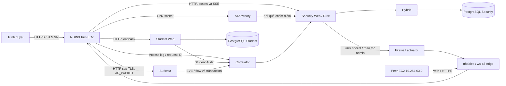

# WebSentinel PBL4 — Kiến trúc bàn giao

Bản bàn giao AWS staging lấy mã ứng dụng ở commit `d10f1f36f95b069ea0294b93c5178b7b2254dedb` làm mốc.
Tài liệu và bằng chứng kiểm tra cuối được cập nhật sau khi đối chiếu bản này.
[Kiểm tra cuối](evidence/final-aws/freeze.json) · [Nghiệm thu Block/Unblock/TTL](evidence/final-aws/acceptance.json)

## Luồng để trình bày khi bảo vệ

- NGINX kết thúc TLS, định tuyến theo SNI và tạo Request ID. HTTP nội bộ
  cho phép Suricata quan sát nhánh sau TLS. Student Audit ghi kết quả nghiệp vụ.
  Correlator dùng Request ID và định danh flow/transaction để ghép bằng chứng.
- HistGradientBoosting URI100 chấm điểm trong phạm vi quan sát đã hỗ trợ.
  Hybrid nhận kết quả Advisory, ghi incident và lưu Audit trong PostgreSQL.
  SSE chuyển cập nhật đã commit tới Security Dashboard.
- C2 Manual dùng Unix socket thuộc root và kiểm danh tính tiến trình gọi.
  Firewall chỉ thực thi trên `ws-c2-edge`, tới HTTPS `10.254.63.1:443`, với
  peer `10.254.63.2` do EC2 quản lý. PostgreSQL và Audit được đối soát với
  readback nftables. Lease hết hạn trong kernel, yêu cầu chặn thủ công nhận TTL từ 60 đến 300 giây.
- Các unit systemd có giới hạn tài nguyên. Security Web kéo theo actuator
  lúc khởi động. Bản rollback root-only chứa backend, frontend và checksum.
  Quy trình dừng EC2, SSM và khôi phục nằm trong runbook. [Vận hành EC2](AWS_STAGING_OPERATIONS_HANDOFF.md#2-vận-hành-ec2) · [Prevention và rollback](AWS_STAGING_OPERATIONS_HANDOFF.md#prevention-trên-bản-aws-đang-phục-vụ)

## Phạm vi được nghiệm thu

| Phạm vi | Kết quả |
|---|---|
| Public HTTPS, Student Web và Security Web | Hai hostname HTTPS 200. Kiểm tra giao diện với tài khoản quản trị có sẵn. |
| Detection đa nguồn, AI và Hybrid | Request HTTPS lành tính ghép đủ NGINX, Suricata, Student Audit, có điểm AI và quyết định Hybrid. |
| Firewall, Prevention và DB/Firewall | ACTIVE, ENABLED và SYNCED trên ingress riêng. Block, Unblock và TTL dùng bằng chứng thực thi trước khi đóng băng. |
| Rule-based và Hybrid Adaptive | Đã nghiệm thu trong canary cô lập. Chặn tự động public và AI Auto-ban tắt. |
| Giới hạn vận hành | Các phép đo là snapshot kiểm tra nhanh. Kiểm tra cuối không reboot EC2, không chạy rollback thực tế và không thay đổi dữ liệu nghiệp vụ. |
